# RuleForge Platform Architecture

**Document role:** Application and integration design reference
**Editorial revision:** 2026-10-25
**Status:** Draft design reference; current configuration is summarized in the overview.
**Original design baseline:** Version 2.0, February 2026

## Changelog

- **2026-10-25 · ARC-DOC-001:** Reorganize the architecture reading path, consolidate repeated material, and separate source evidence from earlier proposals. See the [change record and section map](ARCHITECTURE-CHANGELOG.md#arc-doc-001--2026-10-25).

## Reading path

Start with the [architecture overview](ARCHITECTURE-SUMMARY.md). Continue to the [platform guide](RuleForge-Architecture-v2.md) for application boundaries, the [engine guide](RuleForge-Engine-Core-Architecture-v2.1.md) for execution internals, or the [enterprise guide](enterprise-architecture.md) for deployment and operations. The [Spaces record](enterprise-architecture-spaces-features.md) preserves historical feature requirements.

## In this guide

- [System boundaries and services](#system-boundaries-and-services)
- [Rules, data, and tenancy](#rules-data-and-tenancy)
- [Execution and integration](#execution-and-integration)
- [Security design](#security-design)
- [Reference schemas and operators](#reference-schemas-and-operators)
- [Historical product planning](#historical-product-planning)
- [Related enterprise designs](#related-enterprise-designs)

## How to read the design

The body preserves application design material from the original Version 2.0 document. Its examples describe intended interfaces, relationships, and flows; they are not a substitute for current source contracts or release evidence. Use the [API reference](../api-reference.md) and implementation for integration work.

The current source baseline is Java 25, Spring Boot 4.1.1, a custom engine, seven JVM services, and an optional Python AI service. Current versions and entry points are consolidated in the [overview](ARCHITECTURE-SUMMARY.md#current-source-baseline).

Earlier gRPC/GraphQL, event-sourcing, WASM, BI integration, multi-region, managed-service, performance, and commercial statements below remain proposals or historical claims until separately verified. Benchmark and production targets are centralized in the [enterprise proposal reference](enterprise-architecture.md#earlier-production-proposals).

## System boundaries and services

RuleForge separates reusable decision execution from the surrounding authoring, governance, integration, and operational platform. The engine can be embedded in a Java application; the managed platform exposes these capabilities through service APIs and the browser UI.

### Source-backed service map

| Runtime | Port | Responsibility |
|---|---|---|
| Auth | 8081 | Identity, organizations, membership, spaces, access credentials |
| Management | 8082 | Rule assets, versions, folders, tags, import/export |
| Solver | 8083 | Rule validation, compilation, execution and cache integration |
| Event | 8084 | Audit/event processing and webhook delivery |
| Analytics | 8085 | Decision logs and aggregate queries |
| Scheduler | 8086 | Scheduled and batch work |
| Connector | 8087 | External data enrichment |
| Optional AI service | 8000 locally / 8088 full-stack host | Assisted authoring and analysis |

Source: [platform settings](../../platform/settings.gradle.kts), [README services](../../README.md#services), and [Compose](../../infra/docker/docker-compose.yml). Shared ruleforge-common is a library, not another service.

### Design principles

The original principles below are design intent. In particular, event sourcing, Kubernetes-first operation, gRPC, zero-downtime delivery, and end-to-end observability require independent implementation evidence.

<a id="31-architecture-principles"></a>

#### Architecture Principles

| # | Principle | Rationale |
|---|---|---|
| AP-1 | **API-First Design** | All functionality exposed via REST/gRPC APIs; UI is just another consumer |
| AP-2 | **Separation of Engine & Platform** | Rule execution engine is decoupled and embeddable independently |
| AP-3 | **Event Sourcing for Rules** | All rule changes are immutable events, enabling full audit trail |
| AP-4 | **Stateless Execution** | Rule solver services are stateless for horizontal scaling |
| AP-5 | **Cloud-Native & Kubernetes-First** | Designed for containerized deployment with operator pattern |
| AP-6 | **Multi-Tenancy by Design** | Tenant isolation at data layer with shared compute |
| AP-7 | **Open Standards Where Possible** | Support DMN 1.4, OpenAPI 3.1, CloudEvents |
| AP-8 | **Progressive Complexity** | Simple things easy, complex things possible |
| AP-9 | **Zero-Downtime Deployments** | Blue-green deployments, rule hot-reloading |
| AP-10 | **Observability Built-In** | Structured logging, distributed tracing, metrics from day one |
<a id="4-system-context-c4-level-1"></a>

### System Context (C4 Level 1)

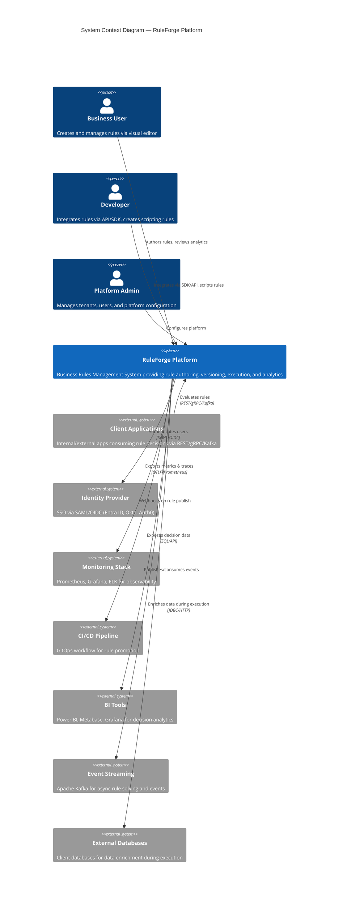
<a id="5-container-architecture-c4-level-2"></a>

### Container Architecture (C4 Level 2)

```mermaid
C4Container
    title Container Diagram — RuleForge Platform

    Person(user, "Users", "Business users, developers, admins")

    Container_Boundary(platform, "RuleForge Platform") {
        Container(webApp, "Web Application", "React 18 + TypeScript", "Visual rule editor, dashboards, admin console")
        Container(apiGateway, "API Gateway", "Kong / Envoy", "Authentication, rate limiting, routing, TLS termination")

        Container(solverSvc, "Solver Service", "Java 21 + Spring Boot", "Stateless rule execution engine. Horizontally scalable.")
        Container(mgmtSvc, "Management Service", "Java 21 + Spring Boot", "Rule CRUD, versioning, import/export, folder management")
        Container(authSvc, "Auth Service", "Java 21 + Spring Boot", "User management, RBAC, API key management, SSO")
        Container(analyticsSvc, "Analytics Service", "Java 21 + Spring Boot", "Decision logging, aggregation, reporting APIs")
        Container(eventSvc, "Event Service", "Java 21 + Spring Boot", "Audit trail, webhooks, event streaming, notifications")
        Container(aiSvc, "AI Assistant Service", "Python + FastAPI", "LLM-powered rule generation, optimization suggestions")
        Container(schedulerSvc, "Scheduler Service", "Java 21 + Spring Boot", "Batch/bulk processing, Integration Flows, cron jobs")
        Container(connectorSvc, "Connector Service", "Java 21 + Spring Boot", "Database connectors, HTTP callouts, external data enrichment")

        ContainerDb(pgDb, "PostgreSQL", "PostgreSQL 16", "Rule definitions, user data, tenant config, audit logs")
        ContainerDb(redisCache, "Redis Cluster", "Redis 7", "Compiled rule cache, session cache, rate limiting")
        ContainerDb(esIndex, "Elasticsearch", "ES 8.x", "Decision logs, full-text search, analytics aggregations")
        ContainerDb(s3Storage, "Object Storage", "S3/MinIO", "Rule exports, attachments, large batch results")

        Container(kafkaBroker, "Kafka", "Apache Kafka", "Async rule solving, event bus, CDC")
    }

    Rel(user, webApp, "HTTPS")
    Rel(user, apiGateway, "REST/gRPC")
    Rel(webApp, apiGateway, "API calls")
    Rel(apiGateway, solverSvc, "Rule execution")
    Rel(apiGateway, mgmtSvc, "Rule management")
    Rel(apiGateway, authSvc, "Auth")
    Rel(apiGateway, analyticsSvc, "Analytics queries")
    Rel(apiGateway, aiSvc, "AI features")
    Rel(solverSvc, redisCache, "Load compiled rules")
    Rel(solverSvc, kafkaBroker, "Publish decisions")
    Rel(solverSvc, connectorSvc, "Data enrichment")
    Rel(mgmtSvc, pgDb, "CRUD")
    Rel(mgmtSvc, redisCache, "Invalidate cache")
    Rel(mgmtSvc, kafkaBroker, "Publish rule changes")
    Rel(authSvc, pgDb, "User/tenant data")
    Rel(analyticsSvc, esIndex, "Query decisions")
    Rel(eventSvc, kafkaBroker, "Consume events")
    Rel(eventSvc, pgDb, "Audit logs")
    Rel(schedulerSvc, solverSvc, "Batch execution")
    Rel(schedulerSvc, s3Storage, "Store results")
```


<a id="51-service-responsibilities"></a>

#### Service Responsibilities

| Service | Responsibilities | Scaling Strategy |
|---|---|---|
| **Solver Service** | Rule evaluation, validation, test bench | Horizontal (CPU-bound) |
| **Management Service** | Rule CRUD, versioning, import/export, folders, tags | Horizontal (I/O-bound) |
| **Auth Service** | Users, tenants, orgs, API keys, RBAC, SSO | Horizontal (stateless) |
| **Analytics Service** | Decision logs, aggregation, reporting | Horizontal (read-heavy) |
| **Event Service** | Audit trail, webhooks, notifications | Horizontal (event-driven) |
| **AI Assistant Service** | Rule generation, optimization, natural language | Vertical (GPU/LLM) |
| **Scheduler Service** | Batch solve, integration flows, cron triggers | Horizontal (worker pool) |
| **Connector Service** | DB connectors, HTTP callouts, data transforms | Horizontal (I/O-bound) |

## Rules, data, and tenancy

<a id="7-core-domain-model"></a>

### Core Domain Model


<a id="71-domain-entities"></a>

#### Domain Entities

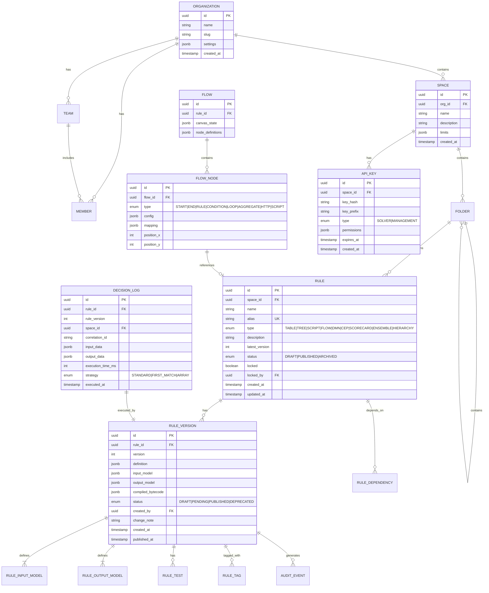


<a id="72-rule-definition-json-schema"></a>

#### Rule Definition JSON Schema

```json
{
  "$schema": "https://ruleforge.io/schema/rule/v1",
  "type": "decision-table",
  "version": 1,
  "inputModel": {
    "customer": {
      "type": "object",
      "properties": {
        "age": { "type": "integer" },
        "income": { "type": "number" },
        "creditScore": { "type": "integer" },
        "employmentType": { "type": "string", "enum": ["FULL_TIME", "PART_TIME", "SELF_EMPLOYED", "UNEMPLOYED"] }
      }
    }
  },
  "outputModel": {
    "decision": {
      "type": "object",
      "properties": {
        "eligible": { "type": "boolean" },
        "maxLoanAmount": { "type": "number" },
        "interestRate": { "type": "number" },
        "riskCategory": { "type": "string" }
      }
    }
  },
  "executionStrategy": "FIRST_MATCH",
  "table": {
    "columns": [
      { "id": "col_1", "type": "INPUT", "path": "customer.age", "operator": "BETWEEN" },
      { "id": "col_2", "type": "INPUT", "path": "customer.creditScore", "operator": "GTE" },
      { "id": "col_3", "type": "INPUT", "path": "customer.employmentType", "operator": "IN" },
      { "id": "col_4", "type": "OUTPUT", "path": "decision.eligible" },
      { "id": "col_5", "type": "OUTPUT", "path": "decision.maxLoanAmount" },
      { "id": "col_6", "type": "OUTPUT", "path": "decision.riskCategory" }
    ],
    "rows": [
      {
        "id": "row_1",
        "active": true,
        "cells": {
          "col_1": { "value": [25, 65] },
          "col_2": { "value": 750 },
          "col_3": { "value": ["FULL_TIME"] },
          "col_4": { "value": true },
          "col_5": { "value": 500000 },
          "col_6": { "value": "LOW" }
        }
      },
      {
        "id": "row_2",
        "active": true,
        "cells": {
          "col_1": { "value": [25, 65] },
          "col_2": { "value": 650 },
          "col_3": { "value": ["FULL_TIME", "PART_TIME"] },
          "col_4": { "value": true },
          "col_5": { "value": 200000 },
          "col_6": { "value": "MEDIUM" }
        }
      }
    ]
  }
}
```
<a id="10-data-architecture"></a>

### Data Architecture


<a id="101-storage-strategy"></a>

#### Storage Strategy

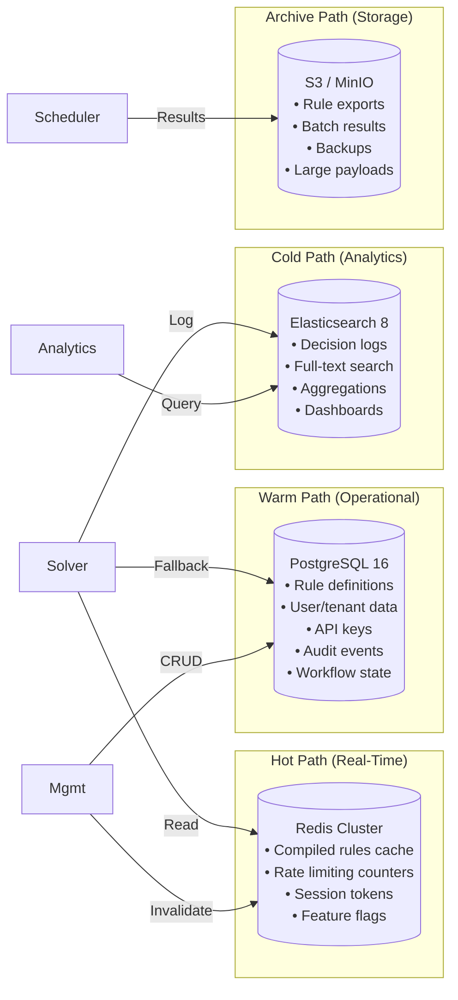


<a id="102-why-postgresql-over-mongodb"></a>

#### Why PostgreSQL over MongoDB

DecisionRules.io uses MongoDB, but for RuleForge we recommend PostgreSQL:

| Criteria | PostgreSQL | MongoDB |
|---|---|---|
| **JSONB Support** | Native, indexed, queryable | Native JSON |
| **ACID Transactions** | Full multi-table | Limited multi-document |
| **Rule Versioning** | Strong with CTEs, window functions | Requires careful schema |
| **Audit Trail** | Triggers + event sourcing | Change streams |
| **Multi-Tenancy** | Row-level security (RLS) | Database-per-tenant or field |
| **Analytics Queries** | Advanced aggregation, CTEs | Aggregation pipeline |
| **Operational Maturity** | Battle-tested in banking | Good, but less in regulated |
| **JSON Schema Validation** | CHECK constraints on JSONB | Built-in validation |

**Decision:** PostgreSQL with JSONB columns for rule definitions gives us the best of both worlds — flexible JSON storage with relational integrity, transactions, and row-level security for multi-tenancy.


<a id="103-caching-strategy"></a>

#### Caching Strategy

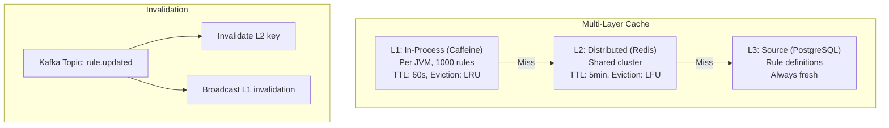

**Cache Key Pattern:**
```
rule:{spaceId}:{ruleId}:{version}:compiled
rule:{spaceId}:{ruleAlias}:latest:compiled
```
<a id="11-multi-tenancy-architecture"></a>

### Multi-Tenancy Architecture


<a id="111-tenant-hierarchy"></a>

#### Tenant Hierarchy

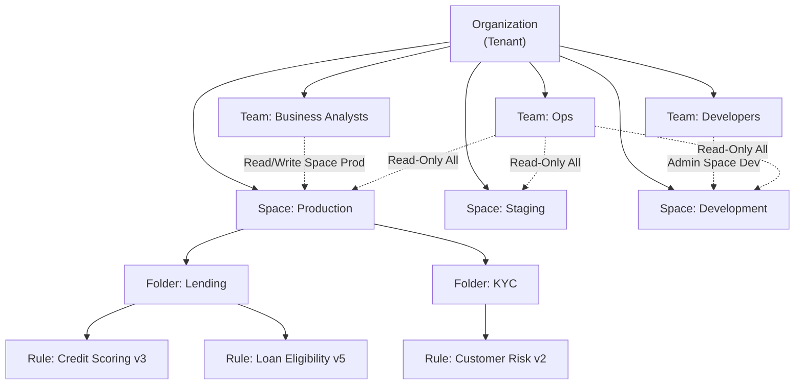


<a id="112-isolation-model"></a>

#### Isolation Model

| Layer | Strategy | Implementation |
|---|---|---|
| **Compute** | Shared (namespaced) | Tenant ID in JWT, propagated to all services |
| **Data** | Row-Level Security | PostgreSQL RLS policies on all tables |
| **Cache** | Key-prefixed | `tenant:{orgId}:rule:{ruleId}:...` |
| **Search** | Index-per-tenant | Elasticsearch index aliases per org |
| **Storage** | Prefix-partitioned | S3 path: `/{orgId}/{spaceId}/...` |
| **Network** | Shared (throttled) | Per-tenant rate limits in API Gateway |
| **Encryption** | Per-tenant keys | AES-256 with tenant-specific KEK |


<a id="113-row-level-security-example"></a>

#### Row-Level Security Example

```sql
-- Enable RLS on rules table
ALTER TABLE rules ENABLE ROW LEVEL SECURITY;

-- Policy: users can only see rules in their space
CREATE POLICY rules_tenant_isolation ON rules
    USING (space_id IN (
        SELECT s.id FROM spaces s
        JOIN org_members om ON om.org_id = s.org_id
        WHERE om.user_id = current_setting('app.current_user_id')::uuid
    ));

-- Set context per request
SET app.current_user_id = '<user-uuid>';
SET app.current_org_id = '<org-uuid>';
```


### Memory and cache sizing reference

This sketch originally appeared in the engine performance chapter. It describes platform-level cache and pool sizing assumptions from the February 2026 design. It is not a measured memory budget or a verified serialization contract.

<a id="legacy-engine-172-memory-architecture"></a>

### Memory Architecture

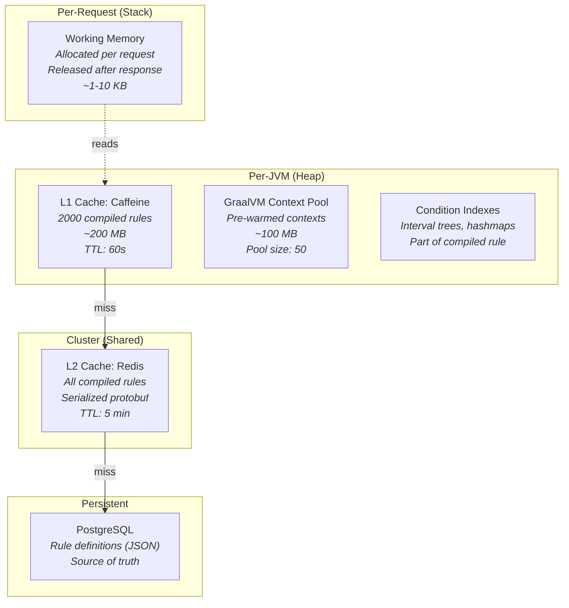

## Execution and integration

<a id="6-component-architecture-c4-level-3"></a>

### Component Architecture (C4 Level 3)


<a id="61-solver-service--internal-components"></a>

#### Solver Service — Internal Components

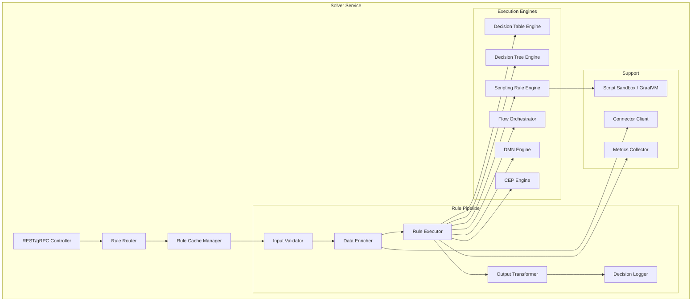


<a id="62-rule-execution-pipeline"></a>

#### Rule Execution Pipeline

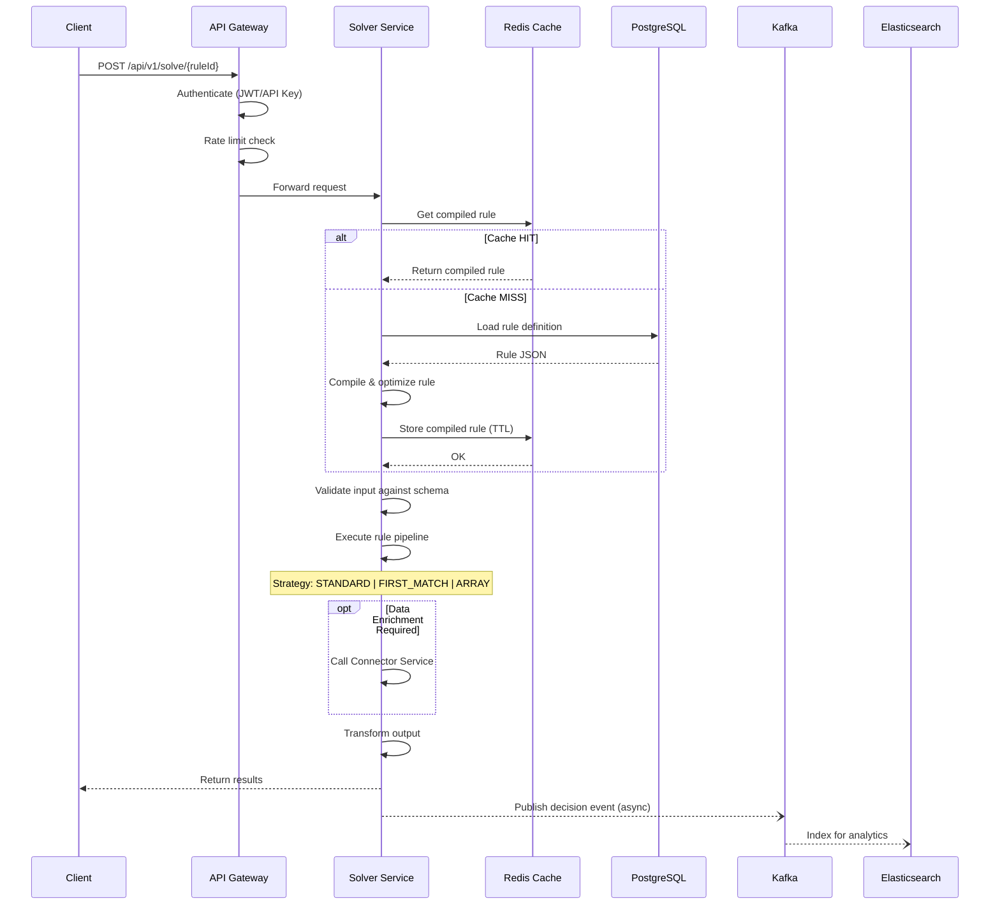

<a id="8-rule-types--execution-engine"></a>
<a id="81-supported-rule-types"></a>
<a id="82-execution-engine-architecture"></a>
<a id="83-jeasyrules-integration-points"></a>
### Engine boundary

The custom engine compiles and evaluates rule definitions. Engine metamodels, execution modes, specialized evaluators, and SPI details are maintained in the [engine guide](RuleForge-Engine-Core-Architecture-v2.1.md#engine-foundations).

The former JEasyRules adapter proposal is superseded by the custom-engine direction documented in that guide. Its outdated recommendation and repeated rule-type overview have been replaced with this reference. This edit does not introduce a new engine decision.

<a id="9-api-design"></a>

### API Design


<a id="91-api-overview"></a>

#### API Overview

```
Base URL: https://api.ruleforge.io/v1

Authentication:
  - Bearer Token (JWT) for UI sessions
  - API Key (x-api-key header) for machine-to-machine
  - API keys scoped: SOLVER (execute only) vs MANAGEMENT (CRUD)
```


<a id="92-solver-api-rule-execution"></a>

#### Solver API (Rule Execution)

```yaml
# Execute a rule (single input)
POST /v1/solve/{ruleIdOrAlias}/{version?}
Headers:
  Authorization: Bearer <solver-api-key>
  Content-Type: application/json
  X-Correlation-Id: <optional>
  X-Audit: true|false
  X-Strategy: STANDARD|FIRST_MATCH|ARRAY
Body:
  {
    "data": {
      "customer": { "age": 35, "creditScore": 720, "employmentType": "FULL_TIME" }
    },
    "options": {
      "strategy": "FIRST_MATCH",
      "excludeColumns": ["col_5"],
      "audit": true
    }
  }
Response 200:
  {
    "correlationId": "abc-123",
    "ruleId": "rule-uuid",
    "version": 2,
    "executionTimeMs": 3,
    "results": [
      {
        "decision": { "eligible": true, "maxLoanAmount": 200000, "riskCategory": "MEDIUM" }
      }
    ]
  }

# Bulk solve (multiple inputs)
POST /v1/solve/bulk/{ruleIdOrAlias}/{version?}
Body:
  {
    "data": [
      { "customer": { "age": 35, "creditScore": 720 } },
      { "customer": { "age": 22, "creditScore": 580 } }
    ]
  }
Response 200:
  {
    "correlationId": "abc-124",
    "results": [
      [{ "decision": { "eligible": true, "riskCategory": "MEDIUM" } }],
      [{ "decision": { "eligible": false, "riskCategory": "HIGH" } }]
    ]
  }

# Async solve via Kafka
POST /v1/solve/async/{ruleIdOrAlias}
Body:
  {
    "data": { ... },
    "callbackUrl": "https://client.app/webhook/result",
    "callbackHeaders": { "Authorization": "Bearer client-token" }
  }
Response 202:
  { "jobId": "job-uuid", "status": "QUEUED" }
```


<a id="93-management-api-rule-crud"></a>

#### Management API (Rule CRUD)

```yaml
# Rules
GET    /v1/rules                           # List rules (paginated, filterable)
POST   /v1/rules                           # Create rule
GET    /v1/rules/{id}                      # Get rule metadata
PUT    /v1/rules/{id}                      # Update rule metadata
DELETE /v1/rules/{id}                      # Delete rule (soft delete)

# Rule Versions
GET    /v1/rules/{id}/versions             # List versions
POST   /v1/rules/{id}/versions             # Create new version (clone latest)
GET    /v1/rules/{id}/versions/{v}         # Get specific version definition
PUT    /v1/rules/{id}/versions/{v}         # Update version definition
POST   /v1/rules/{id}/versions/{v}/publish # Publish version
POST   /v1/rules/{id}/versions/{v}/deprecate
GET    /v1/rules/{id}/versions/{v1}/diff/{v2} # Visual diff between versions

# Rule Testing
POST   /v1/rules/{id}/versions/{v}/test   # Run test bench
POST   /v1/rules/{id}/versions/{v}/validate # Validate rule definition

# Folders & Organization
GET    /v1/folders/{nodeId?}               # Get folder tree
POST   /v1/folders                         # Create folder
PUT    /v1/folders/{id}                    # Update folder / move items
DELETE /v1/folders/{id}                    # Delete folder

# Tags
GET    /v1/tags                            # List all tags in space
POST   /v1/rules/{id}/tags                 # Add tags
DELETE /v1/rules/{id}/tags                 # Remove tags

# Import / Export
POST   /v1/rules/import                    # Import rules (JSON/Excel/DMN)
GET    /v1/rules/{id}/export?format=json|excel|dmn # Export rule
POST   /v1/spaces/export                   # Export entire space
POST   /v1/spaces/import                   # Import space snapshot

# Rule Lock
POST   /v1/rules/{id}/lock                 # Lock rule for editing
DELETE /v1/rules/{id}/lock                 # Unlock rule

# Webhooks
GET    /v1/webhooks                        # List webhooks
POST   /v1/webhooks                        # Create webhook
PUT    /v1/webhooks/{id}                   # Update webhook
DELETE /v1/webhooks/{id}                   # Delete webhook
```


<a id="94-analytics-api"></a>

#### Analytics API

```yaml
GET    /v1/analytics/decisions              # Query decision logs
GET    /v1/analytics/decisions/aggregate    # Aggregated stats
GET    /v1/analytics/rules/{id}/stats       # Per-rule statistics
GET    /v1/analytics/rules/{id}/heatmap     # Row hit frequency heatmap
POST   /v1/analytics/reports                # Generate custom report
GET    /v1/analytics/dashboard              # Dashboard metrics
```


<a id="95-ai-assistant-api"></a>

#### AI Assistant API

```yaml
POST   /v1/ai/generate-table               # Generate decision table from natural language
POST   /v1/ai/suggest-optimization          # Suggest rule optimization
POST   /v1/ai/explain-rule                  # Explain rule in natural language
POST   /v1/ai/generate-test-data            # Generate test data for rule
POST   /v1/ai/detect-conflicts              # Detect conflicting rules
POST   /v1/ai/natural-language-query        # Query rules in natural language
```
<a id="15-event-driven-architecture--audit"></a>

### Event-Driven Architecture & Audit


<a id="151-event-topology"></a>

#### Event Topology

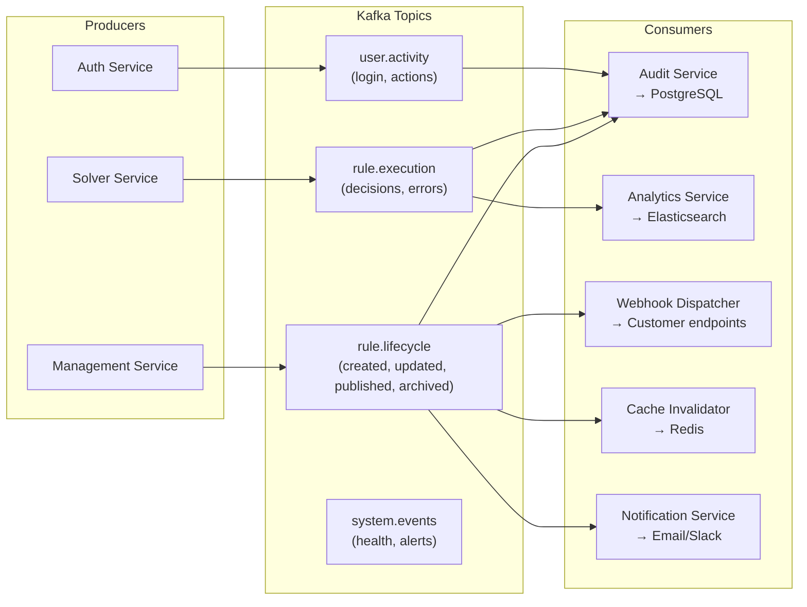


<a id="152-audit-event-schema"></a>

#### Audit Event Schema

```json
{
  "eventId": "evt-uuid",
  "eventType": "rule.version.published",
  "timestamp": "2026-02-20T10:30:00Z",
  "actor": {
    "userId": "user-uuid",
    "email": "analyst@company.com",
    "type": "USER"
  },
  "tenant": {
    "orgId": "org-uuid",
    "spaceId": "space-uuid"
  },
  "resource": {
    "type": "RULE_VERSION",
    "ruleId": "rule-uuid",
    "ruleName": "Credit Scoring",
    "version": 3
  },
  "changes": {
    "previousStatus": "DRAFT",
    "newStatus": "PUBLISHED"
  },
  "metadata": {
    "ipAddress": "203.0.113.1",
    "userAgent": "Mozilla/5.0...",
    "correlationId": "corr-123"
  }
}
```
<a id="16-analytics--bi-architecture"></a>

### Analytics & BI Architecture


<a id="161-decision-analytics-pipeline"></a>

#### Decision Analytics Pipeline

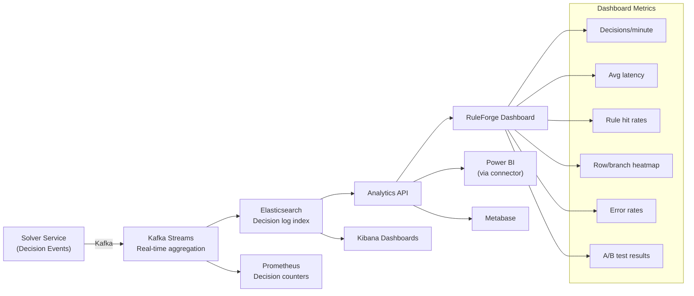


<a id="162-built-in-analytics-features"></a>

#### Built-In Analytics Features

| Feature | Description |
|---|---|
| **Decision Dashboard** | Real-time view of decision volume, latency, error rates |
| **Rule Heatmap** | Which rows/branches are triggered most frequently |
| **Rule Comparison** | Side-by-side comparison of two rule versions' decision outcomes |
| **A/B Testing** | Route traffic between rule versions with statistical analysis |
| **Impact Analysis** | "What-if" simulation: replay historical decisions against new rule version |
| **Export to BI** | ODBC/JDBC connector, Power BI dataset, API export |
<a id="17-ai-assistant-architecture"></a>

### AI Assistant Architecture


<a id="171-ai-capabilities"></a>

#### AI Capabilities

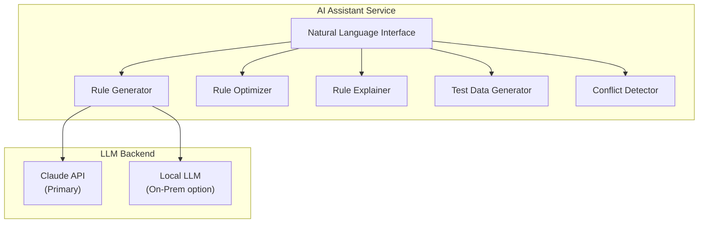


<a id="172-ai-use-cases"></a>

#### AI Use Cases

| Use Case | Input | Output |
|---|---|---|
| **Generate Table** | "Create a credit scoring table with age, income, and credit score" | Complete decision table JSON |
| **Optimize Rule** | Existing rule + decision logs | Suggestions for redundant rows, unreachable branches, performance |
| **Explain Rule** | Rule definition | Plain English explanation of the rule logic |
| **Generate Tests** | Rule definition | Edge case test inputs with expected outputs |
| **Detect Conflicts** | Set of rules in a flow | List of conflicting/overlapping conditions |
| **Natural Language Query** | "Show me all rules that check credit score > 700" | Filtered rule list |
<a id="18-sdk--integration-architecture"></a>

### SDK & Integration Architecture


<a id="181-multi-language-sdk-strategy"></a>

#### Multi-Language SDK Strategy

```
SDKs generated from OpenAPI 3.1 spec using openapi-generator:

  @ruleforge/sdk-node      (TypeScript/JavaScript)
  ruleforge-sdk-python      (Python)
  ruleforge-sdk-java        (Java)
  ruleforge-sdk-go          (Go)
  ruleforge-sdk-dotnet      (C#)
  ruleforge-sdk-php         (PHP)
```


<a id="182-sdk-usage-example"></a>

#### SDK Usage Example

```typescript
import { RuleForge } from '@ruleforge/sdk-node';

const rf = new RuleForge({
  apiKey: process.env.RULEFORGE_SOLVER_KEY,
  baseUrl: 'https://api.ruleforge.io',
});

// Simple solve
const result = await rf.solve('credit-scoring', {
  customer: { age: 35, creditScore: 720, employmentType: 'FULL_TIME' }
});

console.log(result.data);
// { eligible: true, maxLoanAmount: 200000, riskCategory: 'MEDIUM' }

// Bulk solve
const bulkResult = await rf.solveBulk('credit-scoring', [
  { customer: { age: 35, creditScore: 720 } },
  { customer: { age: 22, creditScore: 580 } },
]);

// Async solve with callback
const job = await rf.solveAsync('batch-scoring', largeDataset, {
  callbackUrl: 'https://my-app.com/webhook/result'
});
```


<a id="183-embedded-engine"></a>

#### Embedded Engine

```xml
<!-- Maven dependency for embedded usage -->
<dependency>
    <groupId>io.ruleforge</groupId>
    <artifactId>ruleforge-engine</artifactId>
    <version>1.0.0</version>
</dependency>
```

```java
// Embedded usage — no platform dependency
RuleForgeEngine engine = RuleForgeEngine.builder()
    .withCache(CaffeineCache.defaultConfig())
    .withScripting(GraalVMConfig.sandboxed())
    .build();

// Load rule from file or string
Rule rule = engine.loadRule(Files.readString(Path.of("credit-scoring.json")));

// Execute
RuleResult result = engine.evaluate(rule, Map.of(
    "customer", Map.of("age", 35, "creditScore", 720)
));
```


<a id="184-integration-patterns"></a>

#### Integration Patterns

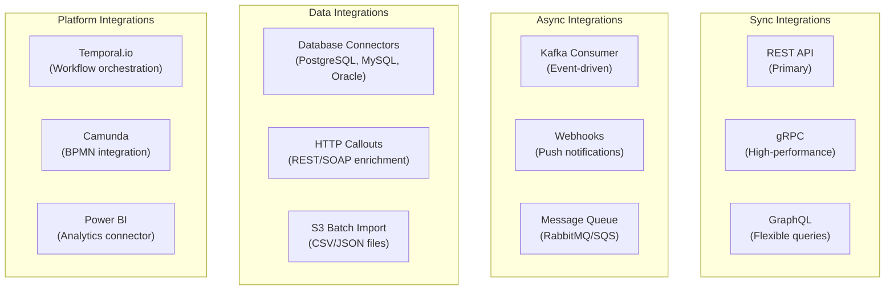

## Security design

<a id="13-security-architecture"></a>

### Security Architecture


<a id="131-authentication--authorization"></a>

#### Authentication & Authorization

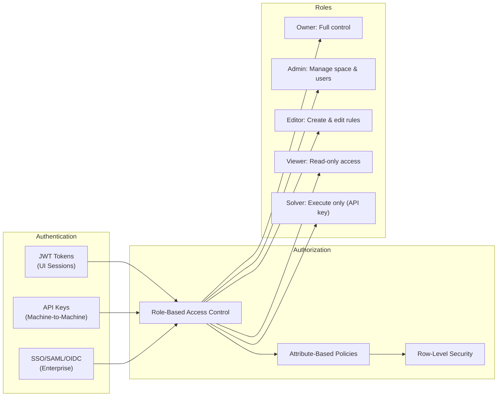


<a id="132-security-controls"></a>

#### Security Controls

| Control | Implementation |
|---|---|
| **Encryption at Rest** | AES-256 for PostgreSQL (TDE), Redis encryption, S3 SSE-KMS |
| **Encryption in Transit** | TLS 1.3 everywhere, mTLS between services |
| **API Key Management** | Hashed storage (bcrypt), prefix for identification, rotation support |
| **Secret Management** | HashiCorp Vault / AWS Secrets Manager |
| **Script Sandboxing** | GraalVM isolated contexts, CPU/memory limits, no filesystem/network |
| **Input Validation** | JSON Schema validation on all inputs, SQL injection prevention |
| **Rate Limiting** | Per-tenant, per-API-key, sliding window in Redis |
| **Audit Trail** | Immutable audit log for all rule changes and decisions |
| **Vulnerability Scanning** | Trivy for containers, Snyk for dependencies |
| **SOC 2 Compliance** | Audit logging, access controls, encryption, monitoring |


<a id="133-script-sandboxing-detail"></a>

#### Script Sandboxing Detail

```java
// GraalVM sandbox configuration for scripting rules
Context context = Context.newBuilder("js")
    .allowHostAccess(HostAccess.NONE)           // No Java interop
    .allowIO(false)                               // No file system
    .allowCreateThread(false)                     // No threading
    .allowNativeAccess(false)                     // No native calls
    .allowEnvironmentAccess(EnvironmentAccess.NONE) // No env vars
    .option("engine.WarnInterpreterOnly", "false")
    .resourceLimits(
        ResourceLimits.newBuilder()
            .statementLimit(100_000, null)         // Max 100K statements
            .build()
    )
    .build();

// Inject safe API
context.getBindings("js").putMember("input", inputData);
context.getBindings("js").putMember("output", outputData);
context.getBindings("js").putMember("DR", drApiProxy); // Safe rule-calling API
context.getBindings("js").putMember("Math", mathFunctions);
context.getBindings("js").putMember("Date", safeDateFunctions);
```


## Reference schemas and operators

The following reference tables are preserved design material. Source APIs and parser/operator implementations determine accepted runtime values.


### Appendix A: Decision Table Operators

| Operator | Symbol | Description | Applies To |
|---|---|---|---|
| Equals | `EQ` | Exact match | All types |
| Not Equals | `NEQ` | Not equal | All types |
| Greater Than | `GT` | Greater than | Number, Date |
| Greater Than or Equal | `GTE` | >= | Number, Date |
| Less Than | `LT` | Less than | Number, Date |
| Less Than or Equal | `LTE` | <= | Number, Date |
| Between | `BETWEEN` | Inclusive range [a, b] | Number, Date |
| In | `IN` | Value in set | String, Number |
| Not In | `NOT_IN` | Value not in set | String, Number |
| Contains | `CONTAINS` | Substring match | String |
| Starts With | `STARTS_WITH` | Prefix match | String |
| Ends With | `ENDS_WITH` | Suffix match | String |
| Regex | `REGEX` | Regular expression | String |
| Is Null | `IS_NULL` | Null check | All types |
| Is Not Null | `IS_NOT_NULL` | Not null check | All types |
| Is True | `IS_TRUE` | Boolean true | Boolean |
| Is False | `IS_FALSE` | Boolean false | Boolean |
| Array Contains | `ARR_CONTAINS` | Array includes value | Array |
| Array Any | `ARR_ANY` | Any element matches | Array |
| Array All | `ARR_ALL` | All elements match | Array |


### Appendix B: Built-In Functions

| Category | Functions |
|---|---|
| **Math** | `ABS`, `CEIL`, `FLOOR`, `ROUND`, `MIN`, `MAX`, `POW`, `SQRT`, `MOD`, `SUM`, `AVG` |
| **String** | `UPPER`, `LOWER`, `TRIM`, `CONCAT`, `SUBSTRING`, `LENGTH`, `REPLACE`, `SPLIT`, `MATCH` |
| **Date** | `NOW`, `TODAY`, `DATE_ADD`, `DATE_DIFF`, `DATE_FORMAT`, `YEAR`, `MONTH`, `DAY`, `IS_BEFORE`, `IS_AFTER` |
| **Logical** | `IF`, `AND`, `OR`, `NOT`, `COALESCE`, `SWITCH`, `IS_NULL` |
| **Array** | `COUNT`, `FIRST`, `LAST`, `FILTER`, `MAP`, `REDUCE`, `FLATTEN`, `UNIQUE`, `SORT` |
| **Data** | `LOOKUP`, `SOLVE` (call another rule), `HTTP_GET`, `HTTP_POST` |
| **Aggregation** | `SUM`, `AVG`, `MIN`, `MAX`, `COUNT`, `MEDIAN`, `PERCENTILE` |

**Historical comparison:** external product capabilities and endpoint claims have not been revalidated.


### Appendix C: Comparison with DecisionRules.io API

| Endpoint | DecisionRules.io | RuleForge |
|---|---|---|
| Solve rule | `POST /rule/solve/:ruleId/:version` | `POST /v1/solve/:ruleIdOrAlias/:version` |
| Bulk solve | Same endpoint, array body | `POST /v1/solve/bulk/:ruleIdOrAlias` (dedicated) |
| Async solve | Kafka Solver API | `POST /v1/solve/async/:ruleId` + callback |
| Get rules | `GET /api/rule` | `GET /v1/rules` |
| Create rule | `POST /api/rule` | `POST /v1/rules` |
| Rule flow solve | Deprecated (merged into solver) | Unified solver endpoint |
| Folder tree | `GET /api/folder/:nodeId` | `GET /v1/folders/:nodeId` |
| Tags | `DELETE /api/tags/:id/:version` | `POST/DELETE /v1/rules/:id/tags` |
| Import | Various per type | `POST /v1/rules/import` (unified) |
| **Additional** | — | gRPC endpoint, GraphQL, version diff, A/B testing, AI endpoints |

<a id="21-appendices"></a>

<a id="19-technology-stack"></a>
<a id="191-backend"></a>
<a id="192-frontend"></a>
<a id="193-infrastructure"></a>
### Technology reference

Current declarations are maintained in the [overview baseline](ARCHITECTURE-SUMMARY.md#current-source-baseline) and linked manifests. The former Java 21 / Spring Boot 3.3 / JEasyRules technology table is replaced. Earlier infrastructure candidates are preserved in the [enterprise proposal reference](enterprise-architecture.md#legacy-platform-193-infrastructure).


## Historical product planning

The material in this chapter records the original author’s proposals and status assertions. External competitor claims, pricing, team size, dates, checkmarks, and achieved performance are historical context, not independently verified product or release evidence.

<a id="1-executive-summary"></a>

### Executive Summary


<a id="11-vision"></a>

#### Vision

RuleForge is an enterprise-grade Business Rules Management System (BRMS) designed to compete with platforms like DecisionRules.io, GoRules, and traditional engines like IBM ODM. It enables organizations to externalize, manage, and execute business rules through an intuitive visual interface while delivering sub-100ms execution performance at scale.


<a id="12-key-differentiators"></a>

#### Key Differentiators

| Capability | DecisionRules.io | IBM ODM | RuleForge (Target) |
|---|---|---|---|
| **Deployment** | SaaS / Managed Cloud / On-Prem | On-Prem / OpenShift | SaaS / Managed / On-Prem / Embedded |
| **Rule Types** | Tables, Trees, Scripts, Flows | BAL, Tables, Flows | Tables, Trees, Scripts, Flows, DMN, CEP |
| **Performance** | ~100K decisions/min | Varies by infra | 500K+ decisions/min |
| **No-Code Editor** | Yes | Limited | Yes (advanced) |
| **AI Assistant** | Basic (Gemini) | None native | LLM-powered (multi-model) |
| **Open Standards** | Proprietary JSON | Proprietary | DMN 1.4 + proprietary |
| **Embeddable Engine** | No (API-only) | Java EE only | Lightweight JAR + WASM |
| **Event Processing** | No | Limited | CEP with Kafka Streams |
| **Database Connector** | Roadmap | Yes | Native (SQL + NoSQL) |
| **Pricing** | €49+/month | $100K+/year | Freemium + Enterprise |


<a id="13-target-use-cases"></a>

#### Target Use Cases

- **Financial Services:** Credit scoring, fraud detection, KYC/AML compliance, loan origination
- **Insurance:** Underwriting, claims processing, premium calculation, policy rating
- **E-Commerce:** Dynamic pricing, promotion rules, product categorization, eligibility
- **Healthcare:** Clinical decision support, eligibility verification, billing rules
- **Logistics:** Route optimization rules, shipping rate calculation, customs compliance
<a id="2-competitive-analysis--positioning"></a>

### Competitive Analysis & Positioning


<a id="21-decisionrulesio-feature-matrix"></a>

#### DecisionRules.io Feature Matrix

Based on research, DecisionRules.io provides:

**Rule Types:**
- Decision Tables (spreadsheet-style, Excel import/export)
- Decision Trees (visual branching logic)
- Scripting Rules (JavaScript with Monaco editor)
- Rule Flows (orchestration of multiple rules)
- Integration Flows (batch processing with external data)
- Lookup Tables (reference data)

**Platform Features:**
- Multi-tenant SaaS with 30+ AWS regions
- MongoDB/CosmosDB storage backend
- Microservices architecture (independent scaling)
- Rule versioning with rollback
- Test Bench for rule testing
- Execution strategies: STANDARD, ARRAY, FIRST_MATCH
- Bulk solve (batch input processing)
- Kafka Solver API
- Management API (CRUD, folder structure, tags)
- SAML SSO (Entra ID, Okta, OAuth)
- Organization/Team/Space hierarchy
- Power BI integration for analytics
- AI Assistant (Gemini-based table generation)
- Rule Lock and Teamwork Indicator
- Audit logs and event timeline
- Webhook support
- Multi-language SDKs (JS/TS, Python, PHP, Go, Java, C#)

**Gaps We Can Exploit:**
1. No DMN standard compliance
2. No embeddable engine (API-only)
3. Limited Complex Event Processing
4. No real-time rule debugging/tracing
5. Basic AI capabilities (only Gemini for table gen)
6. No visual diff for rule versions
7. No A/B testing for rules
8. No built-in database connector (still on roadmap)
9. No rule simulation with historical data
10. No WASM-based client-side execution
<a id="20-development-roadmap"></a>

### Development Roadmap


<a id="201-phased-delivery"></a>

#### Phased Delivery

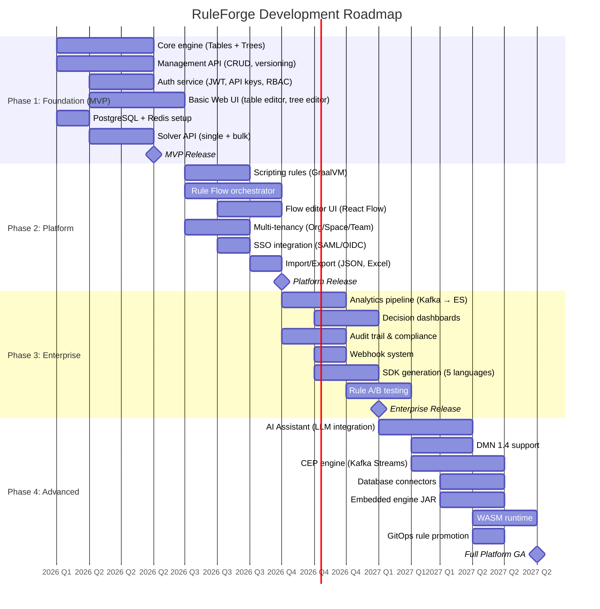


<a id="202-team-structure"></a>

#### Team Structure

| Role | Count | Phase |
|---|---|---|
| Backend Engineers (Java/Spring) | 4-5 | Phase 1+ |
| Frontend Engineers (React/TS) | 2-3 | Phase 1+ |
| DevOps/SRE Engineer | 1-2 | Phase 1+ |
| UI/UX Designer | 1 | Phase 1+ |
| ML/AI Engineer | 1 | Phase 4 |
| QA Engineer | 1-2 | Phase 1+ |
| Product Manager | 1 | Phase 1+ |
| Technical Writer | 1 | Phase 2+ |
| **Total** | **12-16** | — |


<a id="203-implementation-status"></a>

#### Implementation Status

> **All phases 1–5 are complete.** The roadmap above reflects the original plan; actual delivery was accelerated.

- [x] Phase 1 (MVP): Tables, Trees, Auth, Management, Solver, Event service, basic frontend
- [x] Phase 2 (Platform): Scripting (GraalVM), Flows, Connectors, SSO config, Scheduler, Import/Export
- [x] Phase 3 (Enterprise): Analytics, Scorecard, Ensemble, A/B Testing
- [x] Phase 4 (Advanced): AI Assistant, DMN 1.4, CEP, Hierarchy, Embedded JAR
- [x] Phase 5 (Quality): Completeness, tests, local boot fixes, 24 Flyway migrations (V001–V024)


<a id="204-phase-1-mvp-success-criteria-achieved"></a>

#### Phase 1 MVP Success Criteria (Achieved)

- [x] Decision Tables with 10+ operators, 3 execution strategies
- [x] Decision Trees with visual editor
- [x] Rule versioning with publish/draft states
- [x] Solver API < 10ms P50 latency
- [x] Test Bench with inline testing
- [x] JWT + API Key authentication
- [x] RBAC with 5 roles (OWNER, ADMIN, EDITOR, VIEWER, SOLVER)
- [x] 10 concurrent tenants, 1000 rules each
- [ ] 99.9% uptime in staging
- [ ] OpenAPI 3.1 spec published

## Related enterprise designs

Production deployment, target NFRs, capacity examples, and cost assumptions are maintained in one place:

<a id="32-quality-attribute-requirements"></a>

See [Quality Attribute Requirements](enterprise-architecture.md#legacy-platform-32-quality-attribute-requirements).

<a id="12-scalability--performance-architecture"></a>
<a id="121-performance-targets"></a>
<a id="122-horizontal-scaling-architecture"></a>
<a id="123-auto-scaling-policy"></a>
<a id="124-performance-optimization-techniques"></a>

See [Scalability & Performance Architecture](enterprise-architecture.md#legacy-platform-12-scalability--performance-architecture).

<a id="14-deployment-architecture"></a>
<a id="141-deployment-options"></a>
<a id="142-kubernetes-deployment"></a>
<a id="143-cicd--gitops-for-rules"></a>

See [Deployment Architecture](enterprise-architecture.md#legacy-platform-14-deployment-architecture).

<a id="appendix-d-infrastructure-cost-estimate-aws-production"></a>

See [Appendix D: Infrastructure Cost Estimate (AWS, Production)](enterprise-architecture.md#legacy-platform-appendix-d-infrastructure-cost-estimate-aws-production).


<a id="3-architecture-principles--constraints"></a>

## Legacy section links

Earlier headings remain addressable for existing links. Use the reading path above to find their current chapter.

<a id="comprehensive-architecture-design-document"></a>
<a id="ruleforge--scalable-rule-engine-platform"></a>
<a id="table-of-contents"></a>
