# RuleForge Engine Architecture

**Document role:** Rule execution design and extension reference
**Editorial revision:** 2026-10-25
**Status:** Draft design reference; source declarations take precedence over illustrative APIs.
**Original design baseline:** Version 2.1, February 2026; custom engine supersedes the earlier JEasyRules design

## Changelog

- **2026-10-25 · ARC-DOC-001:** Reorganize the architecture reading path, consolidate repeated material, and separate source evidence from earlier proposals. See the [change record and section map](ARCHITECTURE-CHANGELOG.md#arc-doc-001--2026-10-25).

## Reading path

Start with the [architecture overview](ARCHITECTURE-SUMMARY.md). Continue to the [platform guide](RuleForge-Architecture-v2.md) for application boundaries, the [engine guide](RuleForge-Engine-Core-Architecture-v2.1.md) for execution internals, or the [enterprise guide](enterprise-architecture.md) for deployment and operations. The [Spaces record](enterprise-architecture-spaces-features.md) preserves historical feature requirements.

## In this guide

- [Engine foundations](#engine-foundations)
- [Facts, expressions, and compilation](#facts-expressions-and-compilation)
- [Scheduling and rule composition](#scheduling-and-rule-composition)
- [Specialized execution engines](#specialized-execution-engines)
- [Extension and integration reference](#extension-and-integration-reference)
- [Performance and historical design references](#performance-and-historical-design-references)

## Current engine boundary

The engine is Java 25 and consists of twelve Gradle modules, including the aggregate ruleforge-all and Spring Boot starter. The core declares SLF4J and Jackson dependencies. The GraalVM polyglot runtime is bundled; the current dependency baseline is 25.0.5.

Sources: [module settings](../../engine/settings.gradle.kts), [engine properties](../../engine/gradle.properties), [core dependencies](../../engine/ruleforge-core/build.gradle.kts), and [public engine API](../../engine/ruleforge-core/src/main/java/io/ruleforge/core/RuleForgeEngine.java).

The chapters below reorganize the Version 2.1 design for reading: foundations, facts and compilation, scheduling/composition, specialized engines, extension APIs, then performance and historical comparisons. API/class snippets, configuration examples, timings, pool sizes, and comparison tables remain design reference until checked against current implementation. They are not benchmark evidence.

Platform service boundaries, Redis/SQL cache integration, tenancy, and external APIs are owned by the [platform guide](RuleForge-Architecture-v2.md). Hosting, operational controls, and recovery decisions are owned by the [enterprise guide](enterprise-architecture.md).


## Engine foundations

<a id="1-design-rationale"></a>

### Design Rationale


<a id="11-why-not-jeasyrules"></a>

#### Why Not JEasyRules

JEasyRules is excellent for simple embedded rule evaluation but fundamentally lacks the architecture needed for an enterprise BRMS:

| Requirement             | JEasyRules              | What We Need                                                                     |
| ----------------------- | ----------------------- | -------------------------------------------------------------------------------- |
| **Rule priority**       | Simple integer ordering | Multi-dimensional priority: salience + weight + specificity + recency            |
| **Hierarchical rules**  | Flat rule list          | Parent-child inheritance, rule groups, activation groups, rulesets               |
| **Weighted branches**   | Not supported           | Probabilistic scoring, weighted decision paths, confidence levels                |
| **Conflict resolution** | First match only        | 7+ strategies: priority, specificity, recency, weighted, voting, cascade, custom |
| **Forward chaining**    | No                      | Rete-inspired pattern matching with agenda management                            |
| **Rule composition**    | CompositeRule (basic)   | DAG orchestration, parallel execution, sub-flows, loops                          |
| **Working memory**      | Simple Facts map        | Typed fact model with change tracking, truth maintenance                         |
| **Performance**         | Linear O(n) evaluation  | Indexed conditions, compiled expressions, Rete-like discrimination network       |
| **Expression language** | MVEL/SpEL (external)    | Custom RFL with type safety, null safety, domain functions                       |
| **Extensibility**       | Limited                 | Full SPI for custom operators, functions, resolvers, listeners                   |


<a id="12-design-philosophy"></a>

#### Design Philosophy

Our engine follows these principles:

1. **Rules are first-class citizens** — not annotations on POJOs, but rich typed objects with metadata, lineage, and lifecycle
2. **Composition over configuration** — complex behavior emerges from combining simple, testable rule units
3. **Deterministic by default** — same input + same rules = same output, always
4. **Observable execution** — every decision is traceable, explainable, auditable
5. **Fail-safe** — rules that error don't crash the pipeline; fallback and circuit-breaker patterns built in
6. **Embeddable** — the engine can be embedded with its declared SLF4J and Jackson dependencies
<a id="2-engine-architecture-overview"></a>

### Engine Architecture Overview


<a id="21-high-level-engine-components"></a>

#### High-Level Engine Components

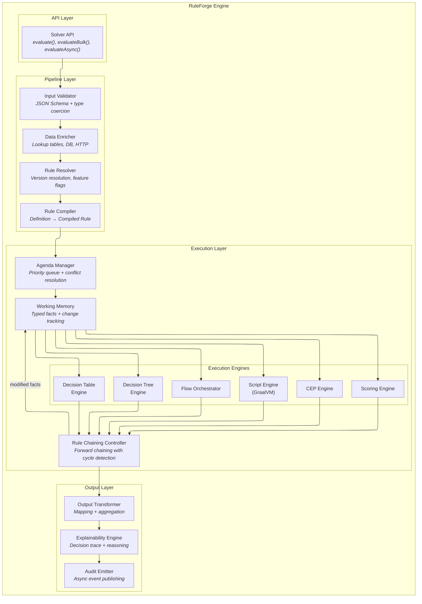


<a id="22-engine-lifecycle"></a>

#### Engine Lifecycle

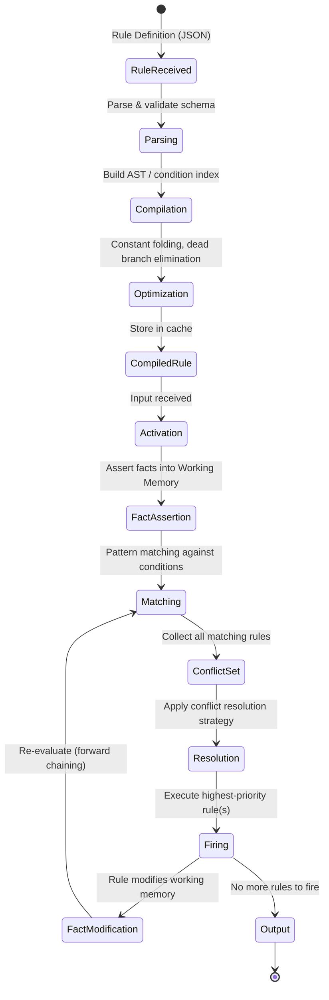
<a id="3-rule-metamodel--the-type-system"></a>

### Rule Metamodel — The Type System


<a id="31-core-abstractions"></a>

#### Core Abstractions

Every rule in the system conforms to a unified metamodel, regardless of whether it's a table, tree, flow, or script:

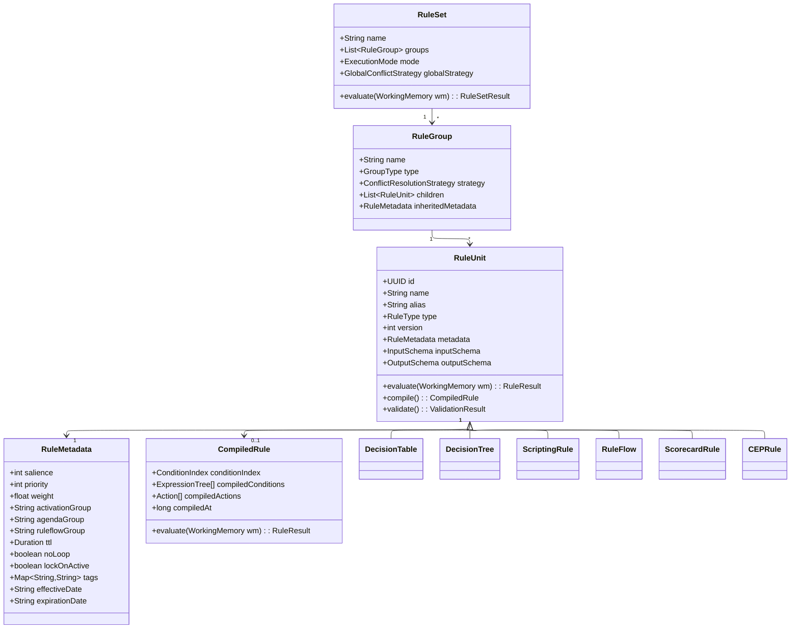


<a id="32-rule-type-taxonomy"></a>

#### Rule Type Taxonomy

```mermaid
---
config:
  layout: elk
  elk:
    # Merges parallel edges into one
    mergeEdges: true
    # Configures how nodes are placed, affecting connector paths
    nodePlacementStrategy: LINEAR_SEGMENTS
---
graph TB
    ROOT["RuleUnit<br/><i>(Abstract base)</i>"]

    ROOT --> ATOMIC["Atomic Rules<br/><i>(Self-contained evaluation)</i>"]
    ROOT --> COMPOSITE["Composite Rules<br/><i>(Orchestrate other rules)</i>"]
    ROOT --> REACTIVE["Reactive Rules<br/><i>(Event-driven)</i>"]

    ATOMIC --> DT["DecisionTable<br/><i>Rows with conditions → actions</i>"]
    ATOMIC --> TREE["DecisionTree<br/><i>Branching IF-THEN-ELSE</i>"]
    ATOMIC --> SCRIPT["ScriptingRule<br/><i>JavaScript/GraalVM</i>"]
    ATOMIC --> SCORE["ScorecardRule<br/><i>Weighted scoring model</i>"]
    ATOMIC --> LOOKUP["LookupTable<br/><i>Reference data</i>"]
    ATOMIC --> DMN_R["DMN Rule<br/><i>FEEL expression</i>"]

    COMPOSITE --> FLOW["RuleFlow<br/><i>DAG orchestration</i>"]
    COMPOSITE --> GROUP["RuleGroup<br/><i>Priority-ordered set</i>"]
    COMPOSITE --> CASCADE["CascadeRule<br/><i>Hierarchical fallthrough</i>"]
    COMPOSITE --> ENSEMBLE["EnsembleRule<br/><i>Voting/averaging</i>"]

    REACTIVE --> CEP_R["CEP Rule<br/><i>Temporal patterns</i>"]
    REACTIVE --> TRIGGER["TriggerRule<br/><i>Event → Action</i>"]

    style ROOT fill:#1a73e8,color:#fff
    style ATOMIC fill:#34a853,color:#fff
    style COMPOSITE fill:#ff6d01,color:#fff
    style REACTIVE fill:#ea4335,color:#fff
```

## Facts, expressions, and compilation

<a id="13-working-memory--fact-model"></a>

### Working Memory & Fact Model


<a id="131-working-memory-design"></a>

#### Working Memory Design

The Working Memory is the shared data space during rule evaluation, replacing JEasyRules' simple `Facts` map with a typed, tracked, observable model:

```java
public class WorkingMemory {
    private final Map<String, Fact<?>> facts = new LinkedHashMap<>();
    private final List<FactChange> changelog = new ArrayList<>();
    private final Set<FactChangeListener> listeners = new CopyOnWriteArraySet<>();
    private boolean modified = false;

    // Type-safe fact operations
    public <T> void assertFact(String path, T value, FactType<T> type) {
        Fact<T> fact = new Fact<>(path, value, type, Instant.now());
        facts.put(path, fact);
        changelog.add(new FactChange(ChangeType.ASSERT, path, null, value));
        modified = true;
        notifyListeners(fact, ChangeType.ASSERT);
    }

    public <T> void modifyFact(String path, T newValue) {
        Fact<?> existing = facts.get(path);
        Object oldValue = existing != null ? existing.getValue() : null;
        assertFact(path, newValue, (FactType<T>) existing.getType());
        changelog.add(new FactChange(ChangeType.MODIFY, path, oldValue, newValue));
    }

    public void retractFact(String path) {
        Fact<?> removed = facts.remove(path);
        if (removed != null) {
            changelog.add(new FactChange(ChangeType.RETRACT, path, removed.getValue(), null));
            modified = true;
        }
    }

    // Deep path access: "customer.address.city"
    @SuppressWarnings("unchecked")
    public <T> T get(String dotPath) {
        return (T) PathResolver.resolve(facts, dotPath);
    }

    // Snapshot for cycle detection
    public long factHash() {
        return facts.values().stream()
            .mapToLong(f -> Objects.hash(f.getPath(), f.getValue()))
            .reduce(0L, (a, b) -> a * 31 + b);
    }

    // Full changelog for explainability
    public List<FactChange> getChangelog() {
        return Collections.unmodifiableList(changelog);
    }
}

public record Fact<T>(
    String path,
    T value,
    FactType<T> type,
    Instant lastModified
) {}

public record FactChange(
    ChangeType type,  // ASSERT, MODIFY, RETRACT
    String path,
    Object oldValue,
    Object newValue
) {}
```


<a id="132-fact-type-system"></a>

#### Fact Type System

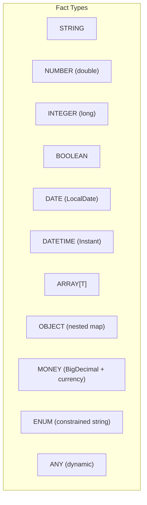


<a id="133-automatic-type-coercion"></a>

#### Automatic Type Coercion

```
Input JSON "35" → INTEGER if schema says integer → long 35
Input JSON 35.0 → INTEGER → long 35 (truncate)
Input JSON "2026-02-20" → DATE → LocalDate.of(2026, 2, 20)
Input JSON true → BOOLEAN → true
Input JSON "true" → BOOLEAN → true (coerced)
```
<a id="15-expression-language-rfl"></a>

### Expression Language (RFL)


<a id="151-ruleforge-language-rfl--custom-expression-language"></a>

#### RuleForge Language (RFL) — Custom Expression Language

While supporting FEEL (DMN standard) for interoperability, RuleForge includes its own expression language for rule conditions and transformations:

```
// Conditions
customer.age >= 18 AND customer.age <= 65
customer.creditScore IN [700, 750, 800]
customer.name STARTS_WITH "A"
transaction.amount BETWEEN 1000 AND 50000
customer.email MATCHES "^[a-z]+@company\\.com$"
order.items ANY item -> item.price > 100
order.items ALL item -> item.inStock == true

// Null-safe navigation
customer.address?.city ?? "UNKNOWN"

// Functions
ROUND(loan.amount * rate.annual / 12, 2)
DATE_DIFF(NOW(), customer.dob, "YEARS")
UPPER(TRIM(customer.name))
SUM(order.items MAP item -> item.price * item.quantity)
IF(customer.vip, amount * 0.9, amount)

// Aggregations
COUNT(transactions WHERE amount > 1000)
AVG(reviews MAP r -> r.score) > 3.5

// Rule reference (call another rule inline)
SOLVE("credit-check", { score: customer.creditScore }).eligible == true
LOOKUP("country-codes", customer.countryCode).region
```


<a id="152-rfl-grammar-ebnf-simplified"></a>

#### RFL Grammar (EBNF Simplified)

```ebnf
expression     = logicalOr ;
logicalOr      = logicalAnd ( "OR" logicalAnd )* ;
logicalAnd     = comparison ( "AND" comparison )* ;
comparison     = addition ( compOp addition )? ;
compOp         = "==" | "!=" | ">" | ">=" | "<" | "<=" | "IN" | "NOT_IN"
               | "BETWEEN" | "MATCHES" | "STARTS_WITH" | "ENDS_WITH"
               | "CONTAINS" | "IS_NULL" | "IS_NOT_NULL" ;
addition       = multiplication ( ("+" | "-") multiplication )* ;
multiplication = unary ( ("*" | "/" | "%") unary )* ;
unary          = ("NOT" | "-") unary | postfix ;
postfix        = primary ( "." identifier | "?." identifier | "[" expression "]" | "(" arguments ")" )* ;
primary        = number | string | boolean | "NULL" | identifier | "(" expression ")"
               | function_call | array_literal | lambda ;
function_call  = identifier "(" arguments ")" ;
lambda         = identifier "->" expression ;
arguments      = ( expression ( "," expression )* )? ;
```
<a id="14-rule-compilation-pipeline"></a>

### Rule Compilation Pipeline


<a id="141-pipeline-stages"></a>

#### Pipeline Stages

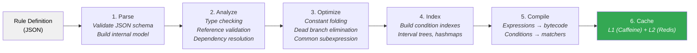


<a id="142-compilation-optimizations"></a>

#### Compilation Optimizations

| Optimization                  | Description                                                             | Impact                  |
| ----------------------------- | ----------------------------------------------------------------------- | ----------------------- |
| **Constant Folding**          | Pre-compute expressions with only constants: `365 * 24 * 60` → `525600` | Eliminates runtime math |
| **Dead Branch Elimination**   | Remove branches that can never match (contradictory conditions)         | Reduces tree depth      |
| **Common Subexpression**      | `IF age > 18 AND age < 65` shares the `age` lookup                      | Fewer memory reads      |
| **Condition Reordering**      | Evaluate cheapest conditions first (O(1) before O(n))                   | Faster short-circuit    |
| **Hash Compilation**          | Compile IN operators to HashSet lookups                                 | O(1) vs O(k)            |
| **Regex Pre-compilation**     | Compile REGEX patterns once at compile time                             | Avoid recompilation     |
| **Expression Specialization** | Generate specialized bytecode for common patterns                       | JIT-friendly            |

## Scheduling and rule composition

<a id="4-priority--salience-system"></a>

### Priority & Salience System


<a id="41-multi-dimensional-priority"></a>

#### Multi-Dimensional Priority

Unlike JEasyRules' single integer priority, RuleForge uses a **multi-dimensional priority vector** for sophisticated conflict resolution:

```
Priority Vector = (salience, specificity, weight, recency, order)
```

| Dimension       | Range           | Description                                                | Example                                   |
| --------------- | --------------- | ---------------------------------------------------------- | ----------------------------------------- |
| **Salience**    | -10000 to 10000 | Explicit rule importance (higher = fires first)            | `salience: 1000` for fraud override rules |
| **Specificity** | Auto-calculated | Number of non-wildcard conditions (more specific = higher) | 5 conditions > 3 conditions               |
| **Weight**      | 0.0 to 1.0      | Confidence/relevance weight for scoring rules              | `weight: 0.85`                            |
| **Recency**     | Timestamp       | When the fact that activated the rule was last modified    | More recent facts = higher priority       |
| **Order**       | 0 to N          | Declaration order within a rule group (tiebreaker)         | Row 1 before Row 2                        |


<a id="42-priority-resolution-algorithm"></a>

#### Priority Resolution Algorithm

```java
public class PriorityVector implements Comparable<PriorityVector> {
    private final int salience;        // Explicit priority
    private final int specificity;     // Auto-computed condition count
    private final double weight;       // Confidence weight
    private final Instant recency;     // Fact modification time
    private final int declarationOrder; // Tiebreaker

    @Override
    public int compareTo(PriorityVector other) {
        // 1. Salience (highest first)
        int cmp = Integer.compare(other.salience, this.salience);
        if (cmp != 0) return cmp;

        // 2. Specificity (most specific first)
        cmp = Integer.compare(other.specificity, this.specificity);
        if (cmp != 0) return cmp;

        // 3. Weight (highest first)
        cmp = Double.compare(other.weight, this.weight);
        if (cmp != 0) return cmp;

        // 4. Recency (most recent first)
        cmp = other.recency.compareTo(this.recency);
        if (cmp != 0) return cmp;

        // 5. Declaration order (first declared first)
        return Integer.compare(this.declarationOrder, other.declarationOrder);
    }
}
```


<a id="43-salience-patterns"></a>

#### Salience Patterns

```json
{
  "rules": [
    {
      "name": "Fraud Override - Block Transaction",
      "metadata": {
        "salience": 10000,
        "activationGroup": "fraud-check",
        "noLoop": true
      },
      "conditions": [
        { "path": "transaction.fraudScore", "op": "GTE", "value": 95 }
      ],
      "actions": [{ "set": "decision.action", "value": "BLOCK" }]
    },
    {
      "name": "Standard Credit Check",
      "metadata": {
        "salience": 100,
        "agendaGroup": "credit-evaluation"
      },
      "conditions": [
        { "path": "customer.creditScore", "op": "GTE", "value": 650 }
      ],
      "actions": [{ "set": "decision.eligible", "value": true }]
    },
    {
      "name": "Default Fallback - Manual Review",
      "metadata": {
        "salience": -1000,
        "activationGroup": "credit-evaluation"
      },
      "conditions": [],
      "actions": [{ "set": "decision.action", "value": "MANUAL_REVIEW" }]
    }
  ]
}
```


<a id="44-activation-groups--agenda-groups"></a>

#### Activation Groups & Agenda Groups

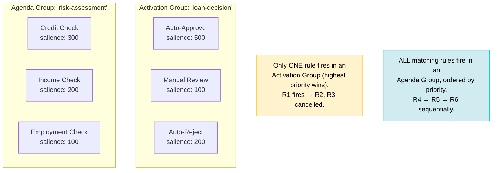

| Concept              | Behavior                                                                 | Use Case                                            |
| -------------------- | ------------------------------------------------------------------------ | --------------------------------------------------- |
| **Activation Group** | Only the highest-priority matching rule fires; rest are cancelled        | Mutually exclusive outcomes (approve/reject/review) |
| **Agenda Group**     | All matching rules fire in priority order; can be focused/defocused      | Step-by-step evaluation phases                      |
| **Ruleflow Group**   | Rules only active when their group is activated by a flow node           | Stage-gated execution in workflows                  |
| **No-Loop**          | Prevents a rule from re-firing when it modifies its own triggering facts | Avoid infinite loops in forward chaining            |
| **Lock-on-Active**   | Once an agenda group fires, no new activations are added to it           | Prevent cascading re-evaluation                     |
<a id="7-execution-strategies--conflict-resolution"></a>

### Execution Strategies & Conflict Resolution


<a id="71-execution-modes"></a>

#### Execution Modes

| Mode            | Description                                                       | Use Case                         |
| --------------- | ----------------------------------------------------------------- | -------------------------------- |
| `FIRST_MATCH`   | Stop at first matching rule (by priority)                         | Eligibility, routing             |
| `ALL_MATCH`     | Fire all matching rules, collect results                          | Validation, multi-output         |
| `BEST_MATCH`    | Score all matches, return highest-scored                          | Recommendation, pricing          |
| `SEQUENTIAL`    | Fire all rules in priority order, each can see previous results   | Pipeline processing              |
| `PARALLEL`      | Fire all matching rules concurrently, aggregate results           | Performance-critical multi-check |
| `FORWARD_CHAIN` | Rete-style: fire → modify facts → re-evaluate → fire until stable | Inference, derivation            |
| `CASCADING`     | Fire through hierarchy levels until a result is produced          | Hierarchical overrides           |


<a id="72-conflict-resolution-strategies"></a>

#### Conflict Resolution Strategies

When multiple rules match at the same priority level:

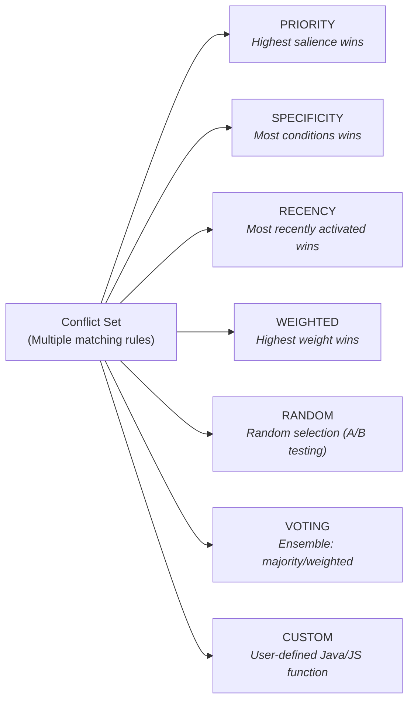


<a id="73-conflict-resolution-implementation"></a>

#### Conflict Resolution Implementation

```java
public interface ConflictResolutionStrategy {
    List<ActivatedRule> resolve(List<ActivatedRule> conflictSet, ExecutionContext ctx);
}

public class CompositeConflictResolver implements ConflictResolutionStrategy {
    private final List<ConflictResolutionStrategy> chain;

    /**
     * Applies resolvers in order. Each resolver narrows the conflict set.
     * Chain: Priority → Specificity → Recency → Declaration Order
     */
    @Override
    public List<ActivatedRule> resolve(List<ActivatedRule> conflictSet, ExecutionContext ctx) {
        List<ActivatedRule> remaining = conflictSet;
        for (ConflictResolutionStrategy resolver : chain) {
            remaining = resolver.resolve(remaining, ctx);
            if (remaining.size() <= 1) break;
        }
        return remaining;
    }
}

// Built-in strategies
public class PriorityResolver implements ConflictResolutionStrategy {
    @Override
    public List<ActivatedRule> resolve(List<ActivatedRule> set, ExecutionContext ctx) {
        int maxSalience = set.stream().mapToInt(r -> r.metadata().salience()).max().orElse(0);
        return set.stream().filter(r -> r.metadata().salience() == maxSalience).toList();
    }
}

public class SpecificityResolver implements ConflictResolutionStrategy {
    @Override
    public List<ActivatedRule> resolve(List<ActivatedRule> set, ExecutionContext ctx) {
        int maxConditions = set.stream().mapToInt(r -> r.conditionCount()).max().orElse(0);
        return set.stream().filter(r -> r.conditionCount() == maxConditions).toList();
    }
}

public class WeightedRandomResolver implements ConflictResolutionStrategy {
    // For A/B testing: probabilistic selection weighted by rule weights
    @Override
    public List<ActivatedRule> resolve(List<ActivatedRule> set, ExecutionContext ctx) {
        double totalWeight = set.stream().mapToDouble(r -> r.metadata().weight()).sum();
        double random = ThreadLocalRandom.current().nextDouble() * totalWeight;

        double cumulative = 0;
        for (ActivatedRule rule : set) {
            cumulative += rule.metadata().weight();
            if (random <= cumulative) return List.of(rule);
        }
        return List.of(set.getLast());
    }
}
```


<a id="74-forward-chaining-with-cycle-detection"></a>

#### Forward Chaining with Cycle Detection

```java
public class ForwardChainingEngine {
    private static final int MAX_ITERATIONS = 100;

    public RuleSetResult evaluate(RuleSet ruleSet, WorkingMemory wm) {
        Agenda agenda = new Agenda(ruleSet, wm);
        Set<String> firedRuleSnapshots = new HashSet<>(); // Cycle detection
        int iteration = 0;

        while (agenda.hasActivations() && iteration < MAX_ITERATIONS) {
            iteration++;

            // 1. Resolve conflicts to pick next rule(s) to fire
            List<ActivatedRule> toFire = agenda.resolveConflicts();

            for (ActivatedRule rule : toFire) {
                // 2. Cycle detection: same rule + same facts = skip
                String snapshot = rule.id() + ":" + wm.factHash();
                if (firedRuleSnapshots.contains(snapshot) && rule.metadata().noLoop()) {
                    continue;
                }
                firedRuleSnapshots.add(snapshot);

                // 3. Fire the rule
                RuleResult result = rule.execute(wm);

                // 4. If working memory was modified, re-evaluate matches
                if (wm.isModified()) {
                    agenda.reEvaluate(wm);
                    wm.clearModificationFlag();
                }
            }
        }

        if (iteration >= MAX_ITERATIONS) {
            throw new RuleEngineException("Forward chaining exceeded max iterations. Possible infinite loop.");
        }

        return new RuleSetResult(wm.getOutputFacts(), iteration);
    }
}
```
<a id="5-hierarchical-rule-composition"></a>

### Hierarchical Rule Composition


<a id="51-composition-model"></a>

#### Composition Model

Rules compose hierarchically, enabling reuse, override, and inheritance:

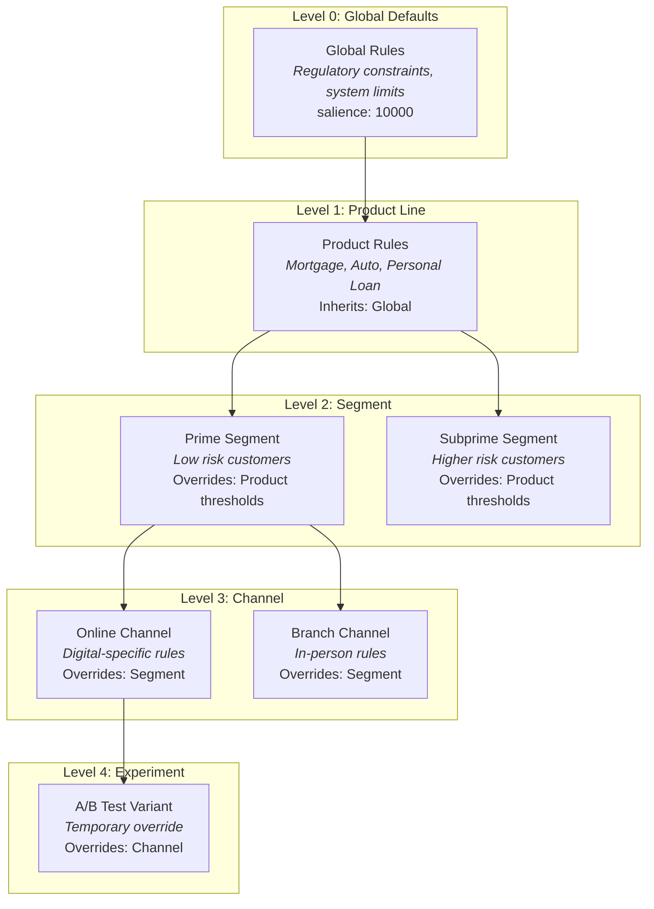


<a id="52-inheritance--override-semantics"></a>

#### Inheritance & Override Semantics

```java
public class HierarchicalRuleResolver {

    /**
     * Resolves the effective rule by walking the hierarchy from
     * most specific (leaf) to most general (root).
     *
     * Override semantics:
     * - REPLACE:  Child completely replaces parent rule
     * - MERGE:    Child rows/branches added to parent (union)
     * - PREPEND:  Child rules evaluated before parent
     * - APPEND:   Child rules evaluated after parent
     * - OVERRIDE_ROWS: Matching rows in child replace parent rows (by row key)
     */
    public CompiledRule resolve(RuleReference ref, EvaluationContext ctx) {
        List<RuleLayer> hierarchy = buildHierarchy(ref, ctx);

        // Walk from root to leaf, applying overrides
        CompiledRule effective = hierarchy.get(0).compile();

        for (int i = 1; i < hierarchy.size(); i++) {
            RuleLayer layer = hierarchy.get(i);
            switch (layer.getOverrideMode()) {
                case REPLACE   -> effective = layer.compile();
                case MERGE     -> effective = effective.mergeWith(layer.compile());
                case PREPEND   -> effective = layer.compile().prependTo(effective);
                case APPEND    -> effective = effective.appendWith(layer.compile());
                case OVERRIDE_ROWS -> effective = effective.overrideRows(layer.compile());
            }
        }
        return effective;
    }

    private List<RuleLayer> buildHierarchy(RuleReference ref, EvaluationContext ctx) {
        // Resolve: Global → Product → Segment → Channel → Experiment
        // Based on context attributes (product, segment, channel, experiment ID)
        return hierarchyService.resolve(ref.getRuleId(), ctx.getHierarchyPath());
    }
}
```


<a id="53-hierarchical-rule-definition"></a>

#### Hierarchical Rule Definition

```json
{
  "ruleId": "loan-eligibility",
  "hierarchy": {
    "levels": [
      {
        "name": "global",
        "selector": {},
        "definition": {
          "type": "decision-table",
          "rows": [
            {
              "id": "global-1",
              "conditions": { "age": { "op": "GTE", "value": 18 } },
              "actions": { "eligible": true }
            },
            {
              "id": "global-2",
              "conditions": { "age": { "op": "LT", "value": 18 } },
              "actions": { "eligible": false, "reason": "UNDERAGE" }
            }
          ]
        }
      },
      {
        "name": "product",
        "selector": { "product": "MORTGAGE" },
        "overrideMode": "MERGE",
        "definition": {
          "type": "decision-table",
          "rows": [
            {
              "id": "mortgage-1",
              "conditions": { "income": { "op": "LT", "value": 30000 } },
              "actions": { "eligible": false, "reason": "INCOME_TOO_LOW" }
            },
            {
              "id": "mortgage-2",
              "conditions": { "loanToValue": { "op": "GT", "value": 0.95 } },
              "actions": { "eligible": false, "reason": "LTV_EXCEEDED" }
            }
          ]
        }
      },
      {
        "name": "segment",
        "selector": { "product": "MORTGAGE", "segment": "PRIME" },
        "overrideMode": "OVERRIDE_ROWS",
        "definition": {
          "type": "decision-table",
          "rows": [
            {
              "id": "mortgage-1",
              "conditions": { "income": { "op": "LT", "value": 20000 } },
              "actions": { "eligible": false, "reason": "INCOME_TOO_LOW" }
            }
          ]
        }
      }
    ]
  }
}
```


<a id="54-hierarchy-resolution-visualization"></a>

#### Hierarchy Resolution Visualization

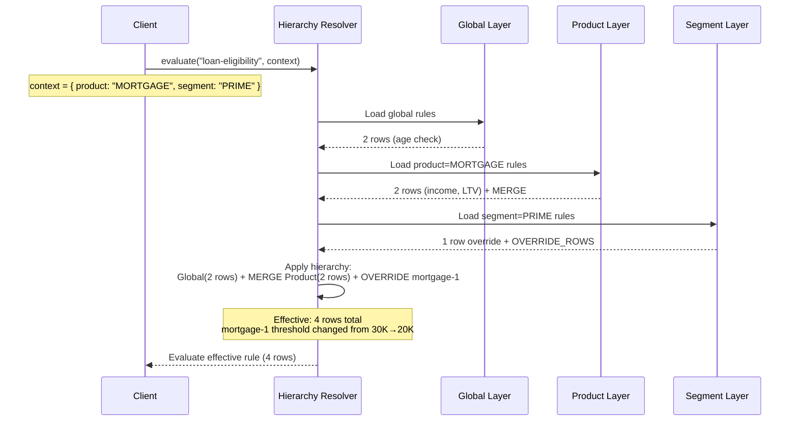

## Specialized execution engines

<a id="8-decision-table-engine"></a>

### Decision Table Engine


<a id="81-indexed-evaluation"></a>

#### Indexed Evaluation

Instead of linear row scanning (O(n) per row × m conditions), the Decision Table Engine uses a **condition index** for fast lookups:

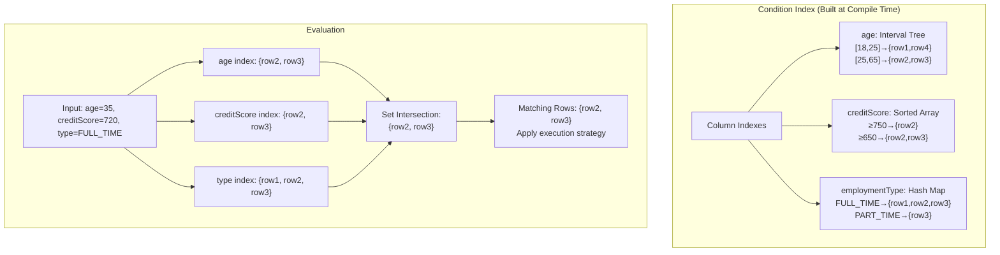


<a id="82-index-types-by-operator"></a>

#### Index Types by Operator

| Operator                  | Index Structure                              | Lookup Complexity            |
| ------------------------- | -------------------------------------------- | ---------------------------- |
| `EQ`, `NEQ`               | HashMap                                      | O(1)                         |
| `IN`, `NOT_IN`            | HashMap (multi-value)                        | O(k) where k = set size      |
| `GT`, `GTE`, `LT`, `LTE`  | Sorted Array + Binary Search                 | O(log n)                     |
| `BETWEEN`                 | Interval Tree                                | O(log n + k)                 |
| `CONTAINS`, `STARTS_WITH` | Trie                                         | O(m) where m = string length |
| `REGEX`                   | Pre-compiled Pattern (no index, linear scan) | O(n)                         |
| `IS_NULL`, `IS_NOT_NULL`  | Bitmap                                       | O(1)                         |


<a id="83-execution-strategies"></a>

#### Execution Strategies

```java
public enum TableExecutionStrategy {
    /**
     * Returns all rows that match the input.
     * Order: by priority vector, then declaration order.
     */
    STANDARD,

    /**
     * Returns only the first matching row (highest priority).
     * Short-circuits evaluation.
     */
    FIRST_MATCH,

    /**
     * Evaluates the input against each row independently.
     * Returns array of results (one per input in bulk).
     */
    ARRAY,

    /**
     * Collects all matching rows, then aggregates their outputs.
     * Aggregation functions: SUM, AVG, MIN, MAX, CONCAT, MERGE.
     */
    AGGREGATE,

    /**
     * Scores each matching row using weighted scoring,
     * returns the top-N results ranked by score.
     */
    RANKED
}
```
<a id="9-decision-tree-engine"></a>

### Decision Tree Engine


<a id="91-tree-node-types"></a>

#### Tree Node Types

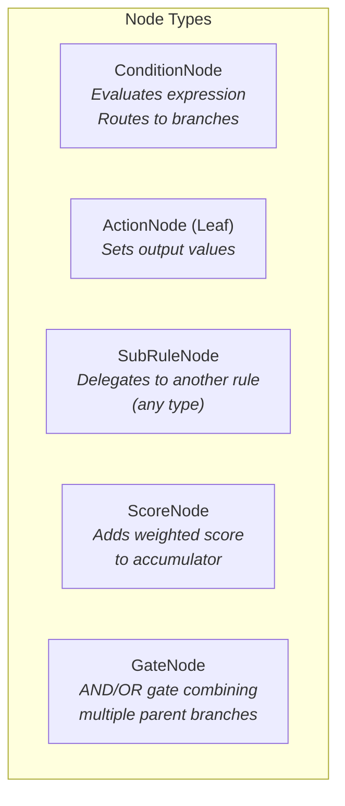


<a id="92-advanced-tree-features"></a>

#### Advanced Tree Features

| Feature                     | Description                                                                      |
| --------------------------- | -------------------------------------------------------------------------------- |
| **Multi-branch conditions** | A condition node can have N branches (not just true/false) — e.g., ranges, enums |
| **Default branch**          | Mandatory fallback for unmatched conditions                                      |
| **Branch weights**          | Each branch carries a confidence weight for probabilistic decisions              |
| **Sub-rule delegation**     | A tree node can invoke any other rule (table, scorecard, another tree)           |
| **Score accumulation**      | Nodes accumulate a running score through the tree path                           |
| **Early termination**       | `HALT` action immediately returns result without traversing remaining branches   |
| **Parallel branches**       | Fork-join: evaluate multiple branches in parallel, merge results                 |


<a id="93-compiled-tree--binary-decision-diagram-bdd"></a>

#### Compiled Tree — Binary Decision Diagram (BDD)

For performance, complex trees are compiled to BDDs:

```
Raw Tree (5 levels, 31 nodes) → BDD optimization → Reduced BDD (12 unique nodes)
```

This eliminates redundant condition checks when the same variable appears at multiple levels.
<a id="6-weighted--scoring-branches"></a>

### Weighted & Scoring Branches


<a id="61-scorecard-rule-type"></a>

#### Scorecard Rule Type

A first-class **ScorecardRule** supports weighted scoring — essential for credit scoring, risk assessment, and eligibility evaluation:

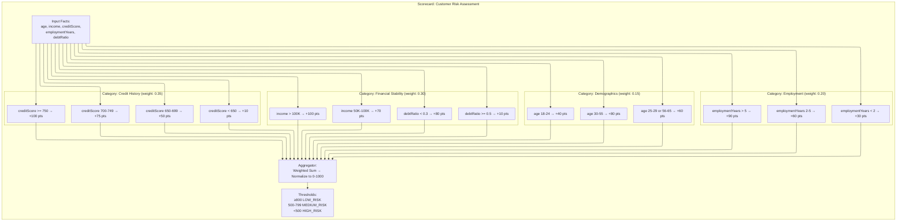


<a id="62-scorecard-definition-schema"></a>

#### Scorecard Definition Schema

```json
{
  "type": "scorecard",
  "name": "Customer Risk Scorecard",
  "version": 3,
  "config": {
    "baseScore": 0,
    "maxScore": 1000,
    "aggregation": "WEIGHTED_SUM",
    "normalization": "LINEAR_SCALE",
    "missingCategoryStrategy": "USE_NEUTRAL_SCORE"
  },
  "categories": [
    {
      "id": "credit-history",
      "name": "Credit History",
      "weight": 0.35,
      "input": "customer.creditScore",
      "bins": [
        {
          "condition": { "op": "GTE", "value": 750 },
          "score": 100,
          "label": "Excellent"
        },
        {
          "condition": { "op": "BETWEEN", "value": [700, 749] },
          "score": 75,
          "label": "Good"
        },
        {
          "condition": { "op": "BETWEEN", "value": [650, 699] },
          "score": 50,
          "label": "Fair"
        },
        {
          "condition": { "op": "LT", "value": 650 },
          "score": 10,
          "label": "Poor"
        }
      ]
    },
    {
      "id": "financial-stability",
      "name": "Financial Stability",
      "weight": 0.3,
      "multiInput": true,
      "bins": [
        {
          "condition": {
            "path": "customer.income",
            "op": "GTE",
            "value": 100000
          },
          "score": 100
        },
        {
          "condition": {
            "path": "customer.income",
            "op": "BETWEEN",
            "value": [50000, 99999]
          },
          "score": 70
        },
        {
          "condition": {
            "path": "customer.debtRatio",
            "op": "LT",
            "value": 0.3
          },
          "score": 80,
          "additive": true
        },
        {
          "condition": {
            "path": "customer.debtRatio",
            "op": "GTE",
            "value": 0.5
          },
          "score": -20,
          "additive": true
        }
      ]
    },
    {
      "id": "employment",
      "name": "Employment Stability",
      "weight": 0.2,
      "input": "customer.employmentYears",
      "bins": [
        { "condition": { "op": "GT", "value": 5 }, "score": 90 },
        { "condition": { "op": "BETWEEN", "value": [2, 5] }, "score": 60 },
        { "condition": { "op": "LT", "value": 2 }, "score": 30 }
      ]
    }
  ],
  "thresholds": [
    {
      "minScore": 800,
      "output": { "riskCategory": "LOW", "action": "AUTO_APPROVE" }
    },
    {
      "minScore": 500,
      "maxScore": 799,
      "output": { "riskCategory": "MEDIUM", "action": "MANUAL_REVIEW" }
    },
    {
      "maxScore": 499,
      "output": { "riskCategory": "HIGH", "action": "AUTO_REJECT" }
    }
  ]
}
```


<a id="63-weighted-decision-trees"></a>

#### Weighted Decision Trees

Standard decision trees use hard branching (IF-THEN-ELSE). Weighted trees add **confidence scores** and **probabilistic branching**:

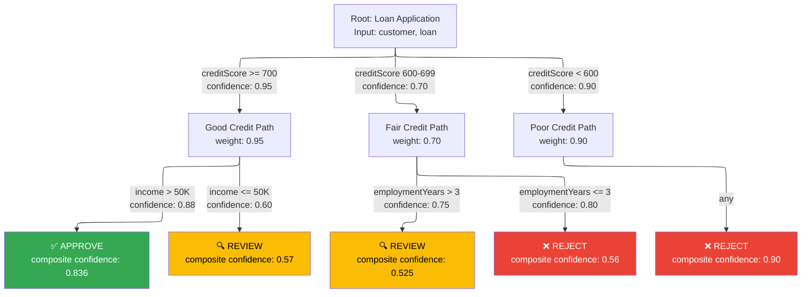

**Composite confidence** = product of branch confidences along the path:

- APPROVE: 0.95 × 0.88 = 0.836
- REVIEW via fair credit: 0.70 × 0.75 = 0.525

This enables **threshold-based output selection**: if composite confidence < 0.6, escalate to MANUAL_REVIEW regardless of the leaf node's decision.


<a id="64-ensemble-rules-voting--averaging"></a>

#### Ensemble Rules (Voting / Averaging)

Multiple rules can be combined as an ensemble, similar to ML ensemble methods:

```json
{
  "type": "ensemble",
  "name": "Fraud Detection Ensemble",
  "strategy": "WEIGHTED_VOTE",
  "quorum": 0.6,
  "members": [
    { "ruleRef": "velocity-check", "weight": 0.3 },
    { "ruleRef": "geo-anomaly-check", "weight": 0.25 },
    { "ruleRef": "device-fingerprint-check", "weight": 0.2 },
    { "ruleRef": "behavioral-pattern-check", "weight": 0.25 }
  ],
  "aggregation": {
    "FRAUD": {
      "op": "WEIGHTED_SUM",
      "threshold": 0.6,
      "output": { "decision": "BLOCK", "reason": "FRAUD_DETECTED" }
    },
    "LEGITIMATE": {
      "op": "WEIGHTED_SUM",
      "threshold": 0.7,
      "output": { "decision": "ALLOW" }
    },
    "DEFAULT": {
      "output": { "decision": "REVIEW", "reason": "INCONCLUSIVE" }
    }
  }
}
```

| Ensemble Strategy  | Description                                        |
| ------------------ | -------------------------------------------------- |
| `MAJORITY_VOTE`    | Each rule casts a binary vote; majority wins       |
| `WEIGHTED_VOTE`    | Votes weighted by rule weight; quorum threshold    |
| `AVERAGE_SCORE`    | Average numeric scores across members              |
| `WEIGHTED_AVERAGE` | Weighted average of numeric scores                 |
| `MAX_CONFIDENCE`   | Take the result from the highest-confidence member |
| `STACK`            | Feed member outputs into a meta-rule               |
<a id="10-rule-flow--orchestration-engine"></a>

### Rule Flow / Orchestration Engine


<a id="101-flow-node-types"></a>

#### Flow Node Types

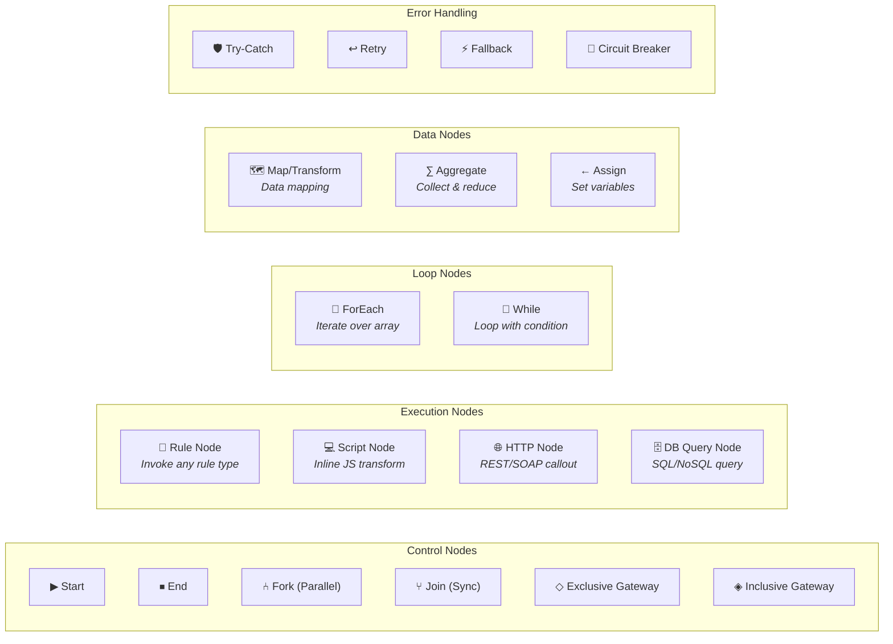


<a id="102-flow-execution-model"></a>

#### Flow Execution Model

```java
public class FlowOrchestrator {

    public FlowResult execute(CompiledFlow flow, WorkingMemory wm) {
        ExecutionDAG dag = flow.getDAG();
        Map<String, CompletableFuture<NodeResult>> futures = new ConcurrentHashMap<>();

        // Topological execution with parallelism
        for (FlowNode node : dag.topologicalOrder()) {
            CompletableFuture<NodeResult> future;

            if (node.isParallelizable() && node.getDependencies().size() > 1) {
                // Wait for all dependencies then execute
                CompletableFuture<Void> deps = CompletableFuture.allOf(
                    node.getDependencies().stream()
                        .map(futures::get)
                        .toArray(CompletableFuture[]::new)
                );
                future = deps.thenApplyAsync(v -> executeNode(node, wm), executorPool);
            } else {
                future = CompletableFuture.supplyAsync(() -> executeNode(node, wm), executorPool);
            }

            futures.put(node.getId(), future);
        }

        // Collect results
        return aggregateResults(futures, dag.getEndNodes());
    }

    private NodeResult executeNode(FlowNode node, WorkingMemory wm) {
        return switch (node.getType()) {
            case RULE -> evaluateSubRule(node, wm);
            case SCRIPT -> executeScript(node, wm);
            case HTTP_CALLOUT -> executeHttpCallout(node, wm);
            case DB_QUERY -> executeDbQuery(node, wm);
            case FOREACH -> executeForEach(node, wm);
            case EXCLUSIVE_GATEWAY -> evaluateGateway(node, wm);
            case ASSIGN -> executeAssignment(node, wm);
            case AGGREGATE -> executeAggregation(node, wm);
            default -> throw new UnsupportedNodeException(node.getType());
        };
    }
}
```


<a id="103-flow-error-handling-patterns"></a>

#### Flow Error Handling Patterns

```json
{
  "flow": {
    "nodes": [
      {
        "id": "credit-check",
        "type": "RULE",
        "ruleRef": "credit-scoring-v3",
        "errorHandling": {
          "strategy": "RETRY_THEN_FALLBACK",
          "retry": {
            "maxAttempts": 3,
            "backoff": "EXPONENTIAL",
            "initialDelay": "100ms"
          },
          "fallback": {
            "type": "RULE",
            "ruleRef": "credit-scoring-simplified",
            "metadata": { "degradedMode": true }
          },
          "circuitBreaker": {
            "failureThreshold": 5,
            "resetTimeout": "30s",
            "halfOpenRequests": 3
          }
        }
      }
    ]
  }
}
```
<a id="11-scripting-engine-graalvm"></a>

### Scripting Engine (GraalVM)

> **Runtime note (current source baseline):** The engine targets **Java 25**. A separate GraalVM JDK is not required; the polyglot runtime is supplied through module dependencies.
> The GraalVM polyglot runtime (`org.graalvm.polyglot:polyglot` + `org.graalvm.polyglot:js-community`)
> is bundled as dependencies in `ruleforge-script/build.gradle.kts`.


<a id="111-sandboxed-execution"></a>

#### Sandboxed Execution

```java
public class ScriptingEngine {
    private final Engine sharedEngine;      // Shared across all contexts (JIT caches)
    private final ObjectPool<Context> pool; // Pre-warmed context pool

    public ScriptingEngine() {
        this.sharedEngine = Engine.newBuilder()
            .option("engine.Mode", "throughput")
            .build();

        this.pool = new GenericObjectPool<>(new ContextFactory(), poolConfig());
    }

    public Object execute(CompiledScript script, WorkingMemory wm, Duration timeout) {
        Context ctx = pool.borrowObject();
        try {
            // Inject safe APIs
            Value bindings = ctx.getBindings("js");
            bindings.putMember("input", ProxyObject.fromMap(wm.getInputFacts()));
            bindings.putMember("output", ProxyObject.fromMap(new LinkedHashMap<>()));
            bindings.putMember("DR", new SafeRuleAPI(wm));   // DR.solve(), DR.lookup()
            bindings.putMember("_math", new SafeMathAPI());
            bindings.putMember("_date", new SafeDateAPI());
            bindings.putMember("_str", new SafeStringAPI());
            bindings.putMember("_arr", new SafeArrayAPI());
            bindings.putMember("console", new SafeConsoleAPI()); // Logs to audit trail

            // Execute with timeout
            Value result = ctx.eval("js", script.getSource());

            return bindings.getMember("output").as(Map.class);
        } finally {
            pool.returnObject(ctx);
        }
    }

    private static class ContextFactory extends BasePooledObjectFactory<Context> {
        @Override
        public Context create() {
            return Context.newBuilder("js")
                .engine(sharedEngine)
                .allowHostAccess(HostAccess.newBuilder()
                    .allowListAccess(true)
                    .allowMapAccess(true)
                    .build())
                .allowIO(IOAccess.NONE)
                .allowCreateThread(false)
                .allowNativeAccess(false)
                .allowEnvironmentAccess(EnvironmentAccess.NONE)
                .allowExperimentalOptions(true)
                .option("js.ecmascript-version", "2022")
                .resourceLimits(ResourceLimits.newBuilder()
                    .statementLimit(500_000, null)   // Max 500K statements
                    .build())
                .build();
        }
    }
}
```


<a id="112-safe-api-surface-dr-object"></a>

#### Safe API Surface (`DR` Object)

```javascript
// Available inside scripting rules:

// Call another rule and get result
const creditResult = DR.solve("credit-scoring", { customer: input.customer });

// Lookup reference data
const rate = DR.lookup("interest-rates", { term: "30Y", type: "FIXED" });

// Access rule variables (configured per-rule)
const threshold = DR.variable("approval_threshold");

// Math functions
const monthly = _math.round(input.loanAmount / input.termMonths, 2);

// Date functions
const age = _date.yearsBetween(input.customer.dob, _date.today());

// Array functions
const highRiskItems = _arr.filter(input.transactions, (t) => t.amount > 10000);

// Console (logged to audit trail)
console.log("Processing customer:", input.customer.id);

// ALWAYS end with:
return output;
```

> **Important conventions:**
>
> - The GraalVM polyglot language ID is `"js"` (not `"javascript"`)
> - Scripts **must** define a function named `evaluate` (not `execute`)
> - The engine calls `context.getBindings("js").getMember("evaluate")` to invoke the script
> - Example: `function evaluate(input) { output.result = input.age >= 18; return output; }`
<a id="12-complex-event-processing-engine"></a>

### Complex Event Processing Engine


<a id="121-cep-pattern-types"></a>

#### CEP Pattern Types

| Pattern         | Description                 | Example                                          |
| --------------- | --------------------------- | ------------------------------------------------ |
| **Sequence**    | Events in specific order    | Login → Failed Auth → Failed Auth (brute force)  |
| **Aggregation** | Aggregate over time window  | SUM(transactions.amount) in 1 hour > $10,000     |
| **Absence**     | Expected event didn't occur | Payment initiated, no confirmation in 30 minutes |
| **Frequency**   | Count exceeding threshold   | > 5 failed logins in 10 minutes                  |
| **Correlation** | Events sharing attributes   | Same card_id across 3+ merchants in 5 minutes    |


<a id="122-cep-architecture"></a>

#### CEP Architecture

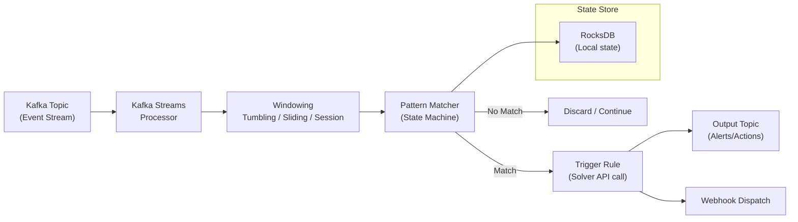

## Extension and integration reference

<a id="16-engine-extension-points-spi"></a>

### Engine Extension Points (SPI)


<a id="161-service-provider-interfaces"></a>

#### Service Provider Interfaces

```java
// Custom operator
public interface OperatorExtension {
    String name();                    // e.g., "PHONETIC_MATCH"
    boolean evaluate(Object left, Object right, EvaluationContext ctx);
    boolean supportsType(FactType<?> type);
}

// Custom function
public interface FunctionExtension {
    String name();                    // e.g., "CREDIT_SCORE_BAND"
    Object invoke(Object[] args, EvaluationContext ctx);
    FunctionSignature signature();    // Parameter types + return type
}

// Custom conflict resolution
public interface ConflictResolutionExtension extends ConflictResolutionStrategy {
    String name();
}

// Custom data enricher
public interface DataEnricherExtension {
    String protocol();               // e.g., "jdbc:", "http:", "redis:"
    Map<String, Object> enrich(String uri, Map<String, Object> params, EvaluationContext ctx);
}

// Rule lifecycle listener
public interface RuleLifecycleListener {
    void beforeEvaluation(RuleUnit rule, WorkingMemory wm);
    void afterEvaluation(RuleUnit rule, RuleResult result, Duration elapsed);
    void onError(RuleUnit rule, Throwable error);
}

// Custom compilation phase
public interface CompilationPhaseExtension {
    int order();                     // Phase ordering
    CompiledRule process(CompiledRule input, CompilationContext ctx);
}
```


<a id="162-extension-registration"></a>

#### Extension Registration

```java
// Java SPI (ServiceLoader) or programmatic
RuleForgeEngine engine = RuleForgeEngine.builder()
    .registerOperator(new PhoneticMatchOperator())
    .registerFunction(new CreditScoreBandFunction())
    .registerConflictStrategy(new BusinessPriorityResolver())
    .registerEnricher(new JdbcEnricher(dataSource))
    .registerEnricher(new RedisEnricher(redisClient))
    .addListener(new MetricsListener(meterRegistry))
    .addListener(new AuditListener(kafkaProducer))
    .addCompilationPhase(new RegulatoryComplianceChecker())
    .build();
```
<a id="19-class-diagrams--interfaces"></a>

### Class Diagrams & Interfaces


<a id="191-core-engine-interfaces"></a>

#### Core Engine Interfaces

```java
// ━━━━━━━━━━━━━━━━━━━━━━━━━━━━━━━━━━━━━━━━━━━━
// Core Engine API
// ━━━━━━━━━━━━━━━━━━━━━━━━━━━━━━━━━━━━━━━━━━━━

public interface RuleForgeEngine {

    /** Evaluate a single rule with input data */
    RuleResult evaluate(String ruleId, int version, Map<String, Object> input);
    RuleResult evaluate(String ruleId, int version, Map<String, Object> input, EvaluationOptions options);

    /** Evaluate with full Working Memory control */
    RuleResult evaluate(CompiledRule rule, WorkingMemory workingMemory);

    /** Bulk evaluate */
    List<RuleResult> evaluateBulk(String ruleId, int version, List<Map<String, Object>> inputs);

    /** Compile a rule definition */
    CompiledRule compile(RuleDefinition definition);

    /** Validate without compiling */
    ValidationResult validate(RuleDefinition definition);

    /** Get engine statistics */
    EngineStatistics getStatistics();

    /** Builder */
    static RuleForgeEngineBuilder builder() { return new RuleForgeEngineBuilder(); }
}

// ━━━━━━━━━━━━━━━━━━━━━━━━━━━━━━━━━━━━━━━━━━━━
// Rule Result
// ━━━━━━━━━━━━━━━━━━━━━━━━━━━━━━━━━━━━━━━━━━━━

public record RuleResult(
    Map<String, Object> output,          // Output facts
    RuleResultMetadata metadata,          // Execution stats
    List<MatchedRule> matchedRules,       // Which rules fired
    DecisionTrace trace                   // Full explainability trace
) {
    public record RuleResultMetadata(
        Duration executionTime,
        int rulesEvaluated,
        int rulesFired,
        int forwardChainingIterations,
        String strategy
    ) {}

    public record MatchedRule(
        String ruleId,
        String ruleName,
        int version,
        PriorityVector priority,
        Map<String, Object> matchedConditions,
        Map<String, Object> producedOutput
    ) {}
}

// ━━━━━━━━━━━━━━━━━━━━━━━━━━━━━━━━━━━━━━━━━━━━
// Decision Trace (Explainability)
// ━━━━━━━━━━━━━━━━━━━━━━━━━━━━━━━━━━━━━━━━━━━━

public record DecisionTrace(
    String ruleId,
    TraceNode rootNode,
    List<FactChange> factChanges,
    Duration totalTime
) {
    public sealed interface TraceNode
        permits ConditionEval, ActionExec, RuleInvocation, FlowStep {

        record ConditionEval(String expression, Object leftValue, String operator,
            Object rightValue, boolean result, Duration time) implements TraceNode {}

        record ActionExec(String action, String path, Object oldValue,
            Object newValue, Duration time) implements TraceNode {}

        record RuleInvocation(String ruleId, String ruleName, RuleResult result,
            Duration time, List<TraceNode> children) implements TraceNode {}

        record FlowStep(String nodeId, String nodeType, TraceNode inner,
            Duration time) implements TraceNode {}
    }
}

// ━━━━━━━━━━━━━━━━━━━━━━━━━━━━━━━━━━━━━━━━━━━━
// Evaluation Options
// ━━━━━━━━━━━━━━━━━━━━━━━━━━━━━━━━━━━━━━━━━━━━

public record EvaluationOptions(
    ExecutionMode mode,                    // FIRST_MATCH, ALL_MATCH, FORWARD_CHAIN, etc.
    ConflictResolutionStrategy strategy,   // How to resolve ties
    Duration timeout,                       // Max execution time
    boolean traceEnabled,                   // Capture decision trace
    boolean auditEnabled,                   // Publish audit event
    Set<String> excludeColumns,             // Skip specific columns
    Map<String, String> hierarchyContext,   // For hierarchical resolution
    String correlationId                    // External correlation
) {
    public static EvaluationOptions defaults() {
        return new EvaluationOptions(
            ExecutionMode.FIRST_MATCH,
            new PriorityConflictResolver(),
            Duration.ofSeconds(5),
            false, true,
            Set.of(), Map.of(), null
        );
    }
}
```

## Performance and historical design references

Benchmark values, thread-pool examples, product comparisons, and build-vs-buy scores are historical design assumptions. They are not measured results or refreshed competitor research.

<a id="17-performance-architecture"></a>

### Performance Architecture


<a id="171-benchmark-targets"></a>

#### Benchmark Targets

| Scenario                                  | Target  | Notes                        |
| ----------------------------------------- | ------- | ---------------------------- |
| Simple table (10 rows, 5 conditions)      | < 0.1ms | Indexed lookup               |
| Medium table (1000 rows, 10 conditions)   | < 1ms   | Indexed + intersection       |
| Complex table (10K rows, 20 conditions)   | < 5ms   | Parallel scan for REGEX      |
| Decision tree (50 nodes)                  | < 0.5ms | BDD traversal                |
| Scorecard (10 categories)                 | < 0.3ms | Parallel category evaluation |
| Rule flow (10 nodes, 3 parallel)          | < 10ms  | Async orchestration          |
| Scripting rule (moderate complexity)      | < 5ms   | Pre-warmed GraalVM           |
| Ensemble (5 members, weighted vote)       | < 15ms  | Parallel member execution    |
| Forward chaining (20 rules, 5 iterations) | < 20ms  | Agenda with caching          |
| Bulk solve (1000 inputs × simple table)   | < 500ms | Thread pool                  |


<a id="172-memory-architecture"></a>

#### Memory Architecture

Platform cache/pool memory assumptions are consolidated in the [platform memory reference](RuleForge-Architecture-v2.md#legacy-engine-172-memory-architecture). Working memory remains local to an evaluation; use the facts chapter for its model.


<a id="173-thread-model-java-21-virtual-threads"></a>

#### Thread Model (Java 21 Virtual Threads)

```java
@Configuration
public class EngineThreadConfig {

    // Rule evaluation uses virtual threads for massive concurrency
    @Bean
    public ExecutorService solverExecutor() {
        return Executors.newVirtualThreadPerTaskExecutor();
    }

    // Parallel flow nodes use a bounded virtual thread pool
    @Bean
    public ExecutorService flowNodeExecutor() {
        return Executors.newFixedThreadPool(
            Runtime.getRuntime().availableProcessors() * 4,
            Thread.ofVirtual().factory()
        );
    }

    // Script execution uses platform threads (GraalVM requirement)
    @Bean
    public ExecutorService scriptExecutor() {
        return new ThreadPoolExecutor(
            10, 50, 60L, TimeUnit.SECONDS,
            new LinkedBlockingQueue<>(1000),
            new ThreadPoolExecutor.CallerRunsPolicy()
        );
    }
}
```
<a id="18-comparison-with-industry-engines"></a>

### Comparison with Industry Engines


<a id="181-architecture-comparison"></a>

#### Architecture Comparison

| Feature                 | Drools (Rete)                       | IBM ODM              | Easy Rules          | RuleForge (Ours)                            |
| ----------------------- | ----------------------------------- | -------------------- | ------------------- | ------------------------------------------- |
| **Algorithm**           | Rete/Phreak                         | Rete                 | Linear scan         | Hybrid: Indexed + Rete-inspired             |
| **Rule priority**       | Salience (integer)                  | Priority + agendas   | Integer priority    | Multi-dimensional vector                    |
| **Hierarchical rules**  | Rule templates, guided rules        | BAL, decision tables | CompositeRule       | Full hierarchy + inheritance                |
| **Weighted scoring**    | Manual (Drools Scorecards)          | Scorecard package    | Not supported       | First-class ScorecardRule + Ensemble        |
| **Conflict resolution** | Priority, recency, specificity      | Priority, rule order | First match         | 7+ strategies, composable chain             |
| **Forward chaining**    | Full Rete network                   | Yes                  | No                  | Rete-inspired with agenda + cycle detection |
| **Expression language** | DRL (Java-like)                     | BAL                  | MVEL/SpEL           | RFL (custom) + FEEL (DMN)                   |
| **Script support**      | Java, DRL                           | Java                 | Java                | JavaScript (GraalVM sandboxed)              |
| **Embeddable**          | Yes (heavy: ~30MB)                  | No                   | Yes (light: ~100KB) | Yes (moderate: ~5MB)                        |
| **REST API**            | KIE Server                          | Decision Server      | Not built-in        | First-class, auto-generated SDKs            |
| **Performance**         | Good (Rete overhead for small sets) | Good                 | Simple (linear)     | Excellent (indexed + compiled)              |
| **Learning curve**      | Steep (DRL, complex API)            | Very steep           | Very easy           | Moderate (rich but documented)              |


<a id="182-when-to-use-what"></a>

#### When to Use What

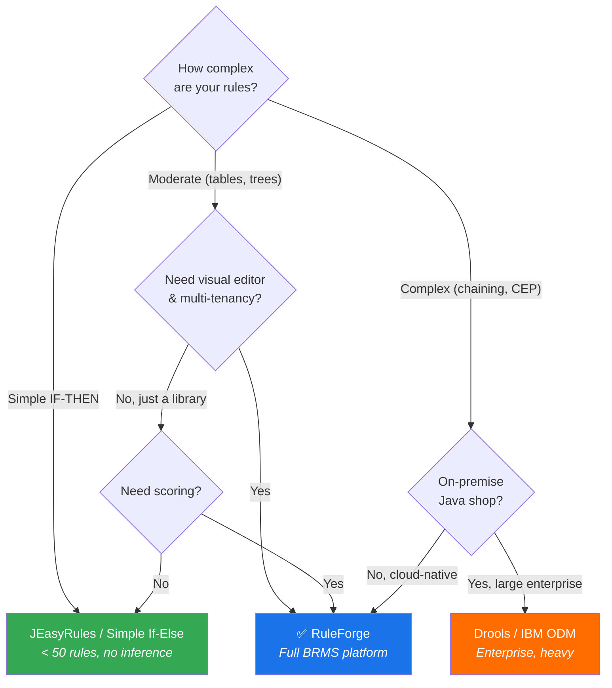
<a id="20-appendices"></a>

### Appendices


#### Appendix A: Engine Module Structure

```
ruleforge-engine/
├── ruleforge-core/                    # Core abstractions, no dependencies
│   ├── model/                         # RuleUnit, RuleMetadata, PriorityVector
│   ├── memory/                        # WorkingMemory, Fact, FactType
│   ├── result/                        # RuleResult, DecisionTrace
│   ├── spi/                           # Extension interfaces
│   └── expression/                    # RFL parser and AST
│
├── ruleforge-table/                   # Decision Table engine
│   ├── compiler/                      # Table → ConditionIndex
│   ├── index/                         # IntervalTree, HashMap, Trie indexes
│   └── evaluator/                     # Table evaluation strategies
│
├── ruleforge-tree/                    # Decision Tree engine
│   ├── compiler/                      # Tree → BDD
│   └── evaluator/                     # Tree traversal
│
├── ruleforge-scorecard/               # Scorecard engine
│   ├── compiler/                      # Scorecard → WeightedEvaluator
│   └── evaluator/                     # Category scoring + aggregation
│
├── ruleforge-flow/                    # Rule Flow orchestrator
│   ├── dag/                           # DAG builder + topological sort
│   ├── nodes/                         # Node type implementations
│   └── orchestrator/                  # Parallel execution engine
│
├── ruleforge-script/                  # Scripting engine (GraalVM)
│   ├── sandbox/                       # Context pool + security
│   └── api/                           # Safe DR API
│
├── ruleforge-cep/                     # Complex Event Processing
│   ├── patterns/                      # Pattern definitions
│   └── streams/                       # Kafka Streams integration
│
├── ruleforge-dmn/                     # DMN 1.4 support
│   ├── parser/                        # DMN XML parser
│   └── feel/                          # FEEL expression evaluator
│
├── ruleforge-ensemble/                # Ensemble rules (voting, averaging)
│
├── ruleforge-hierarchy/               # Hierarchical rule resolution
│
└── ruleforge-spring-boot-starter/     # Spring Boot auto-configuration
```


#### Appendix B: Configuration Reference

```yaml
ruleforge:
  engine:
    # Execution defaults
    default-mode: FIRST_MATCH
    default-timeout: 5s
    max-forward-chain-iterations: 100
    max-script-statements: 500000
    max-flow-depth: 20

    # Cache
    cache:
      l1:
        max-size: 2000
        ttl: 60s
      l2:
        enabled: true
        ttl: 300s
        serialization: PROTOBUF # PROTOBUF | JSON | KRYO

    # Scripting (GraalVM)
    scripting:
      enabled: true
      context-pool-size: 50
      max-execution-time: 5s
      ecmascript-version: "2022"
      allowed-apis: [DR, _math, _date, _str, _arr, console]

    # Compilation
    compilation:
      async: true
      optimization-level: FULL # NONE | BASIC | FULL
      index-threshold: 10 # Min rows before building index

    # Conflict resolution (default chain)
    conflict-resolution:
      chain: [PRIORITY, SPECIFICITY, RECENCY, DECLARATION_ORDER]

    # Observability
    metrics:
      enabled: true
      prefix: ruleforge
      histogram-buckets: [0.001, 0.005, 0.01, 0.05, 0.1, 0.5, 1.0]
    tracing:
      enabled: true
      sample-rate: 0.1 # 10% of requests

    # Extensions
    extensions:
      scan-packages: ["com.company.rules.extensions"]
```


#### Appendix C: Decision Matrix — Build vs. Buy

| Criteria              | Weight | Build Custom | Use Drools | Use JEasyRules + Extend |
| --------------------- | ------ | ------------ | ---------- | ----------------------- |
| Performance at scale  | 0.25   | ★★★★★        | ★★★★       | ★★                      |
| Hierarchical rules    | 0.20   | ★★★★★        | ★★★        | ★                       |
| Weighted scoring      | 0.15   | ★★★★★        | ★★★        | ★                       |
| Embeddable size       | 0.10   | ★★★★         | ★★         | ★★★★★                   |
| Learning curve (team) | 0.10   | ★★★          | ★★         | ★★★★★                   |
| Customizability       | 0.10   | ★★★★★        | ★★★        | ★★★                     |
| Time to market        | 0.05   | ★★           | ★★★★       | ★★★★                    |
| Community/support     | 0.05   | ★★           | ★★★★★      | ★★★                     |
| **Weighted Score**    |        | **4.35**     | **3.25**   | **2.35**                |

**Recommendation:** Build a custom engine. The 45% improvement in weighted score justifies the investment, especially given the competitive requirement for hierarchical rules and weighted scoring that neither Drools nor JEasyRules handle well natively.

<a id="3-rule-metamodel"></a>

For the metamodel, read [engine foundations](#engine-foundations).

## Legacy section links

Earlier headings remain addressable for existing links. Use the reading path above to find their current chapter.

<a id="custom-built-robust-rule-execution-engine"></a>
<a id="ruleforge--rule-engine-core-architecture"></a>
<a id="table-of-contents"></a>
