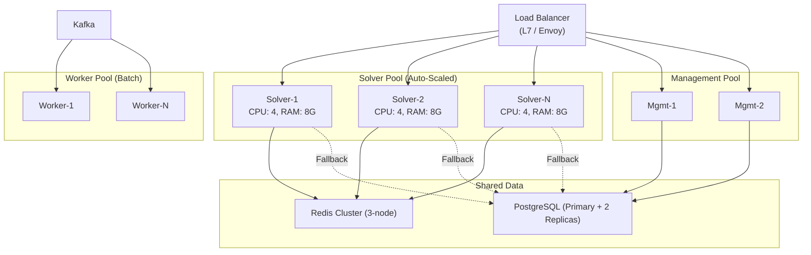
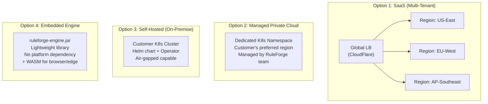
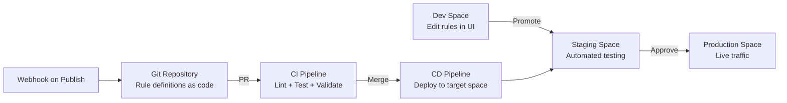

# Enterprise Architecture — RuleForge

**Document role:** Deployment and operating evidence, enterprise decisions, and historical production proposals.
**Editorial revision:** 2026-10-25
**Status:** Draft source inventory; production choices remain unresolved.
**Owner:** Enterprise Architect

## Changelog

- **2026-10-25 · ARC-DOC-001:** Consolidate production proposals from the platform design, improve navigation, and preserve source/evidence boundaries. See [section map](ARCHITECTURE-CHANGELOG.md#arc-doc-001--2026-10-25).

- 2026-10-25: Record a whole-product enterprise inventory from repository deployment and runtime configuration. Preserve the original Spaces-focused architecture separately; accepted ADRs remain unchanged.

## Reading path

Start with the [architecture overview](ARCHITECTURE-SUMMARY.md). Continue to the [platform guide](RuleForge-Architecture-v2.md) for application boundaries, the [engine guide](RuleForge-Engine-Core-Architecture-v2.1.md) for execution internals, or the [enterprise guide](enterprise-architecture.md) for deployment and operations. The [Spaces record](enterprise-architecture-spaces-features.md) preserves historical feature requirements.

## In this guide

- [Scope and Evidence](#scope-and-evidence)
- [1. Deployment Topology](#1-deployment-topology)
- [2. Cloud Provider and Regions](#2-cloud-provider-and-regions)
- [3. Multi-Environment Strategy](#3-multi-environment-strategy)
- [4. CI/CD Pipeline](#4-cicd-pipeline)
- [5. Observability](#5-observability)
- [6. Compliance Posture and Enterprise Controls](#6-compliance-posture-and-enterprise-controls)
- [7. FinOps](#7-finops)
- [8. Disaster Recovery](#8-disaster-recovery)
- [9. Existing Architecture Decisions](#9-existing-architecture-decisions)
- [Decisions and Handoff Boundary](#decisions-and-handoff-boundary)
- [Earlier production proposals](#earlier-production-proposals)

## Scope and Evidence

RuleForge comprises an embeddable Java decision engine and a managed platform for authoring, governing, and executing rules. This document inventories the platform's deployment, operations, and enterprise constraints. Source: [project brief](../project-brief.md).

**Inbound critique: needs_clarification.** The corrected product brief supplies product context. No Business Analyst requirements analysis exists in the current project working tree. Production scale, availability objectives, data residency, regulatory scope, and budget are unknown. Brownfield inventory can proceed; production architecture selection and handoff readiness require those inputs.

Evidence labels:
- **confirmed:** a directly observed repository fact.
- **derived_from_source:** an interpretation of declared configuration.
- **unknown:** no adequate repository or operational evidence.
- **assumption:** an explicit hypothesis requiring validation.

The topology below is declared configuration. Containers, endpoints, controls, backups, and deployments were not exercised. Existing architecture proposals and historical sign-offs do not establish current operating state.

## 1. Deployment Topology

### Declared execution modes

| Mode | Detected topology | Evidence |
|---|---|---|
| Local development | Infrastructure containers plus JVM services, Vite frontend, and optional Python AI process; browser API requests proxy directly to service ports | derived_from_source — [startup script](../../scripts/start-local.sh), [Vite configuration](../../frontend/vite.config.ts), [README](../../README.md) |
| Full Docker stack | Nginx frontend proxies /v1 traffic to Kong; Kong routes to application containers; infrastructure is included from the infrastructure Compose file | derived_from_source — [application Compose](../../infra/docker/docker-compose.yml), [Nginx config](../../frontend/nginx.conf), [Kong config](../../infra/kong/kong.yml) |
| Embedded engine | Consumer Java application hosts the engine independently of the platform deployment | derived_from_source — [engine API](../../engine/ruleforge-core/src/main/java/io/ruleforge/core/RuleForgeEngine.java), [README](../../README.md) |

### Runtime and persistence inventory

| Component | Declared configuration | Boundary / limitation |
|---|---|---|
| Platform | Seven Spring Boot services; host ports 8081–8087; Java 25 runtime images | Service Dockerfiles consume prebuilt JARs; no production placement or scaling configuration established |
| Frontend | Node build stage and Nginx runtime; host port 3000 | Full-stack /v1 proxy targets Kong over HTTP |
| AI service | Python image and Uvicorn; container port 8000, full-stack host port 8088 | Optional in local startup; model-provider credentials and data-processing policy require separate handling |
| PostgreSQL | postgres:16-alpine; pg_data volume; host port 5432 | Volume declaration supplies no backup/restore evidence |
| Redis | redis:7-alpine; 256 MB application memory limit; allkeys-lfu eviction | No persistent volume declared |
| Kafka | apache/kafka:3.7.1; combined broker/controller; offsets-topic replication factor 1; retention 24 hours | No persistent volume declared; no HA established |
| Elasticsearch | Version 9.4.5; single-node; 512 MB minimum/maximum heap; es_data volume | Security disabled in local configuration; no production cluster design established |
| MinIO | latest tag; minio_data volume; host ports 9000/9001 | README reports image pull denial and says no current service uses it |
| Kong | Version 3.6; host ports 8000, 8443, and 8001 | Admin listener binds 0.0.0.0 in Compose; 8443 mapping alone does not prove certificate provisioning |

Sources: [infrastructure Compose](../../infra/docker/docker-compose.infra.yml), [application Compose](../../infra/docker/docker-compose.yml), [sample service Dockerfile](../../platform/ruleforge-auth-service/Dockerfile), [frontend Dockerfile](../../frontend/Dockerfile), [AI Dockerfile](../../ai-service/Dockerfile).

For the declared execution modes, read the table above. Earlier conceptual infrastructure diagrams are grouped under [earlier production proposals](#earlier-production-proposals).

### Configuration gaps to carry forward

- **derived_from_source:** Kafka advertises localhost:9092 while container services bootstrap against kafka:9092. Broker metadata reachability from containers requires validation.
- **derived_from_source:** Kong maps /v1/webhooks to management-service, while the API documentation assigns webhooks to event-service. Solution Architect / Backend Engineer must reconcile routing before claiming Docker-mode API parity.
- **confirmed:** No Kubernetes, Helm, Terraform, or other cloud provisioning configuration was found in the scanned tracked sources.

## 2. Cloud Provider and Regions

| Decision | Current evidence | Required input |
|---|---|---|
| Cloud provider / hosting estate | unknown; local container configuration establishes no provider | Enterprise platform policy and approved hosting requirement |
| Primary region / residency | unknown | Customer locations, data classification, contractual/regulatory requirements |
| Multi-region strategy | unknown | Availability targets, RTO/RPO, cost envelope |
| Portable vs vendor-specific choices | derived_from_source: Docker images and Compose do not select a cloud vendor | Assess managed-service dependencies when a provider is proposed |

No provider, region, managed service, or vendor rejection decision is created by onboarding.

## 3. Multi-Environment Strategy

| Environment | Detection | Infrastructure / promotion / ownership |
|---|---|---|
| Production | No production workflow or infrastructure definition found | unknown; environment boundaries, ownership, release policy, and parity requirements to be agreed |
| Staging | No staging workflow or topology found | unknown; validation gates and deployment responsibility to be agreed |
| Development | Compose, localhost configuration, startup scripts, local logs | derived_from_source; local configuration differs materially from enterprise control requirements |

Application YAML uses ddl-auto: update and disables Flyway startup. The Makefile provides a migration target; the local startup script uses Flyway when present and also contains a SQL fallback path. These are observed development behaviors, not a production migration policy.

Sources: [auth application configuration](../../platform/ruleforge-auth-service/src/main/resources/application.yml), [startup script](../../scripts/start-local.sh), [Makefile](../../Makefile).

## 4. CI/CD Pipeline

**confirmed:** No CI/CD workflow was found under .github/workflows or the other common pipeline paths searched. Existing .github/copilot-instructions.md is developer guidance.

**derived_from_source:** Gradle wrappers, npm scripts, Python project manifests, Maven SDK configuration, Makefile targets, and a live-stack smoke script provide local build/verification entry points. The JVM service Dockerfiles copy build/libs JARs, so a separate build must precede image creation.

[Project gates](../../.bmad/gates.json) declare tests, TypeScript checks, compiled-artifact builds, and a review verdict. Coverage, graph, and security run commands are unconfigured. Declaration is not a successful gate run.

Required decisions: artifact registry, immutable artifact/version strategy, dependency and security gates, environment promotion, release cadence, deployment strategy, rollback procedure, and accountable owners. DevSecOps owns pipeline implementation; no pipeline YAML is generated here.

## 5. Observability

| Signal | Detected configuration | Evidence gap |
|---|---|---|
| Health | Actuator dependency in seven platform services; Dockerfile health checks; AI /health; startup readiness polling | No operational monitoring or alert-delivery evidence |
| Metrics | Application YAML includes health, info, prometheus in endpoint exposure | No explicit Prometheus registry dependency found in scanned build manifests; no scraper/dashboard stack found; live endpoint availability unknown |
| Logs | Local process logs in logs/; runtime container logging | No shared log collection, retention, immutable audit store, or enterprise structured-log standard established |
| Tracing | No explicit tracing backend/instrumentation configuration found | Trace propagation, sampling, retention, and ownership unknown |
| Audit / decision analytics | Application event and analytics features documented | README reports Kafka publication failure; these descriptions cannot establish an effective audit trail |

Sources: [application configuration](../../platform/ruleforge-auth-service/src/main/resources/application.yml), [service build](../../platform/ruleforge-auth-service/build.gradle.kts), [startup script](../../scripts/start-local.sh), [known issues](../../README.md#known-issues).

SLOs/SLIs and targets for availability, execution latency, error rate, throughput, alert routing, and on-call ownership remain unknown. No target values from historical architecture documents are promoted to approved objectives.

## 6. Compliance Posture and Enterprise Controls

**unknown:** Applicable regulatory obligations, data sensitivity, retention, residency, and audit cadence. Example sectors in the project brief do not establish compliance applicability.

| Control concern | Detected signal | Gap / suggested owner |
|---|---|---|
| Identity and tenancy | JWT/API keys, tenant-context code, migration policies and documented organization roles | Effectiveness, least privilege, and access-review policy require SA / InfoSec verification |
| Transport security | Local HTTP routing, plaintext Kafka, Elasticsearch security disabled; broad host-port mappings | Enterprise TLS, certificate lifecycle, network boundaries, and admin-plane exposure require EA / InfoSec / DevSecOps decisions |
| Secret storage | Local Compose/application environment inputs | Enterprise secret manager, workload identity, access policy, and lifecycle are unknown |
| Audit | Application-level audit design and mutation events | Operational completeness, immutable retention, access review, and deployment auditing not established |
| Data handling | Rules, business inputs/results, identity/configuration data, and optional AI provider integration | Product Owner / InfoSec must classify data and assess external processing and residency |

Required enterprise guardrails from the EA role include managed secret storage, TLS, least privilege, audit retention, and explicit data residency. They are review requirements; local configuration is not claimed to satisfy them. No control implementation or compliance certification is asserted.

## 7. FinOps

**confirmed:** No cloud resource definitions, cost-allocation tags, budget resources, or capacity-based cost model were found.

**derived_from_source:** Local configuration supplies a Redis maxmemory setting and Elasticsearch JVM heap settings. These do not define total platform memory, host sizing, production capacity, or a monthly cost.

Open inputs: demand model (throughput, concurrency, rule sizes, retained data), growth, environment count, budget owner, chargeback tags, and billing constraints. Compute commitments and a cost estimate require a chosen platform and workload; no spending commitment is inferred.

## 8. Disaster Recovery

| Stateful component | Persistence evidence | Recovery objectives and verification |
|---|---|---|
| PostgreSQL | Named pg_data volume | RTO, RPO, backup cadence, retention, restore testing, and owner unknown |
| Elasticsearch | Named es_data volume | Recovery/rebuild strategy, dependency on authoritative data, objectives and drills unknown |
| MinIO | Named minio_data volume; current usage disputed by README | Confirm scope before defining object backup and recovery |
| Kafka | No persistent volume declared; local retention 24h and offsets-topic replication factor 1 | Durability, replay/recovery policy, RTO/RPO, and drills unknown |
| Redis | No persistent volume declared; eviction enabled | Confirm cache/token recovery semantics and any authoritative data before defining recovery controls |

Named volumes and source-controlled migrations do not constitute tested backups. No backup jobs, restore runbooks, HA failover evidence, or DR drills were found in the scanned operational sources.

The original feature-scoped document is preserved in the [historical Spaces architecture](enterprise-architecture-spaces-features.md).

## 9. Existing Architecture Decisions

The existing [ADR index](adr/ADR-INDEX.md) records ten Accepted solution decisions. Their status and content are preserved. This document revision creates no new ADRs.

- [ADR-001: Slug Generation Strategy for Spaces](adr/ADR-001-slug-generation.md)
- [ADR-002: ruleCount Computation Strategy](adr/ADR-002-rulecount-strategy.md)
- [ADR-003: Space-Scoped Rule API Design](adr/ADR-003-space-scoped-rule-api.md)
- [ADR-004: Move Rule Implementation Approach](adr/ADR-004-move-copy-rules.md)
- [ADR-005: Detect Sandbox Space by Name](adr/ADR-005-sandbox-detection-by-name.md)
- [ADR-006: Assign-vs-Create Separation — Remove Rule Creation from Space Context](adr/ADR-006-assign-vs-create-separation.md)
- [ADR-007: Webhook Credential Encryption Strategy](adr/ADR-007-webhook-credential-encryption.md)
- [ADR-008: Webhook Auth Injection — Strategy Pattern](adr/ADR-008-webhook-auth-injection-strategy.md)
- [ADR-009: Webhook Delivery Metrics — On-Demand SQL Aggregate](adr/ADR-009-webhook-metrics-storage.md)
- [ADR-010: OAuth 2.0 Token Caching Strategy](adr/ADR-010-oauth2-token-caching-strategy.md)


These ADRs cover Spaces, rule assignment, and webhook decisions. They do not collectively establish a cloud provider, DR objectives, enterprise observability platform, or production CI/CD strategy.

## Decisions and Handoff Boundary

| Required decision / evidence | Suggested owner | Downstream consequence |
|---|---|---|
| BA requirements, workload, criticality and measurable NFRs | Business Analyst / Product Owner | Enables enterprise design choices |
| Hosting, regions, environment separation, capacity and budget | Enterprise Architect / accountable stakeholders | Defines deployment boundaries for SA |
| Data classification, regulatory applicability, trust boundaries | Product Owner / InfoSec | Defines control mapping and residency |
| Pipeline, security gates, secret integration, deployment automation | DevSecOps | Supplies executable operational controls |
| Backup/restore objectives, SLOs, alert routing | EA / operations owner / Product Owner | Supplies operational acceptance requirements |
| Routing and broker connectivity discrepancies | SA / engineering / QE | Establishes trustworthy container-mode behavior |

**Disposition:** needs_clarification for a production architecture mandate. This inventory can inform Solution Architect onboarding after section review. It is not an EA completion sentinel, a Tech Lead GO, a release gate, or permission to provision infrastructure.


## Earlier production proposals

The following material is moved from the February 2026 platform design. It records design options and assumptions for future evaluation. It is not the configuration inventory above, an approved SLO, a chosen provider, a cost quote, or an operating runbook.

| Reference | How to read it |
|---|---|
| Quality attributes and scaling | Candidate targets and example capacity policies; no current load-test or DR evidence |
| Deployment and delivery | Kubernetes, cloud, and promotion examples; no corresponding production estate established |
| Infrastructure tool choices | Earlier candidates requiring platform approval |
| AWS cost worksheet | Historical assumptions only; no current pricing research, budget approval, or provider selection |

<a id="legacy-platform-32-quality-attribute-requirements"></a>

#### Quality Attribute Requirements

| Attribute | Target | Measurement |
|---|---|---|
| **Availability** | 99.95% | Monthly uptime |
| **Latency (P50)** | < 10ms | Single rule execution |
| **Latency (P99)** | < 100ms | Single rule execution |
| **Throughput** | 500K decisions/min per node | Load test |
| **Scalability** | Linear to 100 nodes | Horizontal scale test |
| **Recovery** | RTO < 5min, RPO < 1min | DR drill |
| **Security** | SOC 2 Type II ready | Compliance audit |
<a id="legacy-platform-12-scalability--performance-architecture"></a>

### Scalability & Performance Architecture


<a id="legacy-platform-121-performance-targets"></a>

#### Performance Targets

| Metric | Target | Strategy |
|---|---|---|
| Single rule latency (P50) | < 5ms | In-memory compiled rules, no I/O in hot path |
| Single rule latency (P99) | < 50ms | Warm cache, connection pooling |
| Flow execution (P50) | < 50ms | Parallel node execution, cached sub-rules |
| Bulk solve 1000 inputs | < 2s | Thread pool, batch processing |
| Throughput per node | 8,000+ req/s | Async I/O, non-blocking execution |
| Cluster throughput | 500K+ decisions/min | 10-node cluster |
| Rule compilation | < 500ms | Async background compilation |


<a id="legacy-platform-122-horizontal-scaling-architecture"></a>

#### Horizontal Scaling Architecture




<a id="legacy-platform-123-auto-scaling-policy"></a>

#### Auto-Scaling Policy

```yaml
# Kubernetes HPA for Solver Service
apiVersion: autoscaling/v2
kind: HorizontalPodAutoscaler
metadata:
  name: solver-hpa
spec:
  scaleTargetRef:
    apiVersion: apps/v1
    kind: Deployment
    name: solver-service
  minReplicas: 3
  maxReplicas: 50
  metrics:
    - type: Resource
      resource:
        name: cpu
        target:
          type: Utilization
          averageUtilization: 65
    - type: Pods
      pods:
        metric:
          name: http_requests_per_second
        target:
          type: AverageValue
          averageValue: "5000"
  behavior:
    scaleUp:
      stabilizationWindowSeconds: 30
      policies:
        - type: Pods
          value: 4
          periodSeconds: 60
    scaleDown:
      stabilizationWindowSeconds: 300
      policies:
        - type: Pods
          value: 2
          periodSeconds: 120
```


<a id="legacy-platform-124-performance-optimization-techniques"></a>

#### Performance Optimization Techniques

1. **Compiled Rules:** Rules are compiled to optimized AST/bytecode on publish, not on every execution
2. **Rete-like Indexing:** Decision table conditions are indexed for O(log n) matching
3. **GraalVM Polyglot:** Scripting rules run in pre-warmed GraalVM contexts (not V8/Nashorn)
4. **Connection Pooling:** HikariCP for PostgreSQL, Lettuce for Redis
5. **Async I/O:** Non-blocking Kafka producers, async audit logging
6. **Zero-Copy:** Avoid unnecessary serialization in the execution pipeline
7. **Virtual Threads:** Java 21 virtual threads for high concurrency with low overhead
8. **Result Streaming:** Large bulk results streamed to S3, not buffered in memory
<a id="legacy-platform-14-deployment-architecture"></a>

### Deployment Architecture


<a id="legacy-platform-141-deployment-options"></a>

#### Deployment Options




<a id="legacy-platform-142-kubernetes-deployment"></a>

#### Kubernetes Deployment

```yaml
# Helm values.yaml (simplified)
global:
  domain: ruleforge.example.com
  storageClass: gp3-encrypted

solver:
  replicas: 3
  resources:
    requests: { cpu: "2", memory: "4Gi" }
    limits: { cpu: "4", memory: "8Gi" }
  autoscaling:
    enabled: true
    minReplicas: 3
    maxReplicas: 50
    targetCPUUtilization: 65
  env:
    CACHE_L1_SIZE: "2000"
    CACHE_L2_TTL: "300"
    GRAALVM_SCRIPT_TIMEOUT_MS: "5000"

management:
  replicas: 2
  resources:
    requests: { cpu: "1", memory: "2Gi" }

postgresql:
  primary:
    persistence:
      size: 100Gi
  readReplicas:
    replicaCount: 2

redis:
  architecture: replication
  sentinel:
    enabled: true
  master:
    persistence:
      size: 10Gi

elasticsearch:
  replicas: 3
  persistence:
    size: 200Gi

kafka:
  replicaCount: 3
  persistence:
    size: 100Gi
```


<a id="legacy-platform-143-cicd--gitops-for-rules"></a>

#### CI/CD & GitOps for Rules


<a id="legacy-platform-193-infrastructure"></a>

#### Infrastructure

| Component | Technology | Rationale |
|---|---|---|
| **Container Orchestration** | Kubernetes 1.29+ | Standard for cloud-native |
| **Service Mesh** | Istio (optional) | mTLS, traffic management |
| **CI/CD** | GitHub Actions / ArgoCD | GitOps deployment |
| **Monitoring** | Prometheus + Grafana | Metrics and dashboards |
| **Logging** | OpenTelemetry + Loki | Structured logging |
| **Tracing** | OpenTelemetry + Jaeger | Distributed tracing |
| **Secret Mgmt** | HashiCorp Vault | Secrets, encryption keys |
| **IaC** | Terraform / Pulumi | Infrastructure provisioning |
<a id="legacy-platform-appendix-d-infrastructure-cost-estimate-aws-production"></a>

#### Appendix D: Infrastructure Cost Estimate (AWS, Production)

| Component | Spec | Monthly Cost (est.) |
|---|---|---|
| EKS Cluster | 3 control plane | $220 |
| Solver nodes (3x) | c6g.xlarge (4 vCPU, 8G) | $330 |
| Management nodes (2x) | m6g.large (2 vCPU, 8G) | $150 |
| RDS PostgreSQL | db.r6g.large, Multi-AZ, 100GB | $450 |
| ElastiCache Redis | cache.r6g.large, 3-node | $400 |
| OpenSearch | 3x r6g.large, 200GB | $600 |
| MSK Kafka | kafka.m5.large, 3 broker | $500 |
| ALB | Application Load Balancer | $30 |
| S3 | 500GB + requests | $20 |
| CloudWatch/Monitoring | Logs + metrics | $100 |
| **Total** | | **~$2,800/month** |

*Historical worksheet note: the original author described this as a baseline production setup. Its amounts and assumptions have not been refreshed or adopted.*
