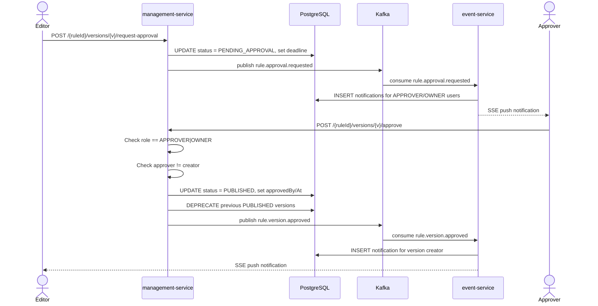
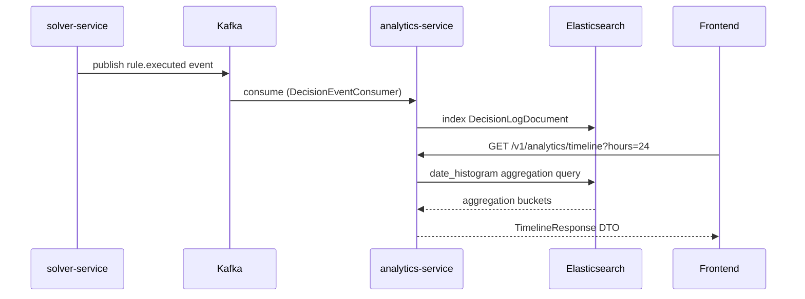
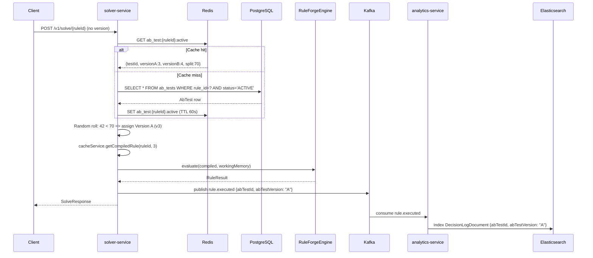

# Feature Sprint 01 — Technical Architecture Document

**Author:** Solution Architect (BMAD)
**Date:** 2026-02-27
**Status:** Accepted
**Scope:** Approvals Enhancement, Analytics Rebuild, A/B Testing Core Fix

---

## Table of Contents

1. [Executive Summary](#1-executive-summary)
2. [Approvals Architecture](#2-approvals-architecture)
3. [Analytics Architecture](#3-analytics-architecture)
4. [A/B Testing Architecture](#4-ab-testing-architecture)
5. [Architecture Decision Records](#5-architecture-decision-records)
6. [Migration Scripts](#6-migration-scripts)
7. [Backward Compatibility](#7-backward-compatibility)

---

## 1. Executive Summary

This document defines the technical architecture for three critical feature enhancements in RuleForge:

1. **Approvals** — RBAC enforcement (APPROVER role), comment threads, notification pipeline, SLA tracking
2. **Analytics** — Replace synthetic frontend data with real Elasticsearch aggregations, add timeline/distribution/percentile endpoints, alerting
3. **A/B Testing** — Fix solver-service to route traffic based on ab_tests table, add results collection via Elasticsearch, statistical significance calculation, winner promotion

### Key Architectural Decisions

| Decision | Choice | Rationale |
|----------|--------|-----------|
| Role check for approvals | JWT claim + management-service validation | No inter-service call needed; role is in JWT |
| Analytics aggregations | Native Elasticsearch queries | Current Java Stream approach loads 10K docs into memory; ES aggregations are O(1) memory |
| A/B test routing | Solver-service reads ab_tests via Redis cache | Sub-millisecond lookup; 60s TTL keeps solver decoupled from management DB |
| Notifications | SSE from event-service + PostgreSQL notification table | Simpler than WebSocket; works with existing Kong gateway |
| Statistical significance | Server-side chi-square + Z-test | Avoids shipping stats libraries to frontend; results cacheable |

---

## 2. Approvals Architecture

### 2.1 Current State Analysis

The approval workflow exists but has critical gaps:

- **VersionController.approveVersion()** extracts `userId` from JWT but performs **no role check** — any authenticated user can approve
- **No comment system** — reviewers cannot provide feedback inline
- **No notifications** — requesters/approvers have no awareness of pending actions
- **No SLA tracking** — approvals can stall indefinitely

### 2.2 RBAC Enhancement

#### 2.2.1 Add APPROVER Role

The existing role enum is `{OWNER, EDITOR, VIEWER}` stored as a string in `members.role`. Add `APPROVER` as a new value.

**Role Hierarchy for Approvals:**
- `OWNER` — can approve (implicit, owns the org)
- `APPROVER` — can approve (explicit approval privilege)
- `EDITOR` — can request approval, cannot approve
- `VIEWER` — read-only, no approval actions

**Implementation: management-service**

The management-service JWT contains `role` in the claims. Add a role check in `VersionService.approve()`:

```java
// In VersionService.approve()
TenantContext.TenantInfo tenant = TenantContext.get();
String role = tenant.role(); // Already propagated from JWT
if (!"OWNER".equals(role) && !"APPROVER".equals(role)) {
    throw new AccessDeniedException("Approval requires APPROVER or OWNER role");
}
// Also prevent self-approval: approver != version creator
if (versionEntity.getCreatedBy().equals(tenant.userId())) {
    throw new ConflictException("Cannot approve your own version");
}
```

**No auth-service changes needed** — the `members.role` column already stores arbitrary strings. The auth-service JWT generation already includes the role claim. We only need to:
1. Allow `APPROVER` as a valid role value in the `UpdateRoleRequest` validation
2. Add `APPROVER` to the `members_role_check` constraint (migration V030)

#### 2.2.2 Self-Approval Prevention

A version creator must not approve their own submission. The `createdBy` field on `RuleVersionEntity` already tracks the author. The check is in the service layer (shown above).

### 2.3 Comment System

#### 2.3.1 Data Model

New table: `rule_version_comments`

```sql
CREATE TABLE rule_version_comments (
    id              UUID PRIMARY KEY DEFAULT gen_random_uuid(),
    rule_id         UUID NOT NULL REFERENCES rules(id) ON DELETE CASCADE,
    version         INT NOT NULL,
    org_id          UUID NOT NULL,
    author_id       UUID NOT NULL,
    body            TEXT NOT NULL,
    parent_id       UUID REFERENCES rule_version_comments(id) ON DELETE CASCADE,
    created_at      TIMESTAMP NOT NULL DEFAULT now(),
    updated_at      TIMESTAMP NOT NULL DEFAULT now()
);

CREATE INDEX idx_rvc_rule_version ON rule_version_comments(rule_id, version);
CREATE INDEX idx_rvc_parent ON rule_version_comments(parent_id);
```

RLS policy: `org_id = current_setting('app.current_org_id')::uuid`

#### 2.3.2 API Endpoints

**management-service** (port 8082):

| Method | Path | Description | Auth |
|--------|------|-------------|------|
| GET | `/v1/rules/{ruleId}/versions/{version}/comments` | List comments (threaded) | VIEWER+ |
| POST | `/v1/rules/{ruleId}/versions/{version}/comments` | Create comment | EDITOR+ |
| PUT | `/v1/rules/{ruleId}/versions/{version}/comments/{commentId}` | Edit comment (author only) | EDITOR+ |
| DELETE | `/v1/rules/{ruleId}/versions/{version}/comments/{commentId}` | Delete comment (author or OWNER) | EDITOR+ |

**Request Schema — Create Comment:**
```json
{
  "body": "Please add edge case handling for null inputs",
  "parentId": null
}
```

**Response Schema — Comment:**
```json
{
  "id": "uuid",
  "ruleId": "uuid",
  "version": 1,
  "authorId": "uuid",
  "authorName": "Jane Smith",
  "body": "Please add edge case handling for null inputs",
  "parentId": null,
  "replies": [],
  "createdAt": "2026-02-27T10:00:00Z",
  "updatedAt": "2026-02-27T10:00:00Z"
}
```

The GET endpoint returns a flat list with `parentId` references. The frontend assembles the thread tree. This avoids recursive SQL queries and simplifies pagination.

#### 2.3.3 Events

On comment creation, publish to `rule.lifecycle` topic:
```json
{
  "eventType": "rule.version.commented",
  "aggregateId": "<ruleId>",
  "payload": {
    "version": 1,
    "commentId": "uuid",
    "authorId": "uuid",
    "parentId": null
  }
}
```

Event-service consumes this and:
1. Creates a notification record for the version creator and any APPROVER members in the org
2. Delivers to registered webhooks

### 2.4 Notification Pipeline

#### 2.4.1 Data Model

New table: `notifications`

```sql
CREATE TABLE notifications (
    id              UUID PRIMARY KEY DEFAULT gen_random_uuid(),
    org_id          UUID NOT NULL,
    user_id         UUID NOT NULL,
    type            VARCHAR(50) NOT NULL,
    title           VARCHAR(255) NOT NULL,
    body            TEXT,
    resource_type   VARCHAR(50),
    resource_id     VARCHAR(255),
    read            BOOLEAN NOT NULL DEFAULT false,
    created_at      TIMESTAMP NOT NULL DEFAULT now()
);

CREATE INDEX idx_notifications_user_unread ON notifications(user_id, read) WHERE read = false;
CREATE INDEX idx_notifications_user_created ON notifications(user_id, created_at DESC);
```

RLS policy: `org_id = current_setting('app.current_org_id')::uuid`

#### 2.4.2 Notification Types

| Event | Notification Recipients | Title Template |
|-------|------------------------|----------------|
| `rule.approval.requested` | All APPROVER + OWNER members in org | "Approval requested for {ruleName} v{version}" |
| `rule.version.approved` | Version creator | "{ruleName} v{version} has been approved" |
| `rule.version.rejected` | Version creator | "{ruleName} v{version} was rejected" |
| `rule.version.commented` | Version creator + previous commenters | "New comment on {ruleName} v{version}" |
| `analytics.alert.triggered` | All OWNER members in org | "Alert: {alertName} threshold exceeded" |

#### 2.4.3 API Endpoints

**event-service** (port 8084):

| Method | Path | Description |
|--------|------|-------------|
| GET | `/v1/notifications` | List notifications for current user (paginated, newest first) |
| GET | `/v1/notifications/unread-count` | Get unread count (for badge) |
| POST | `/v1/notifications/mark-read` | Mark notification(s) as read |
| POST | `/v1/notifications/mark-all-read` | Mark all as read |

**Request — Mark Read:**
```json
{
  "notificationIds": ["uuid1", "uuid2"]
}
```

#### 2.4.4 Real-Time Delivery (SSE)

**Reuse existing SSE infrastructure.** Event-service already has `NotificationController` at `/v1/events/stream` with:
- `SseEmitter` registry keyed by `orgId` (`ConcurrentHashMap<UUID, CopyOnWriteArrayList<SseEmitter>>`)
- 30-minute emitter timeout with auto-cleanup
- 5-second poll-and-push loop (`@Scheduled(fixedDelay = 5000)`)

The existing controller polls `AuditEventRepository` for new events. To add notification delivery:

1. **Extend `pollAndPush()`** to also query the new `notifications` table for unread notifications created since `lastPollTime`
2. **Add user-level filtering** — the current system broadcasts all org events to all org emitters. For notifications, filter by `user_id` matching the emitter's authenticated user. This requires storing `(userId, SseEmitter)` pairs instead of bare `SseEmitter` in the emitter list.
3. **Send as a distinct SSE event name** — use `event.name("user-notification")` to differentiate from the existing `"notification"` event name used for audit events. This lets the frontend subscribe to the right event type.

No new SSE endpoint needed. The frontend connects to the existing `/v1/events/stream` and listens for both `notification` (audit events) and `user-notification` (personal notifications) event names.

**Fallback:** Frontend polls `/v1/notifications/unread-count` every 60 seconds if SSE connection drops.

**Scalability Note:** SSE with in-memory emitter registry works for single-instance event-service. For multi-instance, use Redis Pub/Sub to broadcast notifications to all event-service instances. This is a Phase 2 concern — single instance is sufficient for current scale.

### 2.5 SLA Tracking

#### 2.5.1 Data Model Changes

Add columns to `rule_versions`:

```sql
ALTER TABLE rule_versions ADD COLUMN IF NOT EXISTS approval_deadline TIMESTAMP;
ALTER TABLE rule_versions ADD COLUMN IF NOT EXISTS sla_hours INT DEFAULT 48;
```

When `requestApproval()` is called:
```java
versionEntity.setApprovalDeadline(Instant.now().plus(slaHours, ChronoUnit.HOURS));
```

#### 2.5.2 Scheduler Job

Scheduler-service (port 8086) adds a Quartz job:

- **Job:** `ApprovalSlaCheckJob`
- **Schedule:** Every 15 minutes
- **Logic:** Query `rule_versions WHERE status = 'PENDING_APPROVAL' AND approval_deadline < now()`
- **Action:** Publish `rule.approval.overdue` event to Kafka
- **Notification:** Event-service creates notifications for APPROVER + OWNER members

### 2.6 Sequence Diagram — Approval Flow



---

## 3. Analytics Architecture

### 3.1 Current State Analysis

**Critical Issues:**
1. `AnalyticsService.getDashboardMetrics()` loads up to 10,000 documents into JVM heap and computes aggregations using Java Streams — this is O(n) memory and will fail at scale
2. `AnalyticsDashboardPage.tsx` generates **synthetic jitter data** on the client side (lines 47-92) rather than querying the API
3. No timeline, distribution, or percentile endpoints exist
4. No alerting capability

### 3.2 Elasticsearch Aggregation Endpoints

Replace in-memory Java Stream aggregations with native Elasticsearch aggregation queries. All new endpoints are on analytics-service (port 8085).

#### 3.2.1 Execution Timeline

```
GET /v1/analytics/timeline?hours=24&interval=1h
```

**Elasticsearch Query:**
```json
{
  "size": 0,
  "query": {
    "bool": {
      "filter": [
        { "term": { "orgId": "<orgId>" } },
        { "range": { "timestamp": { "gte": "now-24h" } } }
      ]
    }
  },
  "aggs": {
    "timeline": {
      "date_histogram": {
        "field": "timestamp",
        "fixed_interval": "1h",
        "min_doc_count": 0,
        "extended_bounds": {
          "min": "now-24h",
          "max": "now"
        }
      },
      "aggs": {
        "avg_latency": { "avg": { "field": "executionTimeMs" } },
        "errors": {
          "filter": { "term": { "status": "ERROR" } }
        }
      }
    }
  }
}
```

**Response DTO:**
```json
{
  "interval": "1h",
  "buckets": [
    {
      "timestamp": "2026-02-27T00:00:00Z",
      "count": 1523,
      "avgLatencyMs": 12.4,
      "errorCount": 3
    }
  ]
}
```

#### 3.2.2 Rule Type Distribution

```
GET /v1/analytics/type-distribution?hours=24
```

**Elasticsearch:** `terms` aggregation on `ruleType` field.

**Response:**
```json
{
  "buckets": [
    { "ruleType": "TABLE", "count": 5230 },
    { "ruleType": "TREE", "count": 2100 },
    { "ruleType": "SCORECARD", "count": 890 }
  ]
}
```

#### 3.2.3 Latency Percentiles

```
GET /v1/analytics/latency-percentiles?hours=24
```

**Elasticsearch:** `percentiles` aggregation on `executionTimeMs`.

**Response:**
```json
{
  "p50": 8.2,
  "p75": 15.1,
  "p90": 28.7,
  "p95": 45.3,
  "p99": 120.0,
  "avg": 12.4,
  "max": 350
}
```

#### 3.2.4 Pass/Fail Breakdown

```
GET /v1/analytics/pass-fail?hours=24
```

**Elasticsearch:** `filters` aggregation with `status` term filters.

**Response:**
```json
{
  "total": 8220,
  "success": 8150,
  "error": 70,
  "errorRate": 0.0085
}
```

#### 3.2.5 Enhanced Dashboard Metrics

The existing `/v1/analytics/dashboard` endpoint will be **refactored** to use ES aggregations instead of Java Streams:

```
GET /v1/analytics/dashboard?hours=24
```

**Implementation:** Single multi-aggregation ES query combining:
- `value_count` for total decisions
- `avg` for execution time
- `filter` for error count
- `terms` on `ruleId` with sub-aggs for top-10 rules

This replaces the current `PageRequest.of(0, 10000)` pattern that loads all documents into memory.

#### 3.2.6 Decision Log Search with Expansion

Enhance existing `/v1/analytics/decisions` endpoint:

```
GET /v1/analytics/decisions?ruleId=&from=&to=&page=&size=&expand=true
```

When `expand=true`, include `inputFacts` and `outputResult` in the response. Default: omit these large fields.

#### 3.2.7 CSV Export

```
GET /v1/analytics/decisions/export.csv?ruleId=&from=&to=
```

**Implementation:**
- Uses Elasticsearch scroll API for streaming
- Returns `Content-Type: text/csv` with `Content-Disposition: attachment`
- Streams rows without buffering entire result set
- Max 100,000 rows per export (configurable)

### 3.3 Frontend Real-Time Polling

No WebSocket needed. The frontend dashboard will poll:

```typescript
// Auto-refresh toggle (default: off)
const { data } = useQuery(['dashboard', orgId, hours], fetchDashboard, {
  refetchInterval: autoRefresh ? 30_000 : false,
});
```

This is sufficient for analytics dashboards where sub-second latency is not required.

### 3.4 Alert System

#### 3.4.1 Data Model

New table: `analytics_alerts`

```sql
CREATE TABLE analytics_alerts (
    id                UUID PRIMARY KEY DEFAULT gen_random_uuid(),
    org_id            UUID NOT NULL,
    rule_id           UUID,
    name              VARCHAR(255) NOT NULL,
    metric            VARCHAR(50) NOT NULL,
    threshold         DOUBLE PRECISION NOT NULL,
    comparison        VARCHAR(10) NOT NULL,
    enabled           BOOLEAN NOT NULL DEFAULT true,
    cooldown_minutes  INT NOT NULL DEFAULT 60,
    last_triggered_at TIMESTAMP,
    created_by        UUID NOT NULL,
    created_at        TIMESTAMP NOT NULL DEFAULT now(),
    updated_at        TIMESTAMP NOT NULL DEFAULT now(),
    CONSTRAINT analytics_alerts_metric_check
        CHECK (metric IN ('ERROR_RATE', 'AVG_LATENCY', 'P95_LATENCY', 'THROUGHPUT')),
    CONSTRAINT analytics_alerts_comparison_check
        CHECK (comparison IN ('GT', 'LT', 'GTE', 'LTE'))
);

CREATE INDEX idx_analytics_alerts_org ON analytics_alerts(org_id) WHERE enabled = true;
```

RLS policy: `org_id = current_setting('app.current_org_id')::uuid`

#### 3.4.2 Alert API Endpoints

**analytics-service** (port 8085):

| Method | Path | Description |
|--------|------|-------------|
| POST | `/v1/analytics/alerts` | Create alert rule |
| GET | `/v1/analytics/alerts` | List alert rules for org |
| PUT | `/v1/analytics/alerts/{id}` | Update alert rule |
| DELETE | `/v1/analytics/alerts/{id}` | Delete alert rule |
| GET | `/v1/analytics/alerts/{id}/history` | Get trigger history |

**Create Alert Request:**
```json
{
  "name": "High Error Rate - Pricing Rules",
  "ruleId": "uuid (optional, null for org-wide)",
  "metric": "ERROR_RATE",
  "threshold": 0.05,
  "comparison": "GT",
  "cooldownMinutes": 60
}
```

#### 3.4.3 Alert Evaluation

**Scheduler-service** adds a Quartz job:

- **Job:** `AnalyticsAlertEvaluationJob`
- **Schedule:** Every 5 minutes
- **Logic:**
  1. Query all enabled alerts from `analytics_alerts`
  2. For each alert, query ES for the metric over the last 15 minutes
  3. Compare against threshold
  4. If triggered and cooldown elapsed, publish `analytics.alert.triggered` to Kafka
  5. Update `last_triggered_at`

**Event-service** consumes `analytics.alert.triggered`:
- Creates notification for all OWNER members in the org
- Delivers to registered webhooks

### 3.5 Sequence Diagram — Analytics Pipeline



### 3.6 Scalability Considerations

| Concern | Current | Proposed |
|---------|---------|----------|
| Dashboard query | Load 10K docs into JVM heap | ES aggregation (zero docs transferred) |
| Per-rule stats | Load 10K docs + Java Streams | ES terms + stats aggregation |
| Data retention | Unbounded single index | Add ILM policy: hot (7d) -> warm (30d) -> delete (90d) |
| Export | N/A | Scroll API with streaming response |
| Alert evaluation | N/A | Batch query per alert; max 100 alerts/org |

**Elasticsearch Index Lifecycle Management (ILM):**
```json
{
  "policy": {
    "phases": {
      "hot": { "min_age": "0ms", "actions": { "rollover": { "max_size": "50gb", "max_age": "7d" } } },
      "warm": { "min_age": "7d", "actions": { "readonly": {} } },
      "delete": { "min_age": "90d", "actions": { "delete": {} } }
    }
  }
}
```

---

## 4. A/B Testing Architecture

### 4.1 Current State Analysis

**Critical Issue:** The solver-service **ignores the ab_tests table entirely**. When a rule has an active A/B test, the solver still serves the latest published version. The A/B test entity in management-service is purely a data record with no execution-side integration.

**What exists:**
- `ab_tests` table with `rule_id`, `version_a`, `version_b`, `traffic_split`, `status`
- `AbTestService` CRUD operations in management-service
- `AbTestController` with create/start/stop/delete endpoints
- No connection to solver-service

**What is missing:**
- Solver traffic routing based on A/B test configuration
- Execution tagging with A/B test metadata
- Results collection per A/B test
- Statistical significance calculation
- Winner promotion workflow

### 4.2 Solver Traffic Routing (Core Fix)

#### 4.2.1 Architecture

The solver-service needs to:
1. Check if the requested rule has an ACTIVE A/B test
2. Route traffic to version A or B based on `trafficSplit`
3. Tag the execution event with the A/B test ID and assigned version

**Data Flow:**
```
management-service (ab_tests table)
    |
    | Kafka event: ab_test.started / ab_test.stopped
    v
solver-service (Redis cache: ab_test:{ruleId}:active)
    |
    | On each solve() call: check cache
    v
Version A (trafficSplit% traffic) or Version B ((100 - trafficSplit)% traffic)
```

#### 4.2.2 Redis Cache for A/B Test Lookup

**Key pattern:** `ab_test:{ruleId}:active`

**Value (JSON):**
```json
{
  "testId": "uuid",
  "versionA": 3,
  "versionB": 4,
  "trafficSplit": 70
}
```

**TTL:** 60 seconds (cache miss falls through to DB query)

**Cache population:** Two mechanisms:
1. **Event-driven:** Management-service publishes `ab_test.started` and `ab_test.stopped` events to Kafka. Solver-service's `CacheInvalidationListener` consumes these and populates/evicts the Redis key.
2. **Lazy load:** On cache miss, solver-service queries management-service's internal API or directly queries the `ab_tests` table (solver already has a read-only PG connection).

**Recommendation:** Use lazy load from PG (solver already has `SolverRuleRepository`). Add a `SolverAbTestRepository` with a simple query. This avoids adding a new Kafka consumer and cross-service API dependency.

#### 4.2.3 SolverService Changes

```java
// In SolverService.solve()
public SolveResponse solve(String ruleIdOrAlias, Integer version, SolveRequest request) {
    long startNanos = System.nanoTime();

    // 1. Check for active A/B test (only if no explicit version requested)
    AbTestAssignment abAssignment = null;
    if (version == null) {
        abAssignment = abTestRouter.route(ruleIdOrAlias);
    }

    // 2. Load compiled rule
    int resolvedVersion = abAssignment != null
        ? abAssignment.assignedVersion()
        : (version != null ? version : LATEST_PUBLISHED);
    CompiledRule compiled = cacheService.getCompiledRule(ruleIdOrAlias, resolvedVersion);

    // 3-5. Evaluate (unchanged)
    WorkingMemory workingMemory = new WorkingMemory();
    workingMemory.loadFromMap(request.input());
    RuleResult result = engine.evaluate(compiled, workingMemory);
    long elapsedMs = (System.nanoTime() - startNanos) / 1_000_000;

    // 6. Publish execution event WITH A/B test metadata
    publishExecutionEvent(compiled, result, elapsedMs, abAssignment);

    return mapToResponse(compiled, result, elapsedMs);
}
```

#### 4.2.4 AbTestRouter

New class in solver-service:

```java
@Component
public class AbTestRouter {
    private final RedisTemplate<String, String> redis;
    private final SolverAbTestRepository abTestRepository;
    private final ThreadLocalRandom random = ThreadLocalRandom.current();

    public AbTestAssignment route(String ruleId) {
        // 1. Check Redis cache
        String key = "ab_test:" + ruleId + ":active";
        String cached = redis.opsForValue().get(key);

        AbTestConfig config;
        if (cached != null) {
            config = deserialize(cached);
        } else {
            // 2. Query PG for active test
            config = abTestRepository.findActiveByRuleId(UUID.fromString(ruleId))
                .map(this::toConfig)
                .orElse(null);
            // 3. Cache result (even null, as "no_test" sentinel)
            redis.opsForValue().set(key,
                config != null ? serialize(config) : "none",
                Duration.ofSeconds(60));
        }

        if (config == null) return null;

        // 4. Random assignment based on traffic split
        int roll = random.nextInt(100);
        String assignedLabel = roll < config.trafficSplit() ? "A" : "B";
        int assignedVersion = "A".equals(assignedLabel)
            ? config.versionA() : config.versionB();

        return new AbTestAssignment(config.testId(), assignedLabel, assignedVersion);
    }
}

record AbTestAssignment(UUID testId, String label, int assignedVersion) {}
record AbTestConfig(UUID testId, int versionA, int versionB, int trafficSplit) {}
```

#### 4.2.5 Execution Event Enhancement

Add A/B test metadata to the `rule.executed` Kafka event payload:

```java
Map<String, Object> payload = new HashMap<>(Map.of(
    "ruleType", compiled.type().name(),
    "executionTimeMs", elapsedMs,
    "rulesEvaluated", result.metadata() != null ? result.metadata().rulesEvaluated() : 0,
    "rulesMatched", result.matchedRules() != null ? result.matchedRules().size() : 0,
    "hasOutput", result.hasOutput()
));

if (abAssignment != null) {
    payload.put("abTestId", abAssignment.testId().toString());
    payload.put("abTestVersion", abAssignment.label());
}
```

### 4.3 Results Collection

#### 4.3.1 Elasticsearch Document Enhancement

Add fields to `DecisionLogDocument`:

```java
@Field(type = FieldType.Keyword)
private String abTestId;

@Field(type = FieldType.Keyword)
private String abTestVersion;  // "A" or "B"
```

The `DecisionEventConsumer` in analytics-service already maps from Kafka event payload to document fields. Adding these two fields requires mapping them from the event payload:

```java
if (payload.containsKey("abTestId")) {
    doc.setAbTestId((String) payload.get("abTestId"));
    doc.setAbTestVersion((String) payload.get("abTestVersion"));
}
```

#### 4.3.2 A/B Test Results Endpoint

**analytics-service** (port 8085):

```
GET /v1/analytics/ab-tests/{testId}/results
```

**Elasticsearch Query:**
```json
{
  "size": 0,
  "query": {
    "bool": {
      "filter": [
        { "term": { "orgId": "<orgId>" } },
        { "term": { "abTestId": "<testId>" } }
      ]
    }
  },
  "aggs": {
    "by_version": {
      "terms": { "field": "abTestVersion" },
      "aggs": {
        "count": { "value_count": { "field": "abTestVersion" } },
        "avg_latency": { "avg": { "field": "executionTimeMs" } },
        "p95_latency": { "percentiles": { "field": "executionTimeMs", "percents": [95] } },
        "errors": { "filter": { "term": { "status": "ERROR" } } }
      }
    }
  }
}
```

**Response:**
```json
{
  "testId": "uuid",
  "versionA": {
    "label": "A",
    "version": 3,
    "executions": 7000,
    "errors": 35,
    "errorRate": 0.005,
    "avgLatencyMs": 12.3,
    "p95LatencyMs": 45.2
  },
  "versionB": {
    "label": "B",
    "version": 4,
    "executions": 3000,
    "errors": 21,
    "errorRate": 0.007,
    "avgLatencyMs": 10.1,
    "p95LatencyMs": 38.7
  },
  "totalExecutions": 10000
}
```

### 4.4 Statistical Significance

#### 4.4.1 Endpoint

```
GET /v1/analytics/ab-tests/{testId}/significance
```

**Response:**
```json
{
  "testId": "uuid",
  "metric": "ERROR_RATE",
  "winner": "B",
  "confidence": 0.95,
  "pValue": 0.023,
  "significant": true,
  "sampleSizeA": 7000,
  "sampleSizeB": 3000,
  "minimumSampleSize": 1000,
  "recommendation": "Version B has a statistically significant lower error rate (p=0.023)"
}
```

#### 4.4.2 Implementation

Analytics-service implements two statistical tests:

1. **Chi-square test** for error rate comparison:
   - H0: Error rates are equal
   - Compute chi-square statistic from 2x2 contingency table (success/error x version A/B)
   - Compare against chi-square critical value at alpha=0.05 (3.841 for df=1)

2. **Two-sample Z-test** for mean latency comparison:
   - H0: Mean latencies are equal
   - Z = (mean_A - mean_B) / sqrt(var_A/n_A + var_B/n_B)
   - Compare |Z| against 1.96 for alpha=0.05

**Minimum sample size:** 1000 executions per version before significance can be calculated. Below this threshold, return `"significant": false, "recommendation": "Insufficient data"`.

**No external library needed** — chi-square and Z-test are simple formulas implementable in ~30 lines of Java.

### 4.5 Winner Promotion

#### 4.5.1 Endpoint

```
POST /v1/rules/{ruleId}/ab-tests/{testId}/promote?winner=A|B
```

**management-service** implementation:

```java
@Transactional
public AbTestDto promoteWinner(UUID ruleId, UUID testId, String winner) {
    AbTestEntity test = findOrThrow(testId);
    if (!"ACTIVE".equals(test.getStatus())) {
        throw new ConflictException("Can only promote winner of an ACTIVE test");
    }

    int winnerVersion = "A".equals(winner) ? test.getVersionA() : test.getVersionB();

    // 1. Stop the test
    test.setStatus("COMPLETED");
    abTestRepository.save(test);

    // 2. Publish the winning version (delegates to VersionService.publishVersion)
    versionService.publishVersion(ruleId, winnerVersion);

    // 3. Invalidate Redis cache
    // Publish cache invalidation event
    eventPublisher.publish("rule.lifecycle", DomainEvent.create(
        "ab_test.winner_promoted",
        "AbTest", testId.toString(), orgId, userId,
        Map.of("ruleId", ruleId.toString(), "winner", winner,
               "winnerVersion", winnerVersion)
    ));

    return toDto(test);
}
```

**Solver-service** on receiving `ab_test.winner_promoted`:
- Evicts `ab_test:{ruleId}:active` from Redis
- Evicts compiled rule cache entries for both versions
- Subsequent requests will load the newly published version normally

### 4.6 Updated API Summary

**management-service** (port 8082):

| Method | Path | Description | New? |
|--------|------|-------------|------|
| GET | `/v1/rules/{ruleId}/ab-tests` | List A/B tests for rule | Existing |
| POST | `/v1/rules/{ruleId}/ab-tests` | Create A/B test | Existing |
| POST | `/v1/rules/{ruleId}/ab-tests/{testId}/start` | Start test | Existing |
| POST | `/v1/rules/{ruleId}/ab-tests/{testId}/stop` | Stop test | Existing |
| POST | `/v1/rules/{ruleId}/ab-tests/{testId}/promote` | Promote winner | **New** |
| DELETE | `/v1/rules/{ruleId}/ab-tests/{testId}` | Delete test | Existing |

**analytics-service** (port 8085):

| Method | Path | Description | New? |
|--------|------|-------------|------|
| GET | `/v1/analytics/ab-tests/{testId}/results` | Get A/B test results | **New** |
| GET | `/v1/analytics/ab-tests/{testId}/significance` | Get statistical significance | **New** |

### 4.7 Sequence Diagram — A/B Test Execution



### 4.8 Caching Strategy

| Cache Key | Storage | TTL | Invalidation |
|-----------|---------|-----|--------------|
| `ab_test:{ruleId}:active` | Redis | 60s | On `ab_test.started`/`ab_test.stopped`/`ab_test.winner_promoted` events |
| `tenant:{orgId}:rule:{ruleId}:{version}:compiled` | Redis (L2) + Caffeine (L1) | L1: 5min, L2: 30min | On version publish/deprecate events |
| `none` sentinel for rules without A/B test | Redis | 60s | Prevents repeated PG lookups for rules without tests |

---

## 5. Architecture Decision Records

### ADR-001: Role-Based Approval Enforcement in Service Layer

**Status:** Accepted

**Context:** The current approve endpoint accepts any authenticated user. We need to restrict approvals to authorized roles.

**Decision:** Enforce RBAC in the management-service layer by checking the `role` claim from the JWT. Do not add a separate authorization service.

**Rationale:**
1. The JWT already contains the user's role (set during authentication)
2. Adding an authorization service or inter-service call adds latency and a failure point
3. The role check is a single string comparison, trivially fast
4. Self-approval prevention uses the existing `createdBy` field

**Consequences:**
- Positive: Zero latency overhead, no new dependencies
- Negative: If role semantics become complex (e.g., per-space roles), this will need refactoring
- Accepted risk: JWT role is set at login time; role changes take effect on next login

### ADR-002: Elasticsearch Native Aggregations Over Java Stream Processing

**Status:** Accepted

**Context:** The current analytics service loads up to 10,000 documents into JVM heap and processes them with Java Streams. This approach does not scale beyond ~50K documents and wastes network bandwidth.

**Decision:** Replace all analytics aggregations with native Elasticsearch aggregation queries. The service layer sends an aggregation query and receives only the computed result — no raw documents are transferred.

**Rationale:**
1. ES aggregations execute within the search engine's optimized data structures
2. Network transfer drops from megabytes (raw docs) to kilobytes (aggregation results)
3. Memory usage becomes O(1) regardless of document count
4. ES supports all required aggregation types natively: `date_histogram`, `terms`, `stats`, `percentiles`, `filters`

**Consequences:**
- Positive: 100x+ reduction in memory usage and network transfer
- Positive: Enables real-time dashboards at million-document scale
- Negative: Requires learning the ES aggregation DSL
- Negative: Harder to unit test (need ES testcontainer or mock)

### ADR-003: Solver-Side A/B Test Routing with Redis Cache

**Status:** Accepted

**Context:** A/B test traffic routing must happen in the solver-service (the execution entry point). The solver needs to know which A/B tests are active without adding significant latency to each request.

**Decision:** Solver reads A/B test configuration from Redis (60s TTL cache) with PostgreSQL as the fallback. Random traffic assignment happens in-process.

**Rationale:**
1. Redis lookup adds <1ms latency (acceptable for a feature that saves hours of manual testing)
2. 60s TTL means test start/stop takes at most 60s to propagate (acceptable for non-real-time changes)
3. PG fallback ensures correctness even if Redis is down
4. In-process random assignment is simpler and faster than a dedicated traffic-routing service
5. Event-driven invalidation provides faster propagation when Kafka is healthy

**Alternatives Rejected:**
- **API call to management-service per request:** Adds 5-20ms latency per solve request; unacceptable
- **Solver polls PG every request:** Adds 2-5ms latency; Redis is 10x faster
- **Client-side routing (frontend decides):** Breaks API-key-based execution from external systems

**Consequences:**
- Positive: Sub-millisecond routing overhead
- Negative: A/B test changes take up to 60s to propagate (mitigated by event-driven invalidation)
- Accepted risk: If Redis and PG are both down, A/B routing is skipped and latest published version is used (graceful degradation)

### ADR-004: Server-Side Statistical Significance Calculation

**Status:** Accepted

**Context:** A/B test results need statistical significance analysis to determine if differences between versions are meaningful.

**Decision:** Implement chi-square test (for proportions like error rate) and two-sample Z-test (for means like latency) in the analytics-service. No external statistics library.

**Rationale:**
1. Both tests are simple formulas (10-20 lines of code each)
2. No need for Apache Commons Math or similar heavyweight dependency
3. Results are cacheable and can be computed on-demand
4. Minimum sample size (1000/version) prevents premature conclusions
5. Server-side computation means all clients (web, API, SDK) get consistent results

**Consequences:**
- Positive: No new dependencies
- Positive: Consistent significance calculation across all clients
- Negative: Limited to two test types (sufficient for MVP; Bayesian methods are a Phase 2 consideration)

---

## 6. Migration Scripts

### V030 — Approvals Enhancement

```sql
-- V030__approvals_enhancement.sql

-- 1. Add APPROVER to members role check
ALTER TABLE members DROP CONSTRAINT IF EXISTS members_role_check;
ALTER TABLE members ADD CONSTRAINT members_role_check
    CHECK (role IN ('OWNER', 'APPROVER', 'EDITOR', 'VIEWER'));

-- 2. Add SLA columns to rule_versions
ALTER TABLE rule_versions ADD COLUMN IF NOT EXISTS approval_deadline TIMESTAMP;
ALTER TABLE rule_versions ADD COLUMN IF NOT EXISTS sla_hours INT DEFAULT 48;

-- 3. Create rule_version_comments table
CREATE TABLE IF NOT EXISTS rule_version_comments (
    id              UUID PRIMARY KEY DEFAULT gen_random_uuid(),
    rule_id         UUID NOT NULL REFERENCES rules(id) ON DELETE CASCADE,
    version         INT NOT NULL,
    org_id          UUID NOT NULL,
    author_id       UUID NOT NULL,
    body            TEXT NOT NULL,
    parent_id       UUID REFERENCES rule_version_comments(id) ON DELETE CASCADE,
    created_at      TIMESTAMP NOT NULL DEFAULT now(),
    updated_at      TIMESTAMP NOT NULL DEFAULT now()
);

CREATE INDEX IF NOT EXISTS idx_rvc_rule_version ON rule_version_comments(rule_id, version);
CREATE INDEX IF NOT EXISTS idx_rvc_parent ON rule_version_comments(parent_id);

-- 4. Create notifications table
CREATE TABLE IF NOT EXISTS notifications (
    id              UUID PRIMARY KEY DEFAULT gen_random_uuid(),
    org_id          UUID NOT NULL,
    user_id         UUID NOT NULL,
    type            VARCHAR(50) NOT NULL,
    title           VARCHAR(255) NOT NULL,
    body            TEXT,
    resource_type   VARCHAR(50),
    resource_id     VARCHAR(255),
    read            BOOLEAN NOT NULL DEFAULT false,
    created_at      TIMESTAMP NOT NULL DEFAULT now()
);

CREATE INDEX IF NOT EXISTS idx_notifications_user_unread
    ON notifications(user_id, read) WHERE read = false;
CREATE INDEX IF NOT EXISTS idx_notifications_user_created
    ON notifications(user_id, created_at DESC);
```

### V031 — Analytics Alerts

```sql
-- V031__analytics_alerts.sql

CREATE TABLE IF NOT EXISTS analytics_alerts (
    id                UUID PRIMARY KEY DEFAULT gen_random_uuid(),
    org_id            UUID NOT NULL,
    rule_id           UUID,
    name              VARCHAR(255) NOT NULL,
    metric            VARCHAR(50) NOT NULL,
    threshold         DOUBLE PRECISION NOT NULL,
    comparison        VARCHAR(10) NOT NULL,
    enabled           BOOLEAN NOT NULL DEFAULT true,
    cooldown_minutes  INT NOT NULL DEFAULT 60,
    last_triggered_at TIMESTAMP,
    created_by        UUID NOT NULL,
    created_at        TIMESTAMP NOT NULL DEFAULT now(),
    updated_at        TIMESTAMP NOT NULL DEFAULT now(),
    CONSTRAINT analytics_alerts_metric_check
        CHECK (metric IN ('ERROR_RATE', 'AVG_LATENCY', 'P95_LATENCY', 'THROUGHPUT')),
    CONSTRAINT analytics_alerts_comparison_check
        CHECK (comparison IN ('GT', 'LT', 'GTE', 'LTE'))
);

CREATE INDEX IF NOT EXISTS idx_analytics_alerts_org
    ON analytics_alerts(org_id) WHERE enabled = true;
```

### V032 — RLS for New Tables

```sql
-- V032__rls_new_tables.sql

-- RLS for rule_version_comments
ALTER TABLE rule_version_comments ENABLE ROW LEVEL SECURITY;
CREATE POLICY rule_version_comments_org_isolation ON rule_version_comments
    USING (org_id = current_setting('app.current_org_id')::uuid);

-- RLS for notifications
ALTER TABLE notifications ENABLE ROW LEVEL SECURITY;
CREATE POLICY notifications_org_isolation ON notifications
    USING (org_id = current_setting('app.current_org_id')::uuid);

-- RLS for analytics_alerts
ALTER TABLE analytics_alerts ENABLE ROW LEVEL SECURITY;
CREATE POLICY analytics_alerts_org_isolation ON analytics_alerts
    USING (org_id = current_setting('app.current_org_id')::uuid);
```

---

## 7. Backward Compatibility

### API Compatibility

| Change | Impact | Mitigation |
|--------|--------|------------|
| APPROVER role enforcement on `/approve` | Users who previously could approve may be blocked | Add migration note; existing OWNERs retain approval capability |
| Self-approval prevention | Users who approved their own versions will be blocked | This is a security fix, not a regression |
| New analytics endpoints | Additive; no breaking changes | Old `/dashboard` endpoint continues to work (same response shape, now backed by ES aggregations) |
| A/B test routing in solver | Rules without active tests behave identically | Only affects rules with ACTIVE ab_tests |
| DecisionLogDocument new fields | Additive ES fields | Existing documents without `abTestId` return null; no reindex needed |

### Database Compatibility

All migrations use `ADD COLUMN IF NOT EXISTS` and `CREATE TABLE IF NOT EXISTS` for idempotency. No existing columns are modified or dropped.

### Event Compatibility

New event types (`rule.version.commented`, `rule.approval.overdue`, `analytics.alert.triggered`, `ab_test.winner_promoted`) are additive. Existing consumers ignore unknown event types.

---

## Appendix: Kong Gateway Route Additions

Add routes for new endpoints:

```yaml
# Notifications (event-service)
- paths: ["/v1/notifications"]
  service: event-service
  strip_path: false

# Analytics alerts (analytics-service, already routed via /v1/analytics prefix)
# No change needed — /v1/analytics/* already routes to analytics-service

# A/B test results (analytics-service)
# /v1/analytics/ab-tests/* already covered by /v1/analytics prefix
```

For local dev, add Vite proxy entries:
```typescript
// vite.config.ts additions
'/v1/notifications': { target: 'http://localhost:8084' },
```

The `/v1/analytics/*` proxy already exists and covers the new analytics endpoints.
