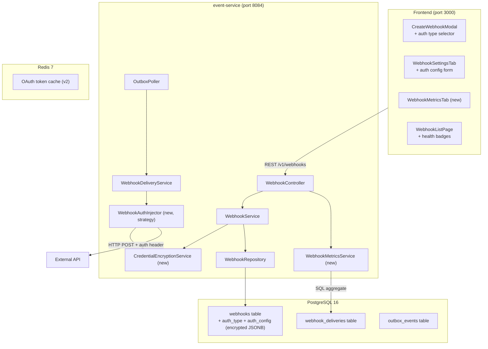
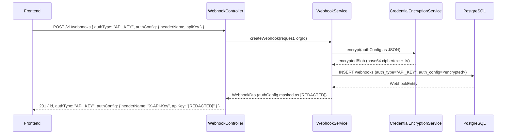
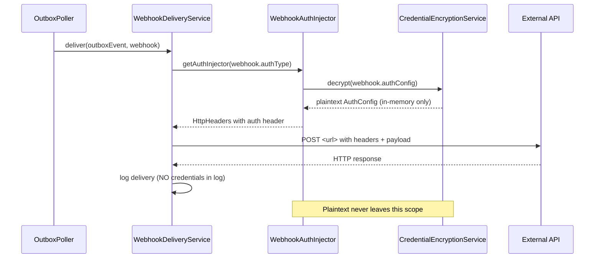

# Solution Architecture — Webhooks Authentication Enhancement (Epic 5)

**Date:** 2026-03-18
**Author:** Solution Architect (BMAD)
**Input:** `docs/prd-webhooks-auth.md`, `docs/project-brief-webhooks-auth.md`
**Status:** APPROVED — Proceeding to Implementation

---

## 1. Executive Summary

This document defines the technical architecture for extending the RuleForge webhook system to support multi-type outbound authentication. The scope spans `event-service` backend (schema, encryption, delivery), two new Flyway migrations, and the React frontend form updates. No new microservices are introduced. The key architectural challenge is injecting per-webhook auth credentials into outbound HTTP requests without exposing plaintext values at rest, in logs, or in API responses.

**Key decisions:**
- Auth configuration stored as AES-256-GCM encrypted JSONB in a new `auth_config` column (ADR-007)
- Strategy pattern for auth injection — `WebhookAuthInjector` implementations per auth type (ADR-008)
- Delivery metrics computed on-demand via SQL aggregate query on `webhook_deliveries` table (ADR-009)
- OAuth 2.0 deferred to v2 (confirmed by Product Owner)

---

## 2. Architecture Overview

### 2.1 Affected Components



### 2.2 Request Flow — Webhook Creation with Auth Config



### 2.3 Request Flow — Outbound Delivery with Auth Injection



---

## 3. Data Model Changes

### 3.1 Flyway Migration V050 — Webhook Auth Schema

```sql
-- V050__webhook_auth_config.sql

-- Add auth_type column with enum constraint
ALTER TABLE webhooks
    ADD COLUMN IF NOT EXISTS auth_type VARCHAR(32) NOT NULL DEFAULT 'SIGNING_SECRET',
    ADD COLUMN IF NOT EXISTS auth_config TEXT;  -- AES-256-GCM encrypted JSON blob

-- Constraint on auth_type values
ALTER TABLE webhooks
    ADD CONSTRAINT chk_auth_type CHECK (
        auth_type IN ('NONE', 'SIGNING_SECRET', 'API_KEY', 'BASIC_AUTH', 'BEARER_TOKEN',
                      'CUSTOM_HEADER', 'OAUTH2_CLIENT_CREDENTIALS')
    );

-- Add retry config columns
ALTER TABLE webhooks
    ADD COLUMN IF NOT EXISTS retry_initial_delay_seconds INT NOT NULL DEFAULT 30,
    ADD COLUMN IF NOT EXISTS retry_backoff_multiplier NUMERIC(4,2) NOT NULL DEFAULT 2.0,
    ADD COLUMN IF NOT EXISTS retry_max_attempts INT NOT NULL DEFAULT 5,
    ADD COLUMN IF NOT EXISTS retry_on_status_codes VARCHAR(100) NOT NULL DEFAULT '429,408,500,502,503,504';

-- Index on auth_type for bulk queries
CREATE INDEX IF NOT EXISTS idx_webhooks_auth_type ON webhooks(auth_type);
```

### 3.2 Flyway Migration V051 — Migrate Existing Secrets

```sql
-- V051__migrate_existing_webhook_secrets.sql
-- NOTE: This migration ONLY sets auth_type = SIGNING_SECRET for existing rows.
-- Actual encryption of secret values is performed at application startup by
-- WebhookCredentialMigrationService (one-time job), NOT in SQL, to ensure
-- the encryption key (from application.yml) is available.

UPDATE webhooks
SET auth_type = 'SIGNING_SECRET'
WHERE auth_type = 'SIGNING_SECRET'  -- idempotent; already default
  AND secret IS NOT NULL;

-- For rows where secret is NULL (no signing configured), mark as NONE
UPDATE webhooks
SET auth_type = 'NONE'
WHERE secret IS NULL
  AND auth_type = 'SIGNING_SECRET';  -- overrides default

-- auth_config will be populated at startup by WebhookCredentialMigrationService
-- which reads the plaintext secret column and writes encrypted auth_config
```

### 3.3 Entity Model (WebhookEntity)

**New fields added to `WebhookEntity.java`:**

```java
@Column(name = "auth_type", nullable = false)
@Enumerated(EnumType.STRING)
private WebhookAuthType authType = WebhookAuthType.NONE;

@Column(name = "auth_config", columnDefinition = "TEXT")
private String authConfig; // encrypted JSON blob

@Column(name = "retry_initial_delay_seconds")
private int retryInitialDelaySeconds = 30;

@Column(name = "retry_backoff_multiplier")
private BigDecimal retryBackoffMultiplier = new BigDecimal("2.0");

@Column(name = "retry_max_attempts")
private int retryMaxAttempts = 5;

@Column(name = "retry_on_status_codes")
private String retryOnStatusCodes = "429,408,500,502,503,504";
```

### 3.4 Auth Config Internal Model

```java
// io.ruleforge.event.model.WebhookAuthConfig — NOT a JPA entity; encrypted POJO
public sealed interface WebhookAuthConfig permits
    WebhookAuthConfig.None,
    WebhookAuthConfig.SigningSecret,
    WebhookAuthConfig.ApiKey,
    WebhookAuthConfig.BasicAuth,
    WebhookAuthConfig.BearerToken,
    WebhookAuthConfig.CustomHeader {

    record None() implements WebhookAuthConfig {}
    record SigningSecret(String secret) implements WebhookAuthConfig {}
    record ApiKey(String headerName, String apiKey) implements WebhookAuthConfig {}
    record BasicAuth(String username, String password) implements WebhookAuthConfig {}
    record BearerToken(String token) implements WebhookAuthConfig {}
    record CustomHeader(String headerName, String headerValue) implements WebhookAuthConfig {}
}
```

---

## 4. New Components

### 4.1 CredentialEncryptionService

**Location:** `io.ruleforge.event.service.CredentialEncryptionService`

**Responsibilities:**
- Encrypt `WebhookAuthConfig` objects to Base64-encoded AES-256-GCM ciphertext + IV
- Decrypt ciphertext back to `WebhookAuthConfig` (in memory only)
- Key sourced from `ruleforge.webhook.credential-key` (application.yml; must be 32 bytes)

```java
@Service
public class CredentialEncryptionService {

    private final SecretKeySpec secretKey;
    private final ObjectMapper objectMapper;

    public CredentialEncryptionService(
            @Value("${ruleforge.webhook.credential-key}") String base64Key,
            ObjectMapper objectMapper) {
        byte[] keyBytes = Base64.getDecoder().decode(base64Key);
        this.secretKey = new SecretKeySpec(keyBytes, "AES");
        this.objectMapper = objectMapper;
    }

    public String encrypt(WebhookAuthConfig config) {
        // 1. Serialize config to JSON
        // 2. Generate random 12-byte IV
        // 3. AES-256-GCM encrypt
        // 4. Return Base64(IV || ciphertext || auth-tag)
    }

    public WebhookAuthConfig decrypt(String encryptedBlob, WebhookAuthType authType) {
        // 1. Base64 decode → extract IV + ciphertext + auth-tag
        // 2. AES-256-GCM decrypt
        // 3. Deserialize JSON based on authType discriminator
        // 4. Return typed WebhookAuthConfig record
    }
}
```

**Key properties in `application.yml`:**
```yaml
ruleforge:
  webhook:
    credential-key: ${WEBHOOK_CREDENTIAL_KEY}  # 32-byte base64-encoded AES key
```

### 4.2 WebhookAuthInjector (Strategy Pattern)

**Location:** `io.ruleforge.event.delivery`

```
WebhookAuthInjector (interface)
├── NoneAuthInjector
├── SigningSecretInjector  (existing HMAC logic moved here)
├── ApiKeyAuthInjector
├── BasicAuthInjector
├── BearerTokenInjector
└── CustomHeaderInjector
```

**Interface contract:**
```java
public interface WebhookAuthInjector {
    WebhookAuthType supportedType();
    void injectAuth(HttpHeaders headers, WebhookAuthConfig config, byte[] payload);
}
```

**Registry:**
```java
@Component
public class WebhookAuthInjectorRegistry {
    private final Map<WebhookAuthType, WebhookAuthInjector> injectors;

    public WebhookAuthInjectorRegistry(List<WebhookAuthInjector> injectors) {
        this.injectors = injectors.stream()
            .collect(toMap(WebhookAuthInjector::supportedType, identity()));
    }

    public WebhookAuthInjector getFor(WebhookAuthType type) {
        return injectors.getOrDefault(type, injectors.get(NONE));
    }
}
```

### 4.3 WebhookMetricsService

**Location:** `io.ruleforge.event.service.WebhookMetricsService`

**Query approach:** On-demand aggregate from `webhook_deliveries` table (see ADR-009).

```java
@Service
public class WebhookMetricsService {

    public WebhookMetricsDto getMetrics(UUID webhookId, UUID orgId) {
        // SQL aggregate query on webhook_deliveries for last 7 days
        // Returns: successRate, totalDeliveries, failedDeliveries, dlqDepth, avgLatencyMs, timeline
    }
}
```

**New endpoint:** `GET /v1/webhooks/{id}/metrics`

---

## 5. API Contract Changes

### 5.1 Updated WebhookRequest DTO

```json
// POST /v1/webhooks — request body (new fields)
{
  "name": "My Integration Webhook",
  "url": "https://api.example.com/webhooks",
  "events": ["rule.published", "rule.executed"],
  "scope": "org",
  "authType": "API_KEY",           // NEW: NONE | SIGNING_SECRET | API_KEY | BASIC_AUTH | BEARER_TOKEN | CUSTOM_HEADER
  "authConfig": {                   // NEW: type-specific credential object
    "headerName": "X-API-Key",
    "apiKey": "sk_live_abc123"
  },
  "retryConfig": {                  // NEW: optional retry overrides
    "initialDelaySeconds": 60,
    "backoffMultiplier": 2.0,
    "maxAttempts": 10,
    "retryOnStatusCodes": [429, 408, 500, 502, 503, 504]
  }
}
```

### 5.2 Updated WebhookDto (response)

```json
// GET /v1/webhooks/{id} — response (masked credentials)
{
  "id": "uuid",
  "name": "My Integration Webhook",
  "url": "https://api.example.com/webhooks",
  "events": ["rule.published"],
  "scope": "org",
  "status": "ACTIVE",
  "authType": "API_KEY",
  "authConfig": {
    "headerName": "X-API-Key",
    "apiKey": "[REDACTED]"          // ← masked; never plaintext
  },
  "retryConfig": {
    "initialDelaySeconds": 60,
    "backoffMultiplier": 2.0,
    "maxAttempts": 10,
    "retryOnStatusCodes": [429, 408, 500, 502, 503, 504]
  },
  "createdAt": "2026-03-18T10:00:00Z",
  "updatedAt": "2026-03-18T10:00:00Z"
}
```

### 5.3 New Metrics Endpoint

```
GET /v1/webhooks/{id}/metrics

Response 200:
{
  "webhookId": "uuid",
  "period": "7d",
  "successRate": 94.3,
  "totalDeliveries": 256,
  "successDeliveries": 241,
  "failedDeliveries": 15,
  "dlqDepth": 3,
  "avgLatencyMs": 142,
  "deliveryTimeline": [
    { "date": "2026-03-12", "success": 38, "failed": 2 },
    { "date": "2026-03-13", "success": 41, "failed": 1 },
    ...
  ]
}
```

### 5.4 Backward Compatibility

| Old request field | New behaviour |
|---|---|
| `"secret": "xyz"` (no `authType`) | Inferred as `authType: "SIGNING_SECRET"` |
| No `secret`, no `authType` | Inferred as `authType: "NONE"` |
| `"authType": "SIGNING_SECRET"` + `"authConfig": { "secret": "xyz" }` | New preferred form |

---

## 6. Credential Masking Strategy

All masking applied at DTO layer, not controller layer:

```java
public class WebhookAuthConfigMaskingSerializer extends JsonSerializer<WebhookAuthConfig> {
    @Override
    public void serialize(WebhookAuthConfig value, JsonGenerator gen, SerializerProvider sp) {
        // For each credential field: replace value with "[REDACTED]"
        // Non-credential fields (headerName, username prefix) optionally exposed
    }
}
```

Applied via `@JsonSerialize(using = WebhookAuthConfigMaskingSerializer.class)` on `WebhookDto.authConfig`.

**Fields that are ALWAYS masked:**
- `apiKey`
- `password`
- `token`
- `secret`
- `headerValue`
- `clientSecret`

**Fields that are NOT masked:**
- `headerName`
- `username` (only the value, not password)

---

## 7. Security Architecture

| Concern | Approach |
|---|---|
| **Credentials at rest** | AES-256-GCM, 12-byte random IV per encryption, key from env var |
| **Credentials in transit** | HTTPS to external APIs; TLS enforced by SSRF guard pre-check |
| **Credentials in logs** | Never log `authConfig` field; `WebhookEntity.authConfig` excluded from `toString()` |
| **Credentials in audit events** | `AuditEvent` payload omits `authConfig`; logs `authType` + `webhookId` only |
| **Credentials in GET responses** | `[REDACTED]` via `WebhookAuthConfigMaskingSerializer` at DTO layer |
| **Credential rotation RBAC** | PATCH /v1/webhooks/{id}/auth-config requires OWNER role (like existing secret rotation) |
| **Encryption key exposure** | Key stored as environment variable; not in code, not in database |
| **Key rotation (future)** | Deferred to v2; document: to rotate key, re-encrypt all `auth_config` rows |

---

## 8. Retry Configuration Architecture

**How configurable retry integrates with OutboxPoller:**

```java
// OutboxPoller uses per-webhook retry config
@Scheduled(fixedDelay = 5000)
public void poll() {
    List<OutboxEvent> pending = outboxRepo.findPendingWithRetryReady();
    pending.forEach(event -> {
        WebhookEntity webhook = webhookRepo.findById(event.getWebhookId()).orElseThrow();
        RetryConfig retryConfig = RetryConfig.builder()
            .initialDelaySeconds(webhook.getRetryInitialDelaySeconds())
            .backoffMultiplier(webhook.getRetryBackoffMultiplier().doubleValue())
            .maxAttempts(webhook.getRetryMaxAttempts())
            .retryOnStatusCodes(parseStatusCodes(webhook.getRetryOnStatusCodes()))
            .build();
        deliveryService.deliver(event, webhook, retryConfig);
    });
}
```

**Retry schedule column in `outbox_events`:**
```sql
-- V050 also adds:
ALTER TABLE outbox_events
    ADD COLUMN IF NOT EXISTS next_retry_at TIMESTAMPTZ;
```

This allows `SELECT * FROM outbox_events WHERE status = 'PENDING' AND (next_retry_at IS NULL OR next_retry_at <= NOW())` for ready-to-retry events.

---

## 9. Delivery Metrics Architecture

**ADR-009 decision: On-demand SQL aggregate** (not pre-aggregated table).

```sql
-- WebhookMetricsRepository query
SELECT
    COUNT(*) AS total_deliveries,
    COUNT(*) FILTER (WHERE status = 'SUCCESS') AS success_count,
    COUNT(*) FILTER (WHERE status IN ('FAILED', 'IN_DLQ')) AS failed_count,
    COUNT(*) FILTER (WHERE status = 'IN_DLQ') AS dlq_depth,
    AVG(EXTRACT(EPOCH FROM (delivered_at - attempted_at)) * 1000)::INT AS avg_latency_ms,
    date_trunc('day', attempted_at) AS day,
    COUNT(*) FILTER (WHERE status = 'SUCCESS') AS day_success,
    COUNT(*) FILTER (WHERE status != 'SUCCESS') AS day_failed
FROM webhook_deliveries
WHERE webhook_id = :webhookId
  AND org_id = :orgId
  AND attempted_at >= NOW() - INTERVAL '7 days'
GROUP BY date_trunc('day', attempted_at)
ORDER BY day;
```

**Index added in V050:**
```sql
CREATE INDEX IF NOT EXISTS idx_webhook_deliveries_metrics
    ON webhook_deliveries(webhook_id, org_id, attempted_at, status);
```

---

## 10. Frontend Architecture

### 10.1 Type Additions

```typescript
// frontend/src/api/webhooks.api.ts additions

export type WebhookAuthType =
  | 'NONE'
  | 'SIGNING_SECRET'
  | 'API_KEY'
  | 'BASIC_AUTH'
  | 'BEARER_TOKEN'
  | 'CUSTOM_HEADER'

export interface WebhookAuthConfig {
  // API_KEY
  headerName?: string
  apiKey?: string
  // BASIC_AUTH
  username?: string
  password?: string
  // BEARER_TOKEN
  token?: string
  // CUSTOM_HEADER
  headerValue?: string
  // SIGNING_SECRET
  secret?: string
}

export interface WebhookRetryConfig {
  initialDelaySeconds: number
  backoffMultiplier: number
  maxAttempts: number
  retryOnStatusCodes: number[]
}

export interface WebhookMetrics {
  webhookId: string
  successRate: number
  totalDeliveries: number
  failedDeliveries: number
  dlqDepth: number
  avgLatencyMs: number
  deliveryTimeline: Array<{ date: string; success: number; failed: number }>
}
```

### 10.2 New Hooks

```typescript
// useWebhookMetrics(webhookId) — in webhooks.api.ts
export function useWebhookMetrics(webhookId: string) {
  return useQuery({
    queryKey: ['webhooks', webhookId, 'metrics'],
    queryFn: () => api.get<WebhookMetrics>(`/v1/webhooks/${webhookId}/metrics`),
    staleTime: 60_000,  // metrics refresh every 60s
  })
}
```

### 10.3 New Components

| Component | Location | Purpose |
|---|---|---|
| `WebhookAuthConfigForm` | `features/webhooks/components/` | Auth type selector + type-specific credential fields |
| `WebhookRetryConfigForm` | `features/webhooks/components/` | Retry parameters (collapsible "Advanced" section) |
| `WebhookMetricsTab` | `features/webhooks/components/` | Metrics panel with Recharts bar chart |
| `WebhookHealthBadge` | `features/webhooks/components/` | Green/amber/red badge for list page |

---

## 11. Performance & Scalability

| Concern | Approach |
|---|---|
| **Encryption overhead** | AES-GCM decrypt <1ms per delivery; negligible vs network latency |
| **Metrics query latency** | Compound index on `(webhook_id, org_id, attempted_at, status)` ensures <10ms for 7d window |
| **Credential key in memory** | `CredentialEncryptionService` is `@Service` singleton; key loaded once at startup |
| **Retry config reads** | `WebhookEntity` already fetched per delivery; no extra query |

---

## 12. Migration & Rollout Plan

1. **V050** runs first: adds `auth_type`, `auth_config`, `retry_*` columns with defaults
2. **V051** runs second: sets `auth_type = SIGNING_SECRET` for existing webhooks with secrets
3. **`WebhookCredentialMigrationService`** runs on startup (Spring `ApplicationRunner`): encrypts existing plaintext `secret` column values into `auth_config` column, sets `auth_type = SIGNING_SECRET`, then nullifies `secret` column
4. **Backward-compat shim in `WebhookService`**: if incoming request has `secret` but no `authType`, auto-map to `SIGNING_SECRET`
5. **`secret` column retained** (not dropped) in this epic — column drop deferred to V052 in v2 after transition period

---

## 13. Architecture Decision Records

| ADR | Decision | Status |
|---|---|---|
| ADR-007 | Webhook Credential Encryption — AES-256-GCM with app.yml key | Accepted |
| ADR-008 | Webhook Auth Injection — Strategy Pattern per auth type | Accepted |
| ADR-009 | Webhook Metrics Storage — On-demand SQL aggregate | Accepted |

---

## 14. Risk Analysis

| Risk | Probability | Impact | Mitigation |
|---|---|---|---|
| Encryption key loss causes all credentials unreadable | Low | Critical | Key stored in `.env` + secrets manager backup; document key rotation procedure |
| Credential migration corrupts existing secrets | Low | High | `WebhookCredentialMigrationService` is idempotent (checks if `auth_config` already set); dry-run mode available |
| `authConfig` JSON serialization edge cases (special chars) | Medium | Low | Use Jackson with explicit type discriminator; integration tests cover all 5 auth types |
| Metrics query slow on high-volume orgs (>10M deliveries) | Low | Medium | Partition `webhook_deliveries` by `org_id` in v2 if needed; compound index covers 99% of cases |
| Frontend form state drift when switching auth types | Medium | Medium | `useEffect` clears credential fields when `authType` changes; Vitest tests cover all transitions |
