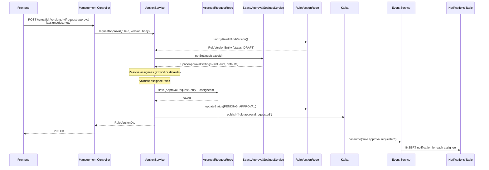
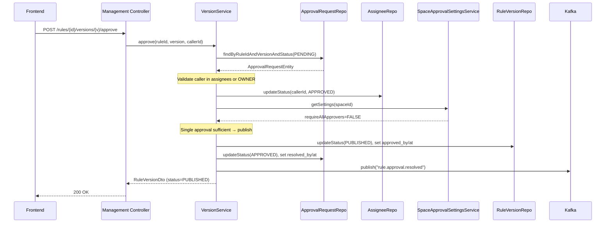
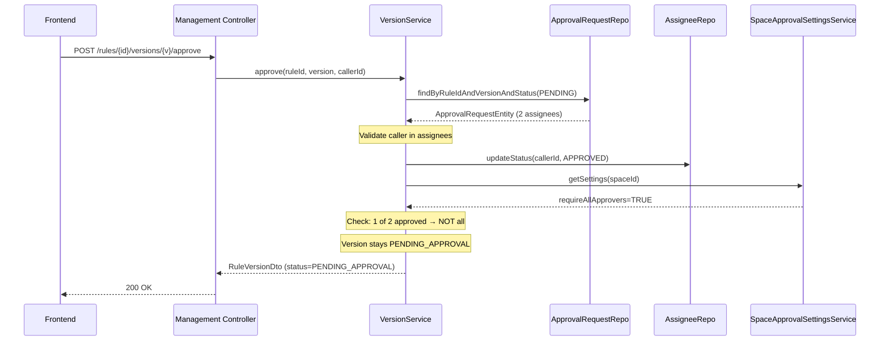
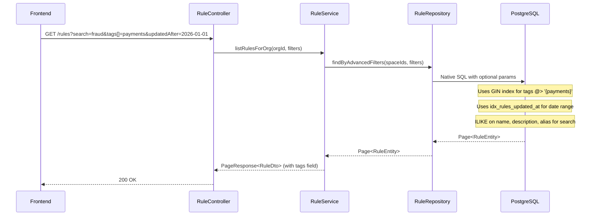

# Sprint 02 — Technical Architecture Document

**Author:** Solution Architect (BMAD)
**Date:** 2026-02-27
**Status:** Accepted
**Scope:** Enhanced Rule Search & Filtering, Approval Assignment System

---

## Table of Contents

1. [Executive Summary](#1-executive-summary)
2. [EPIC 1: Enhanced Rule Search and Filtering](#2-epic-1-enhanced-rule-search-and-filtering)
3. [EPIC 2: Approval Assignment System](#3-epic-2-approval-assignment-system)
4. [EPIC 3: Migration Scripts](#4-epic-3-migration-scripts)
5. [EPIC 4: Caching Strategy](#5-epic-4-caching-strategy)
6. [Architecture Decision Records](#6-architecture-decision-records)
7. [Sequence Diagrams](#7-sequence-diagrams)
8. [Backward Compatibility](#8-backward-compatibility)
9. [Security Considerations](#9-security-considerations)

---

## 1. Executive Summary

Sprint 02 addresses two foundational gaps in RuleForge:

1. **Enhanced Search & Filtering** — The current `GET /v1/rules` endpoint only supports `name ILIKE` search plus `folderId`, `status`, and `type` filters. Users cannot search across name + description + alias, filter by tags, filter by creator, or search by date range. This sprint adds a normalized tag system with GIN-indexed denormalization, multi-field text search, date range filters, creator filters, and a `hasVersion` filter for finding rules with pending approvals.

2. **Approval Assignment System** — The current approval workflow has no concept of assignment. Any user with APPROVER or OWNER role can approve any pending version. This sprint introduces explicit approval requests with assignee tracking, configurable space-level approval settings (default approvers, SLA hours, quorum logic), and a dedicated approval request listing API for approver dashboards.

### Key Architectural Decisions

| Decision | Choice | Rationale |
|----------|--------|-----------|
| Tag storage | Normalized `rule_tags` table + denormalized `TEXT[]` column on `rules` | Normalized for integrity + CRUD; denormalized array with GIN index for fast containment queries on list endpoint |
| Tag sync mechanism | PostgreSQL trigger | Guarantees consistency without application-layer coordination; trigger fires on INSERT/DELETE to `rule_tags` |
| Enhanced search query | Single JPQL query with optional params | Avoids N repository methods; all new params are optional so existing callers are unaffected |
| Approval assignment | Separate `approval_requests` + `approval_request_assignees` tables | Decouples assignment tracking from `rule_versions`; preserves full audit trail of who was assigned, when they responded |
| Quorum logic | `require_all_approvers` boolean on `space_approval_settings` | Simple two-mode model (any-one vs. all) covers 95% of use cases; avoids complex quorum fractions |
| Batch approval requests | Single transaction with partial failure reporting | Returns `succeeded[]` and `failed[]` arrays; does not roll back succeeded items if some fail validation |

### Affected Services

| Service | Changes |
|---------|---------|
| management-service | New entities, repositories, DTOs, controllers for tags, enhanced search, approval requests, space settings, eligible approvers, batch request |
| event-service | New Kafka consumer for `rule.approval.requested` to create notifications for assigned approvers |
| auth-service | No changes (APPROVER role already in V031 migration) |

---

## 2. EPIC 1: Enhanced Rule Search and Filtering

### 2.1 Tags System

#### 2.1.1 Data Model

**New table: `rule_tags`** (normalized storage for tag CRUD)

```sql
CREATE TABLE rule_tags (
    id          UUID PRIMARY KEY DEFAULT gen_random_uuid(),
    rule_id     UUID NOT NULL REFERENCES rules(id) ON DELETE CASCADE,
    tag         VARCHAR(100) NOT NULL,
    created_at  TIMESTAMPTZ NOT NULL DEFAULT NOW(),
    UNIQUE(rule_id, tag)
);

CREATE INDEX idx_rule_tags_tag ON rule_tags(tag);
CREATE INDEX idx_rule_tags_rule_id ON rule_tags(rule_id);
```

**New column on `rules` table** (denormalized for fast list queries):

```sql
ALTER TABLE rules ADD COLUMN IF NOT EXISTS tags TEXT[] NOT NULL DEFAULT '{}';
CREATE INDEX rules_tags_gin ON rules USING gin(tags);
```

**Sync trigger** (keeps `rules.tags` in sync with `rule_tags`):

```sql
CREATE OR REPLACE FUNCTION sync_rule_tags() RETURNS TRIGGER AS $$
BEGIN
    IF TG_OP = 'INSERT' THEN
        UPDATE rules SET tags = (
            SELECT COALESCE(array_agg(rt.tag ORDER BY rt.tag), '{}')
            FROM rule_tags rt WHERE rt.rule_id = NEW.rule_id
        ) WHERE id = NEW.rule_id;
    ELSIF TG_OP = 'DELETE' THEN
        UPDATE rules SET tags = (
            SELECT COALESCE(array_agg(rt.tag ORDER BY rt.tag), '{}')
            FROM rule_tags rt WHERE rt.rule_id = OLD.rule_id
        ) WHERE id = OLD.rule_id;
    END IF;
    RETURN NULL;
END;
$$ LANGUAGE plpgsql;

CREATE TRIGGER trg_sync_rule_tags
    AFTER INSERT OR DELETE ON rule_tags
    FOR EACH ROW EXECUTE FUNCTION sync_rule_tags();
```

#### 2.1.2 Tag API Endpoints

**Tag autocomplete:**

```
GET /v1/tags?prefix=fraud&limit=20
```

Response:
```json
{
  "data": [
    { "tag": "fraud-detection", "ruleCount": 12 },
    { "tag": "fraud-scoring", "ruleCount": 5 }
  ]
}
```

Implementation: `SELECT tag, COUNT(*) as rule_count FROM rule_tags WHERE tag ILIKE :prefix || '%' GROUP BY tag ORDER BY rule_count DESC LIMIT :limit`

Scoped to the caller's org via RLS on `rule_tags` (join through `rules` → `spaces` → `org_id`).

**Tag CRUD on a rule:**

```
POST   /v1/rules/{ruleId}/tags        Body: { "tags": ["fraud", "payments"] }
DELETE /v1/rules/{ruleId}/tags/{tag}
GET    /v1/rules/{ruleId}/tags         (already available via RuleDto.tags)
```

The `POST` endpoint is idempotent — it adds tags that don't exist and ignores duplicates. Returns the full updated tag list.

#### 2.1.3 JPA Entity

New `RuleTagEntity`:

```java
@Entity
@Table(name = "rule_tags")
public class RuleTagEntity {
    @Id @GeneratedValue(strategy = GenerationType.UUID)
    private UUID id;

    @Column(name = "rule_id", nullable = false)
    private UUID ruleId;

    @Column(nullable = false, length = 100)
    private String tag;

    @Column(name = "created_at", nullable = false, updatable = false)
    private Instant createdAt;
}
```

Add to `RuleEntity`:

```java
@Column(name = "tags", columnDefinition = "text[]")
@JdbcTypeCode(SqlTypes.ARRAY)
private String[] tags = {};
```

#### 2.1.4 RuleDto Enhancement

Add `tags` field to `RuleDto`:

```java
public record RuleDto(
    UUID id, UUID spaceId, UUID folderId,
    String name, String alias, String type, String description,
    String status, int latestVersion,
    boolean locked, UUID lockedBy, Instant lockedAt,
    UUID createdBy, Instant createdAt, Instant updatedAt,
    List<String> tags  // NEW
) {}
```

### 2.2 Enhanced Rule Search

#### 2.2.1 Extended Query Parameters on `GET /v1/rules`

| Param | Type | Description | Current? |
|-------|------|-------------|----------|
| `folderId` | UUID | Filter by folder | Existing |
| `status` | String | Filter by rule status (ACTIVE, INACTIVE, etc.) | Existing |
| `type` | String | Filter by rule type (TABLE, TREE, etc.) | Existing |
| `search` | String | **Enhanced**: searches `name`, `description`, AND `alias` (ILIKE on all three) | Modified |
| `tags` | String[] | Tag filter (AND logic: rule must have ALL specified tags) | **New** |
| `createdBy` | UUID | Filter by creator member ID | **New** |
| `updatedAfter` | Instant | Filter rules updated after this timestamp | **New** |
| `updatedBefore` | Instant | Filter rules updated before this timestamp | **New** |
| `hasVersion` | String | Version status filter, e.g. `PENDING_APPROVAL` | **New** |
| `spaceId` | UUID | Filter by specific space (admin cross-space use) | **New** |

All new parameters are optional. Omitting them returns the same results as today.

#### 2.2.2 Controller Changes

Update `RuleController.listRulesForOrg()`:

```java
@GetMapping("/rules")
public ApiResponse<PageResponse<RuleDto>> listRulesForOrg(
        @RequestParam(required = false) UUID folderId,
        @RequestParam(required = false) String status,
        @RequestParam(required = false) String type,
        @RequestParam(required = false) String search,
        @RequestParam(required = false) List<String> tags,       // NEW
        @RequestParam(required = false) UUID createdBy,          // NEW
        @RequestParam(required = false) Instant updatedAfter,    // NEW
        @RequestParam(required = false) Instant updatedBefore,   // NEW
        @RequestParam(required = false) String hasVersion,       // NEW
        @RequestParam(required = false) UUID spaceId,            // NEW
        @PageableDefault(size = 20) Pageable pageable) {
    // ...
}
```

#### 2.2.3 Repository Query

Replace the current `findByFilters` / `findByFiltersAndSearch` pair with a single native query that handles all optional parameters:

```java
@Query(value = """
    SELECT r.* FROM rules r
    WHERE r.space_id IN (:spaceIds)
      AND (:folderId IS NULL OR r.folder_id = CAST(:folderId AS uuid))
      AND (:status IS NULL OR r.status = :status)
      AND (:type IS NULL OR r.type = :type)
      AND (:search IS NULL OR (
           lower(r.name) LIKE lower(concat('%', :search, '%'))
           OR lower(r.description) LIKE lower(concat('%', :search, '%'))
           OR lower(r.alias) LIKE lower(concat('%', :search, '%'))
      ))
      AND (:createdBy IS NULL OR r.created_by = CAST(:createdBy AS uuid))
      AND (CAST(:updatedAfter AS timestamptz) IS NULL OR r.updated_at >= CAST(:updatedAfter AS timestamptz))
      AND (CAST(:updatedBefore AS timestamptz) IS NULL OR r.updated_at <= CAST(:updatedBefore AS timestamptz))
      AND (:tagsEmpty = true OR r.tags @> CAST(:tags AS text[]))
      AND (:hasVersion IS NULL OR EXISTS (
           SELECT 1 FROM rule_versions rv
           WHERE rv.rule_id = r.id AND rv.status = :hasVersion
      ))
    """,
    countQuery = """
    SELECT count(*) FROM rules r
    WHERE r.space_id IN (:spaceIds)
      AND (:folderId IS NULL OR r.folder_id = CAST(:folderId AS uuid))
      AND (:status IS NULL OR r.status = :status)
      AND (:type IS NULL OR r.type = :type)
      AND (:search IS NULL OR (
           lower(r.name) LIKE lower(concat('%', :search, '%'))
           OR lower(r.description) LIKE lower(concat('%', :search, '%'))
           OR lower(r.alias) LIKE lower(concat('%', :search, '%'))
      ))
      AND (:createdBy IS NULL OR r.created_by = CAST(:createdBy AS uuid))
      AND (CAST(:updatedAfter AS timestamptz) IS NULL OR r.updated_at >= CAST(:updatedAfter AS timestamptz))
      AND (CAST(:updatedBefore AS timestamptz) IS NULL OR r.updated_at <= CAST(:updatedBefore AS timestamptz))
      AND (:tagsEmpty = true OR r.tags @> CAST(:tags AS text[]))
      AND (:hasVersion IS NULL OR EXISTS (
           SELECT 1 FROM rule_versions rv
           WHERE rv.rule_id = r.id AND rv.status = :hasVersion
      ))
    """,
    nativeQuery = true)
Page<RuleEntity> findByAdvancedFilters(
    @Param("spaceIds") Collection<UUID> spaceIds,
    @Param("folderId") UUID folderId,
    @Param("status") String status,
    @Param("type") String type,
    @Param("search") String search,
    @Param("createdBy") UUID createdBy,
    @Param("updatedAfter") Instant updatedAfter,
    @Param("updatedBefore") Instant updatedBefore,
    @Param("tags") String[] tags,
    @Param("tagsEmpty") boolean tagsEmpty,
    @Param("hasVersion") String hasVersion,
    Pageable pageable
);
```

The `tagsEmpty` boolean flag is passed as `true` when no tags are provided, bypassing the `@>` operator. This avoids null-handling complexity with PostgreSQL array containment.

#### 2.2.4 Search Performance

Existing indexes sufficient for most filters:
- `rules.space_id` — already indexed (FK)
- `rules.folder_id` — already indexed (FK)
- `rules.status` — low cardinality, table scan acceptable
- `rules.type` — low cardinality, table scan acceptable
- `rules.created_by` — **add index** (new filter)
- `rules.updated_at` — **add index** (new date range filter)
- `rules.tags` — GIN index (new, see V033)

New indexes in V033:
```sql
CREATE INDEX idx_rules_created_by ON rules(created_by);
CREATE INDEX idx_rules_updated_at ON rules(updated_at);
```

For the `search` ILIKE across three columns, a `pg_trgm` GIN index would help at scale but is not required for Sprint 02 volumes. Document as a future optimization.

### 2.3 Batch Request Approval

#### 2.3.1 Endpoint

```
POST /v1/rules/batch/request-approval
```

Request body:
```json
{
  "ruleIds": ["uuid-1", "uuid-2", "uuid-3"],
  "assigneeIds": ["approver-uuid-1", "approver-uuid-2"],
  "note": "Monthly fraud rules update — please review by EOD"
}
```

Response (HTTP 200):
```json
{
  "data": {
    "succeeded": [
      { "ruleId": "uuid-1", "version": 3, "requestId": "req-uuid-1" },
      { "ruleId": "uuid-2", "version": 1, "requestId": "req-uuid-2" }
    ],
    "failed": [
      { "ruleId": "uuid-3", "reason": "Latest version is already PUBLISHED" }
    ]
  }
}
```

#### 2.3.2 Validation Rules

For each `ruleId` in the batch:
1. Rule must exist and be accessible by caller's org (RLS)
2. The latest version must have status `DRAFT` (not already PENDING_APPROVAL or PUBLISHED)
3. No existing PENDING approval request for this rule+version
4. All `assigneeIds` must have APPROVER or OWNER role in the org

If `assigneeIds` is empty or omitted, fall back to the space's `default_approvers` (from `space_approval_settings`). If no default approvers are configured, return an error for that rule.

#### 2.3.3 Transaction Semantics

The batch operation runs in a single `@Transactional` block. However, individual rule failures (validation) do not roll back succeeded items — the service catches validation exceptions per-rule and collects them into the `failed` array. Only infrastructure failures (DB errors, connection issues) cause a full rollback.

#### 2.3.4 DTO

```java
public record BatchApprovalRequestDto(
    List<UUID> ruleIds,
    List<UUID> assigneeIds,
    String note
) {}

public record BatchApprovalResultDto(
    List<ApprovalSuccessItem> succeeded,
    List<ApprovalFailureItem> failed
) {}

public record ApprovalSuccessItem(UUID ruleId, int version, UUID requestId) {}
public record ApprovalFailureItem(UUID ruleId, String reason) {}
```

---

## 3. EPIC 2: Approval Assignment System

### 3.1 Data Model

#### 3.1.1 `approval_requests` Table

```sql
CREATE TABLE approval_requests (
    id              UUID PRIMARY KEY DEFAULT gen_random_uuid(),
    rule_id         UUID NOT NULL REFERENCES rules(id) ON DELETE CASCADE,
    version         INTEGER NOT NULL,
    requested_by    UUID NOT NULL REFERENCES members(id),
    requested_at    TIMESTAMPTZ NOT NULL DEFAULT NOW(),
    note            TEXT,
    status          VARCHAR(20) NOT NULL DEFAULT 'PENDING'
                    CHECK (status IN ('PENDING', 'APPROVED', 'REJECTED', 'CANCELLED')),
    resolved_by     UUID REFERENCES members(id),
    resolved_at     TIMESTAMPTZ,
    deadline        TIMESTAMPTZ,
    UNIQUE(rule_id, version)
);

CREATE INDEX idx_approval_requests_rule_id ON approval_requests(rule_id);
CREATE INDEX idx_approval_requests_status ON approval_requests(status);
CREATE INDEX idx_approval_requests_requested_by ON approval_requests(requested_by);
CREATE INDEX idx_approval_requests_deadline ON approval_requests(deadline)
    WHERE status = 'PENDING';
```

The `UNIQUE(rule_id, version)` constraint ensures only one active approval request per rule version at a time. If a version is rejected and re-submitted, the old request is marked `CANCELLED` before creating a new one.

#### 3.1.2 `approval_request_assignees` Table

```sql
CREATE TABLE approval_request_assignees (
    id              UUID PRIMARY KEY DEFAULT gen_random_uuid(),
    request_id      UUID NOT NULL REFERENCES approval_requests(id) ON DELETE CASCADE,
    assignee_id     UUID NOT NULL REFERENCES members(id),
    status          VARCHAR(20) NOT NULL DEFAULT 'PENDING'
                    CHECK (status IN ('PENDING', 'APPROVED', 'REJECTED')),
    responded_at    TIMESTAMPTZ,
    UNIQUE(request_id, assignee_id)
);

CREATE INDEX idx_approval_assignees_request_id ON approval_request_assignees(request_id);
CREATE INDEX idx_approval_assignees_assignee_id ON approval_request_assignees(assignee_id);
CREATE INDEX idx_approval_assignees_pending ON approval_request_assignees(assignee_id, status)
    WHERE status = 'PENDING';
```

#### 3.1.3 `space_approval_settings` Table

```sql
CREATE TABLE space_approval_settings (
    id                      UUID PRIMARY KEY DEFAULT gen_random_uuid(),
    space_id                UUID NOT NULL UNIQUE REFERENCES spaces(id) ON DELETE CASCADE,
    default_approvers       UUID[] NOT NULL DEFAULT '{}',
    sla_hours               INTEGER NOT NULL DEFAULT 48,
    require_all_approvers   BOOLEAN NOT NULL DEFAULT FALSE,
    created_at              TIMESTAMPTZ NOT NULL DEFAULT NOW(),
    updated_at              TIMESTAMPTZ NOT NULL DEFAULT NOW()
);
```

`require_all_approvers`:
- `FALSE` (default): Any single assigned approver's approval publishes the version immediately.
- `TRUE`: ALL assigned approvers must approve before the version is published.

#### 3.1.4 Entity-Relationship Diagram

```mermaid
erDiagram
    rules ||--o{ rule_tags : has
    rules ||--o{ rule_versions : has
    rules ||--o{ approval_requests : has
    approval_requests ||--o{ approval_request_assignees : has
    spaces ||--o| space_approval_settings : has
    members ||--o{ approval_requests : "requested_by"
    members ||--o{ approval_request_assignees : "assigned_to"

    rules {
        uuid id PK
        uuid space_id FK
        uuid folder_id FK
        varchar name
        varchar alias UK
        varchar type
        text description
        varchar status
        int latest_version
        text_array tags
        uuid created_by
        timestamptz created_at
        timestamptz updated_at
    }

    rule_tags {
        uuid id PK
        uuid rule_id FK
        varchar tag
        timestamptz created_at
    }

    approval_requests {
        uuid id PK
        uuid rule_id FK
        int version
        uuid requested_by FK
        timestamptz requested_at
        text note
        varchar status
        uuid resolved_by FK
        timestamptz resolved_at
        timestamptz deadline
    }

    approval_request_assignees {
        uuid id PK
        uuid request_id FK
        uuid assignee_id FK
        varchar status
        timestamptz responded_at
    }

    space_approval_settings {
        uuid id PK
        uuid space_id FK_UK
        uuid_array default_approvers
        int sla_hours
        boolean require_all_approvers
        timestamptz created_at
        timestamptz updated_at
    }
```

### 3.2 Modified Approval Request Flow

#### 3.2.1 Request Approval (Modified Existing Endpoint)

**`POST /v1/rules/{ruleId}/versions/{version}/request-approval`**

Current signature accepts no body. Modified to accept optional body:

```json
{
  "assigneeIds": ["uuid-1", "uuid-2"],
  "note": "Urgent — fraud rule update"
}
```

Both fields are optional:
- If `assigneeIds` is omitted or empty, the system loads `space_approval_settings.default_approvers` for the rule's space.
- If no default approvers are configured and no assignees provided, return `400 Bad Request` with message "No approvers specified and no default approvers configured for this space."

**Service logic:**

```
1. Load rule + validate latest version status is DRAFT
2. Resolve assignee IDs (explicit or space defaults)
3. Validate each assignee has APPROVER or OWNER role in the org
4. Cancel any existing PENDING approval_request for this rule+version
5. Create approval_requests record
   - Set deadline = NOW() + space_approval_settings.sla_hours (or default 48h)
6. Create approval_request_assignees record for each assignee
7. Update rule_versions.status = 'PENDING_APPROVAL'
8. Publish Kafka event: rule.approval.requested
   {
     ruleId, version, requestId, requestedBy,
     assigneeIds, note, deadline
   }
9. Return updated RuleVersionDto
```

#### 3.2.2 Approve Version (Modified)

**`POST /v1/rules/{ruleId}/versions/{version}/approve`**

Modified validation:

```
1. Load approval_request for (rule_id, version) with status PENDING
2. Validate caller is in approval_request_assignees for this request
   - OR caller has OWNER role (owners can always approve)
3. Update approval_request_assignees.status = 'APPROVED' for caller
   - Set responded_at = NOW()
4. Load space_approval_settings for the rule's space
5. If require_all_approvers = FALSE:
   → Single approval is sufficient → proceed to publish
6. If require_all_approvers = TRUE:
   → Check if ALL assignees have status 'APPROVED'
   → If not all approved yet, return version with PENDING_APPROVAL status
   → If all approved, proceed to publish
7. Publish flow:
   a. Update rule_versions.status = 'PUBLISHED', set approved_by, approved_at
   b. Update approval_requests.status = 'APPROVED', set resolved_by, resolved_at
   c. Publish Kafka event: rule.approval.resolved
      { ruleId, version, requestId, resolvedBy, resolution: 'APPROVED' }
8. Return updated RuleVersionDto
```

#### 3.2.3 Reject Version (Modified)

**`POST /v1/rules/{ruleId}/versions/{version}/reject`**

Modified to include assignment validation:

```
1. Load approval_request for (rule_id, version) with status PENDING
2. Validate caller is in approval_request_assignees OR has OWNER role
3. Update approval_request_assignees.status = 'REJECTED' for caller
   - Set responded_at = NOW()
4. Immediately reject the entire request:
   a. Update approval_requests.status = 'REJECTED', set resolved_by, resolved_at
   b. Update rule_versions.status = 'DRAFT'
   c. Store rejection_reason on rule_versions
5. Publish Kafka event: rule.approval.resolved
   { ruleId, version, requestId, resolvedBy, resolution: 'REJECTED', reason }
6. Return updated RuleVersionDto
```

Any single rejection immediately rejects the entire request. This is intentional — a reviewer who rejects is blocking the change and the author should address feedback before re-submitting.

#### 3.2.4 Cancel Approval Request (New)

**`POST /v1/rules/{ruleId}/versions/{version}/cancel-approval`**

Only the original requester (or OWNER) can cancel. Transitions the version back to DRAFT.

```
1. Load approval_request for (rule_id, version) with status PENDING
2. Validate caller = requested_by OR caller is OWNER
3. Update approval_requests.status = 'CANCELLED'
4. Update rule_versions.status = 'DRAFT'
5. Publish Kafka event: rule.approval.resolved
   { ruleId, version, requestId, resolution: 'CANCELLED' }
6. Return updated RuleVersionDto
```

### 3.3 New API Endpoints

#### 3.3.1 Approval Request List

```
GET /v1/approval-requests
```

Query parameters:

| Param | Type | Description |
|-------|------|-------------|
| `assignedToMe` | boolean | Only requests where current user is an assignee |
| `status` | String | PENDING, APPROVED, REJECTED, CANCELLED |
| `ruleId` | UUID | Filter to a specific rule |
| `requestedBy` | UUID | Filter by requester |
| `from` | Instant | Requested after this timestamp |
| `to` | Instant | Requested before this timestamp |
| `page` | int | Page number (0-indexed) |
| `size` | int | Page size (default 20) |

Response:
```json
{
  "data": {
    "content": [
      {
        "id": "request-uuid",
        "ruleId": "rule-uuid",
        "ruleName": "Fraud Detection v2",
        "ruleType": "TABLE",
        "version": 3,
        "requestedBy": "member-uuid",
        "requestedByName": "Alice Smith",
        "requestedAt": "2026-02-27T10:00:00Z",
        "note": "Monthly update",
        "status": "PENDING",
        "resolvedBy": null,
        "resolvedAt": null,
        "deadline": "2026-03-01T10:00:00Z",
        "assignees": [
          {
            "memberId": "approver-uuid-1",
            "name": "Bob Jones",
            "status": "PENDING",
            "respondedAt": null
          },
          {
            "memberId": "approver-uuid-2",
            "name": "Carol White",
            "status": "APPROVED",
            "respondedAt": "2026-02-27T14:30:00Z"
          }
        ]
      }
    ],
    "page": 0,
    "size": 20,
    "totalElements": 1,
    "totalPages": 1
  }
}
```

#### 3.3.2 Approval Request Detail

```
GET /v1/approval-requests/{requestId}
```

Returns the same shape as an individual item in the list, plus:
- `comments`: List of `rule_version_comments` for this rule+version (reuses existing comment system from Sprint 01)

#### 3.3.3 Space Approval Settings

```
GET  /v1/spaces/{spaceId}/approval-settings
PUT  /v1/spaces/{spaceId}/approval-settings
```

`PUT` request body:
```json
{
  "defaultApprovers": ["member-uuid-1", "member-uuid-2"],
  "slaHours": 72,
  "requireAllApprovers": true
}
```

Authorization: OWNER or ADMIN role only. Validated in the service layer using `TenantContext.get().role()`.

Response:
```json
{
  "data": {
    "spaceId": "space-uuid",
    "defaultApprovers": [
      { "id": "member-uuid-1", "name": "Bob Jones", "email": "bob@acme.com" },
      { "id": "member-uuid-2", "name": "Carol White", "email": "carol@acme.com" }
    ],
    "slaHours": 72,
    "requireAllApprovers": true
  }
}
```

#### 3.3.4 Eligible Approvers

```
GET /v1/rules/{ruleId}/eligible-approvers
```

Returns all org members with APPROVER or OWNER role, flagged if they are in the rule's space default approvers list:

```json
{
  "data": [
    {
      "id": "member-uuid-1",
      "name": "Bob Jones",
      "email": "bob@acme.com",
      "role": "APPROVER",
      "isDefaultApprover": true
    },
    {
      "id": "member-uuid-2",
      "name": "Alice Admin",
      "email": "alice@acme.com",
      "role": "OWNER",
      "isDefaultApprover": false
    }
  ]
}
```

Implementation: Query `members` where `role IN ('APPROVER', 'OWNER')` and `org_id = current org`. Cross-reference with `space_approval_settings.default_approvers` for the rule's space.

### 3.4 DTO Design

```java
// --- Approval Request DTOs ---

public record ApprovalRequestDto(
    UUID id,
    UUID ruleId,
    String ruleName,
    String ruleType,
    int version,
    UUID requestedBy,
    String requestedByName,
    Instant requestedAt,
    String note,
    String status,           // PENDING, APPROVED, REJECTED, CANCELLED
    UUID resolvedBy,
    Instant resolvedAt,
    Instant deadline,
    List<AssigneeStatusDto> assignees
) {}

public record AssigneeStatusDto(
    UUID memberId,
    String name,
    String status,           // PENDING, APPROVED, REJECTED
    Instant respondedAt
) {}

// --- Request Bodies ---

public record RequestApprovalBody(
    List<UUID> assigneeIds,  // optional — falls back to space defaults
    String note              // optional
) {}

// --- Space Approval Settings ---

public record SpaceApprovalSettingsDto(
    UUID spaceId,
    List<MemberSummaryDto> defaultApprovers,
    int slaHours,
    boolean requireAllApprovers
) {}

public record UpdateSpaceApprovalSettingsRequest(
    List<UUID> defaultApprovers,
    int slaHours,
    boolean requireAllApprovers
) {}

// --- Eligible Approver ---

public record EligibleApproverDto(
    UUID id,
    String name,
    String email,
    String role,
    boolean isDefaultApprover
) {}
```

### 3.5 JPA Entities

#### ApprovalRequestEntity

```java
@Entity
@Table(name = "approval_requests")
public class ApprovalRequestEntity {
    @Id @GeneratedValue(strategy = GenerationType.UUID)
    private UUID id;

    @Column(name = "rule_id", nullable = false)
    private UUID ruleId;

    @Column(nullable = false)
    private int version;

    @Column(name = "requested_by", nullable = false)
    private UUID requestedBy;

    @Column(name = "requested_at", nullable = false)
    private Instant requestedAt;

    @Column
    private String note;

    @Column(nullable = false, length = 20)
    private String status;

    @Column(name = "resolved_by")
    private UUID resolvedBy;

    @Column(name = "resolved_at")
    private Instant resolvedAt;

    @Column
    private Instant deadline;

    @OneToMany(mappedBy = "request", cascade = CascadeType.ALL, orphanRemoval = true)
    private List<ApprovalRequestAssigneeEntity> assignees = new ArrayList<>();
}
```

#### ApprovalRequestAssigneeEntity

```java
@Entity
@Table(name = "approval_request_assignees")
public class ApprovalRequestAssigneeEntity {
    @Id @GeneratedValue(strategy = GenerationType.UUID)
    private UUID id;

    @ManyToOne(fetch = FetchType.LAZY)
    @JoinColumn(name = "request_id", nullable = false)
    private ApprovalRequestEntity request;

    @Column(name = "assignee_id", nullable = false)
    private UUID assigneeId;

    @Column(nullable = false, length = 20)
    private String status;

    @Column(name = "responded_at")
    private Instant respondedAt;
}
```

#### SpaceApprovalSettingsEntity

```java
@Entity
@Table(name = "space_approval_settings")
public class SpaceApprovalSettingsEntity {
    @Id @GeneratedValue(strategy = GenerationType.UUID)
    private UUID id;

    @Column(name = "space_id", nullable = false, unique = true)
    private UUID spaceId;

    @Column(name = "default_approvers", columnDefinition = "uuid[]")
    @JdbcTypeCode(SqlTypes.ARRAY)
    private UUID[] defaultApprovers = {};

    @Column(name = "sla_hours", nullable = false)
    private int slaHours = 48;

    @Column(name = "require_all_approvers", nullable = false)
    private boolean requireAllApprovers = false;

    @Column(name = "created_at", nullable = false, updatable = false)
    private Instant createdAt;

    @Column(name = "updated_at", nullable = false)
    private Instant updatedAt;
}
```

### 3.6 Kafka Events

New event types published on the `rule.lifecycle` topic:

**`rule.approval.requested`**
```json
{
  "eventType": "rule.approval.requested",
  "timestamp": "2026-02-27T10:00:00Z",
  "orgId": "org-uuid",
  "data": {
    "requestId": "request-uuid",
    "ruleId": "rule-uuid",
    "ruleName": "Fraud Detection v2",
    "version": 3,
    "requestedBy": "member-uuid",
    "assigneeIds": ["approver-uuid-1", "approver-uuid-2"],
    "note": "Monthly update",
    "deadline": "2026-03-01T10:00:00Z"
  }
}
```

**`rule.approval.resolved`**
```json
{
  "eventType": "rule.approval.resolved",
  "timestamp": "2026-02-27T14:30:00Z",
  "orgId": "org-uuid",
  "data": {
    "requestId": "request-uuid",
    "ruleId": "rule-uuid",
    "version": 3,
    "resolvedBy": "member-uuid",
    "resolution": "APPROVED",
    "reason": null
  }
}
```

**Event-service consumer** creates `notifications` records for each assignee when `rule.approval.requested` is received:
- `type`: `APPROVAL_REQUESTED`
- `title`: "Approval requested: {ruleName} v{version}"
- `body`: note (if provided)
- `resource_type`: `APPROVAL_REQUEST`
- `resource_id`: requestId

On `rule.approval.resolved`, create notification for the original requester:
- `type`: `APPROVAL_RESOLVED`
- `title`: "Your approval request was {resolution}: {ruleName} v{version}"

### 3.7 Controller Design

New controller in management-service:

```java
@RestController
@RequestMapping("/v1")
public class ApprovalController {

    @GetMapping("/approval-requests")
    public ApiResponse<PageResponse<ApprovalRequestDto>> listApprovalRequests(
        @RequestParam(required = false) boolean assignedToMe,
        @RequestParam(required = false) String status,
        @RequestParam(required = false) UUID ruleId,
        @RequestParam(required = false) UUID requestedBy,
        @RequestParam(required = false) Instant from,
        @RequestParam(required = false) Instant to,
        @PageableDefault(size = 20) Pageable pageable) { ... }

    @GetMapping("/approval-requests/{requestId}")
    public ApiResponse<ApprovalRequestDto> getApprovalRequest(
        @PathVariable UUID requestId) { ... }

    @PostMapping("/rules/batch/request-approval")
    @AuditLog(action = "BATCH_REQUEST_APPROVAL", resourceType = "ApprovalRequest")
    public ApiResponse<BatchApprovalResultDto> batchRequestApproval(
        @Valid @RequestBody BatchApprovalRequestDto request) { ... }

    @GetMapping("/rules/{ruleId}/eligible-approvers")
    public ApiResponse<List<EligibleApproverDto>> getEligibleApprovers(
        @PathVariable UUID ruleId) { ... }

    @GetMapping("/spaces/{spaceId}/approval-settings")
    public ApiResponse<SpaceApprovalSettingsDto> getApprovalSettings(
        @PathVariable UUID spaceId) { ... }

    @PutMapping("/spaces/{spaceId}/approval-settings")
    @AuditLog(action = "UPDATE_APPROVAL_SETTINGS", resourceType = "SpaceApprovalSettings")
    public ApiResponse<SpaceApprovalSettingsDto> updateApprovalSettings(
        @PathVariable UUID spaceId,
        @Valid @RequestBody UpdateSpaceApprovalSettingsRequest request) { ... }
}
```

Modify existing `VersionController`:

```java
// Update request-approval to accept optional body
@PostMapping("/{version}/request-approval")
public ApiResponse<RuleVersionDto> requestApproval(
    @PathVariable UUID ruleId,
    @PathVariable int version,
    @RequestBody(required = false) RequestApprovalBody body) { ... }

// Add cancel-approval
@PostMapping("/{version}/cancel-approval")
@AuditLog(action = "CANCEL_APPROVAL", resourceType = "RuleVersion")
public ApiResponse<RuleVersionDto> cancelApproval(
    @PathVariable UUID ruleId,
    @PathVariable int version) { ... }
```

---

## 4. EPIC 3: Migration Scripts

### 4.1 V033 — New Tables and Indexes

```sql
-- V033__search_filtering_and_approval_assignment.sql

-- ============================================================
-- 1. Tags system
-- ============================================================

-- Normalized tag storage
CREATE TABLE IF NOT EXISTS rule_tags (
    id          UUID PRIMARY KEY DEFAULT gen_random_uuid(),
    rule_id     UUID NOT NULL REFERENCES rules(id) ON DELETE CASCADE,
    tag         VARCHAR(100) NOT NULL,
    created_at  TIMESTAMPTZ NOT NULL DEFAULT NOW(),
    UNIQUE(rule_id, tag)
);

CREATE INDEX idx_rule_tags_tag ON rule_tags(tag);
CREATE INDEX idx_rule_tags_rule_id ON rule_tags(rule_id);

-- Denormalized tags array on rules for fast list queries
ALTER TABLE rules ADD COLUMN IF NOT EXISTS tags TEXT[] NOT NULL DEFAULT '{}';
CREATE INDEX rules_tags_gin ON rules USING gin(tags);

-- Trigger to sync rule_tags → rules.tags
CREATE OR REPLACE FUNCTION sync_rule_tags() RETURNS TRIGGER AS $$
BEGIN
    IF TG_OP = 'INSERT' THEN
        UPDATE rules SET tags = (
            SELECT COALESCE(array_agg(rt.tag ORDER BY rt.tag), '{}')
            FROM rule_tags rt WHERE rt.rule_id = NEW.rule_id
        ) WHERE id = NEW.rule_id;
    ELSIF TG_OP = 'DELETE' THEN
        UPDATE rules SET tags = (
            SELECT COALESCE(array_agg(rt.tag ORDER BY rt.tag), '{}')
            FROM rule_tags rt WHERE rt.rule_id = OLD.rule_id
        ) WHERE id = OLD.rule_id;
    END IF;
    RETURN NULL;
END;
$$ LANGUAGE plpgsql;

CREATE TRIGGER trg_sync_rule_tags
    AFTER INSERT OR DELETE ON rule_tags
    FOR EACH ROW EXECUTE FUNCTION sync_rule_tags();

-- Additional indexes for enhanced search
CREATE INDEX IF NOT EXISTS idx_rules_created_by ON rules(created_by);
CREATE INDEX IF NOT EXISTS idx_rules_updated_at ON rules(updated_at);

-- ============================================================
-- 2. Approval assignment system
-- ============================================================

-- Approval requests
CREATE TABLE IF NOT EXISTS approval_requests (
    id              UUID PRIMARY KEY DEFAULT gen_random_uuid(),
    rule_id         UUID NOT NULL REFERENCES rules(id) ON DELETE CASCADE,
    version         INTEGER NOT NULL,
    requested_by    UUID NOT NULL REFERENCES members(id),
    requested_at    TIMESTAMPTZ NOT NULL DEFAULT NOW(),
    note            TEXT,
    status          VARCHAR(20) NOT NULL DEFAULT 'PENDING'
                    CHECK (status IN ('PENDING', 'APPROVED', 'REJECTED', 'CANCELLED')),
    resolved_by     UUID REFERENCES members(id),
    resolved_at     TIMESTAMPTZ,
    deadline        TIMESTAMPTZ,
    UNIQUE(rule_id, version)
);

CREATE INDEX idx_approval_requests_rule_id ON approval_requests(rule_id);
CREATE INDEX idx_approval_requests_status ON approval_requests(status);
CREATE INDEX idx_approval_requests_requested_by ON approval_requests(requested_by);
CREATE INDEX idx_approval_requests_deadline ON approval_requests(deadline)
    WHERE status = 'PENDING';

-- Approval request assignees
CREATE TABLE IF NOT EXISTS approval_request_assignees (
    id              UUID PRIMARY KEY DEFAULT gen_random_uuid(),
    request_id      UUID NOT NULL REFERENCES approval_requests(id) ON DELETE CASCADE,
    assignee_id     UUID NOT NULL REFERENCES members(id),
    status          VARCHAR(20) NOT NULL DEFAULT 'PENDING'
                    CHECK (status IN ('PENDING', 'APPROVED', 'REJECTED')),
    responded_at    TIMESTAMPTZ,
    UNIQUE(request_id, assignee_id)
);

CREATE INDEX idx_approval_assignees_request_id ON approval_request_assignees(request_id);
CREATE INDEX idx_approval_assignees_assignee_id ON approval_request_assignees(assignee_id);
CREATE INDEX idx_approval_assignees_pending ON approval_request_assignees(assignee_id, status)
    WHERE status = 'PENDING';

-- Space approval settings
CREATE TABLE IF NOT EXISTS space_approval_settings (
    id                      UUID PRIMARY KEY DEFAULT gen_random_uuid(),
    space_id                UUID NOT NULL UNIQUE REFERENCES spaces(id) ON DELETE CASCADE,
    default_approvers       UUID[] NOT NULL DEFAULT '{}',
    sla_hours               INTEGER NOT NULL DEFAULT 48,
    require_all_approvers   BOOLEAN NOT NULL DEFAULT FALSE,
    created_at              TIMESTAMPTZ NOT NULL DEFAULT NOW(),
    updated_at              TIMESTAMPTZ NOT NULL DEFAULT NOW()
);
```

### 4.2 V034 — RLS Policies

```sql
-- V034__rls_sprint02_tables.sql

-- ============================================================
-- RLS for rule_tags
-- ============================================================
ALTER TABLE rule_tags ENABLE ROW LEVEL SECURITY;

CREATE POLICY rule_tags_org_isolation ON rule_tags
    USING (rule_id IN (
        SELECT r.id FROM rules r
        JOIN spaces s ON s.id = r.space_id
        WHERE s.org_id = current_setting('app.current_org_id', true)::uuid
    ));

-- ============================================================
-- RLS for approval_requests
-- ============================================================
ALTER TABLE approval_requests ENABLE ROW LEVEL SECURITY;

CREATE POLICY approval_requests_org_isolation ON approval_requests
    USING (rule_id IN (
        SELECT r.id FROM rules r
        JOIN spaces s ON s.id = r.space_id
        WHERE s.org_id = current_setting('app.current_org_id', true)::uuid
    ));

-- ============================================================
-- RLS for approval_request_assignees
-- ============================================================
ALTER TABLE approval_request_assignees ENABLE ROW LEVEL SECURITY;

CREATE POLICY approval_request_assignees_org_isolation ON approval_request_assignees
    USING (request_id IN (
        SELECT ar.id FROM approval_requests ar
        JOIN rules r ON r.id = ar.rule_id
        JOIN spaces s ON s.id = r.space_id
        WHERE s.org_id = current_setting('app.current_org_id', true)::uuid
    ));

-- ============================================================
-- RLS for space_approval_settings
-- ============================================================
ALTER TABLE space_approval_settings ENABLE ROW LEVEL SECURITY;

CREATE POLICY space_approval_settings_org_isolation ON space_approval_settings
    USING (space_id IN (
        SELECT s.id FROM spaces s
        WHERE s.org_id = current_setting('app.current_org_id', true)::uuid
    ));
```

---

## 5. EPIC 4: Caching Strategy

### 5.1 Space Approval Settings Cache

**Why cache:** Every `request-approval`, `approve`, and `reject` operation reads space approval settings (default approvers, SLA hours, quorum mode). This is a high-read, low-write configuration.

| Property | Value |
|----------|-------|
| Key | `space:{spaceId}:approval-settings` |
| Value | JSON-serialized `SpaceApprovalSettingsDto` |
| TTL | 5 minutes |
| Invalidation | On `PUT /v1/spaces/{spaceId}/approval-settings` — delete key |
| Fallback | On cache miss, read from DB and populate cache |

Implementation in `SpaceApprovalSettingsService`:

```java
public SpaceApprovalSettingsDto getSettings(UUID spaceId) {
    String key = "space:" + spaceId + ":approval-settings";
    String cached = redisTemplate.opsForValue().get(key);
    if (cached != null) {
        return objectMapper.readValue(cached, SpaceApprovalSettingsDto.class);
    }
    SpaceApprovalSettingsEntity entity = repository.findBySpaceId(spaceId)
        .orElse(defaultSettings(spaceId));
    SpaceApprovalSettingsDto dto = toDto(entity);
    redisTemplate.opsForValue().set(key, objectMapper.writeValueAsString(dto),
        Duration.ofMinutes(5));
    return dto;
}
```

### 5.2 No Cache Needed

| Resource | Reason |
|----------|--------|
| `eligible-approvers` | Infrequent call (only when opening approval dialog), sub-100ms query |
| `rule list with new filters` | Existing PostgreSQL query with new indexes is sufficient; no hotspot pattern |
| `approval-requests list` | Moderate frequency; DB query with indexes is fast enough |
| `tag autocomplete` | Low frequency; GIN index on `rule_tags.tag` handles well |

---

## 6. Architecture Decision Records

### ADR-S02-001: Normalized `rule_tags` Table + Denormalized `TEXT[]` Column

**Status:** Accepted

**Context:** Rules need tagging for categorization and filtering. Options:
1. Tags as JSONB array on `rules` table only
2. Normalized `rule_tags` junction table only
3. Hybrid: normalized table for CRUD + denormalized array for fast reads

**Decision:** Hybrid approach (option 3).

**Rationale:**
- Normalized `rule_tags` gives us proper uniqueness constraints, efficient tag-level queries (autocomplete, count), and clean CRUD operations
- Denormalized `rules.tags TEXT[]` with GIN index enables `@>` (array containment) for fast filtering in list queries without JOIN
- PostgreSQL trigger maintains consistency without application-layer complexity
- The denormalized column adds ~100 bytes per rule (negligible storage cost)

**Consequences:**
- Positive: Fast tag filtering on rule list (single table scan with GIN), clean tag CRUD
- Negative: Trigger adds slight overhead on tag INSERT/DELETE (microseconds)
- Neutral: Two representations of the same data; trigger guarantees consistency

**Alternatives Rejected:**
- JSONB-only: No efficient containment queries without GIN; harder to do tag autocomplete
- Normalized-only: Requires JOIN on every rule list query; pagination with JOIN is slower

### ADR-S02-002: Separate `approval_requests` Table vs. Inline on `rule_versions`

**Status:** Accepted

**Context:** The current `rule_versions` table has `approved_by`, `approved_at`, `rejection_reason`, `approval_deadline`, `sla_hours`. We need to track multiple assignees and their individual responses.

**Decision:** Create separate `approval_requests` and `approval_request_assignees` tables. Keep existing `rule_versions` columns for backward compatibility.

**Rationale:**
- A dedicated request table provides a complete audit trail: who was assigned, when they responded, final resolution
- Multiple assignees per request require a junction table
- Decoupled from version lifecycle — approval request has its own lifecycle (PENDING → APPROVED/REJECTED/CANCELLED)
- Enables the `GET /v1/approval-requests` dashboard API without complex version queries

**Consequences:**
- Positive: Clean separation of concerns, full audit trail, enables approver dashboard
- Negative: Two places store approval state (request table + version table); must keep in sync
- Mitigation: Single service method handles both updates atomically in a `@Transactional` block

### ADR-S02-003: `require_all_approvers` Boolean for Quorum Logic

**Status:** Accepted

**Context:** Organizations need different approval policies: some want any single approver to be sufficient, others want unanimous approval from all assigned reviewers.

**Decision:** Boolean flag `require_all_approvers` on `space_approval_settings`. `FALSE` = any one approval publishes. `TRUE` = all must approve.

**Rationale:**
- Covers the two most common approval patterns in enterprise BRMS
- Simple to implement and understand
- Avoids complexity of fractional quorums (e.g., "3 of 5 must approve") which is rarely needed

**Consequences:**
- Positive: Simple, covers 95%+ of use cases
- Negative: Cannot express "2 of 3" quorum — would need a future `required_approvals` integer field
- Future: If quorum fractions are needed, add `required_approvals INT DEFAULT NULL` — when non-null, overrides `require_all_approvers`

### ADR-S02-004: Single Native Query for Enhanced Search

**Status:** Accepted

**Context:** The current `RuleRepository` has 8+ query methods for different filter combinations. Adding 6 new filter parameters would create a combinatorial explosion.

**Decision:** Replace existing filter methods with a single native SQL query using optional parameter patterns (`IS NULL OR ...`).

**Rationale:**
- One query handles all 11 filter parameters (all optional)
- PostgreSQL query planner optimizes away NULL-checked branches
- Native query needed for `@>` array containment operator (not supported in JPQL)
- Backward compatible: existing callers pass `null` for new params

**Consequences:**
- Positive: Single query to maintain, no combinatorial explosion, all filters composable
- Negative: Native query loses some JPA type safety; slightly harder to read
- Mitigation: Comprehensive integration tests for each filter combination

---

## 7. Sequence Diagrams

### 7.1 Request Approval with Assignment



### 7.2 Approve Version (require_all_approvers = FALSE)



### 7.3 Approve Version (require_all_approvers = TRUE, partial)



### 7.4 Enhanced Rule Search



---

## 8. Backward Compatibility

### 8.1 Search API

All new query parameters on `GET /v1/rules` are optional. Existing callers that only pass `folderId`, `status`, `type`, or `search` continue to work identically. The `search` parameter behavior changes to also search `description` and `alias` — this is a superset of the current behavior and should not break any existing usage.

The old `findByFilters` and `findByFiltersAndSearch` repository methods can be kept temporarily but marked `@Deprecated`. The service layer should use `findByAdvancedFilters` for all calls.

### 8.2 Approval API

The existing `POST /v1/rules/{ruleId}/versions/{version}/request-approval` currently accepts no body. The modified version accepts an optional body (`RequestApprovalBody`). Since `@RequestBody(required = false)` is used, callers that send no body continue to work — the system falls back to space default approvers.

The existing `approve` and `reject` endpoints add assignee validation but maintain the same URL and response shape. The only behavioral change is that approvers must now be assigned (or be OWNER). For organizations that have not yet configured approval settings, OWNER can always approve, maintaining backward compatibility.

### 8.3 RuleDto

The `tags` field is added to `RuleDto`. Since this is a JSON response, additional fields are always backward-compatible — existing clients that do not expect `tags` simply ignore it.

---

## 9. Security Considerations

### 9.1 Authorization Matrix

| Endpoint | OWNER | ADMIN | APPROVER | EDITOR | VIEWER |
|----------|-------|-------|----------|--------|--------|
| `GET /v1/rules` (with new filters) | Yes | Yes | Yes | Yes | Yes |
| `POST /v1/rules/{id}/tags` | Yes | Yes | No | Yes | No |
| `DELETE /v1/rules/{id}/tags/{tag}` | Yes | Yes | No | Yes | No |
| `GET /v1/tags` | Yes | Yes | Yes | Yes | Yes |
| `POST /rules/{id}/versions/{v}/request-approval` | Yes | Yes | No | Yes | No |
| `POST /rules/{id}/versions/{v}/approve` | Yes | No | Yes* | No | No |
| `POST /rules/{id}/versions/{v}/reject` | Yes | No | Yes* | No | No |
| `POST /rules/{id}/versions/{v}/cancel-approval` | Yes | No | No | Yes** | No |
| `POST /rules/batch/request-approval` | Yes | Yes | No | Yes | No |
| `GET /v1/approval-requests` | Yes | Yes | Yes | Yes | Yes |
| `GET /v1/spaces/{id}/approval-settings` | Yes | Yes | Yes | Yes | Yes |
| `PUT /v1/spaces/{id}/approval-settings` | Yes | Yes | No | No | No |
| `GET /v1/rules/{id}/eligible-approvers` | Yes | Yes | Yes | Yes | No |

*Must be assigned to the specific approval request (or OWNER).
**Must be the original requester (or OWNER).

### 9.2 RLS Enforcement

All new tables have RLS policies that scope visibility to the caller's org via `app.current_org_id` session variable, consistent with existing RuleForge tables. The `approval_request_assignees` policy chains through `approval_requests` → `rules` → `spaces` → `org_id`.

### 9.3 Input Validation

- Tag names: max 100 chars, alphanumeric + hyphens + underscores only (validated via `@Pattern`)
- Note text: max 2000 chars
- `assigneeIds` array: max 20 entries (prevents abuse)
- `ruleIds` in batch request: max 50 entries
- `slaHours`: range 1-720 (30 days max)
- `defaultApprovers` array: max 20 entries

---

## Appendix A: File Inventory (Management Service)

New files to create:

| File | Purpose |
|------|---------|
| `entity/RuleTagEntity.java` | JPA entity for `rule_tags` |
| `entity/ApprovalRequestEntity.java` | JPA entity for `approval_requests` |
| `entity/ApprovalRequestAssigneeEntity.java` | JPA entity for `approval_request_assignees` |
| `entity/SpaceApprovalSettingsEntity.java` | JPA entity for `space_approval_settings` |
| `repository/RuleTagRepository.java` | CRUD + autocomplete queries |
| `repository/ApprovalRequestRepository.java` | Approval request queries |
| `repository/ApprovalRequestAssigneeRepository.java` | Assignee queries |
| `repository/SpaceApprovalSettingsRepository.java` | Settings CRUD |
| `dto/ApprovalRequestDto.java` | Response DTO |
| `dto/AssigneeStatusDto.java` | Assignee status DTO |
| `dto/RequestApprovalBody.java` | Request body for approval |
| `dto/BatchApprovalRequestDto.java` | Batch request body |
| `dto/BatchApprovalResultDto.java` | Batch response |
| `dto/SpaceApprovalSettingsDto.java` | Settings response |
| `dto/UpdateSpaceApprovalSettingsRequest.java` | Settings update request |
| `dto/EligibleApproverDto.java` | Eligible approver response |
| `dto/TagDto.java` | Tag autocomplete response |
| `dto/AddTagsRequest.java` | Add tags request body |
| `service/TagService.java` | Tag CRUD + autocomplete |
| `service/ApprovalRequestService.java` | Approval request lifecycle |
| `service/SpaceApprovalSettingsService.java` | Settings CRUD + cache |
| `controller/ApprovalController.java` | New REST endpoints |
| `controller/TagController.java` | Tag endpoints |

Files to modify:

| File | Changes |
|------|---------|
| `entity/RuleEntity.java` | Add `tags TEXT[]` column |
| `dto/RuleDto.java` | Add `tags` field |
| `repository/RuleRepository.java` | Add `findByAdvancedFilters` native query |
| `service/RuleService.java` | Update `listRulesForOrg` to pass new params |
| `service/VersionService.java` | Modify `requestApproval`, `approve`, `reject`; add `cancelApproval` |
| `controller/RuleController.java` | Add new query params to `listRulesForOrg` |
| `controller/VersionController.java` | Update `requestApproval` signature; add `cancelApproval` |

Migration files:

| File | Content |
|------|---------|
| `db/migrations/V033__search_filtering_and_approval_assignment.sql` | Tables, indexes, triggers |
| `db/migrations/V034__rls_sprint02_tables.sql` | RLS policies |
